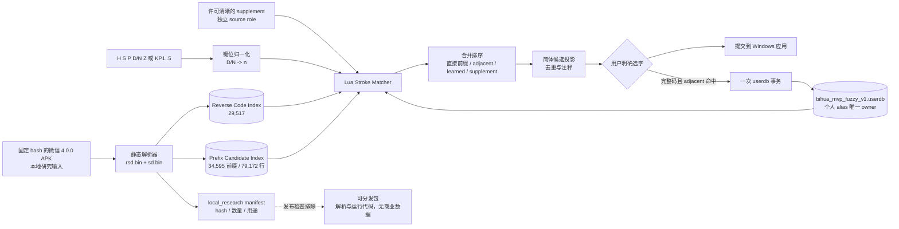
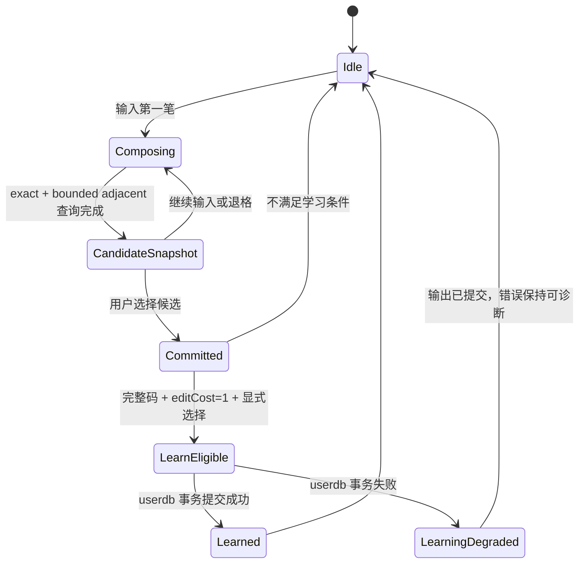

> 历史设计记录。当前交付以 README.md 与 docs/MVP.md 的 0.4.0 规格为准：F/7 分词、T/6 通配、折㇇、通配？、候选无注释、相邻错位容错关闭。

# 2026-10-13-2346 简体笔画码表与相邻错序个性学习架构

> 设计状态：`ready`  
> 2026-10-14 更新：微信输入法 Android 4.0.0 的静态反查码、逐前缀候选、存储顺序与分数已经由固定哈希 APK 可复现导出，并通过全量内部一致性检查。现有证据足以实施本地静态候选实验、一次相邻错序和独立 userdb 学习；手机实时界面的上下文调分、个人历史、词组联想与运行时筛选仍未验证，因此产品只能称为“基于 4.0.0 静态资源的本地实验”，不能宣称完整复刻微信输入法。

## 问题、范围与非目标

### 要解决的问题

现有 `bihua_mvp` 已经证明 Windows、小狼毫、五键笔画、纯笔画、默认简体和可恢复部署可以工作。下一步需要把“能查字”升级为“对齐微信输入法 Android 4.0.0 的五笔画编码和普通字候选顺序，并能容忍用户自己的相邻笔顺差异”：

1. 数据质量：简体常用字采用微信输入法 Android 4.0.0 已验证的逐前缀候选顺序与存储分数作为本地实验 profile；不能继续把 CNS 主表、北大附表、OpenCC 输出和个人偏好混成一个不可解释的排序，也不能把存储分数称为原始字频。
2. 有限容错：第一阶段只支持一次相邻错序。例如用户输入「国」的 `szhhsdhh`，可通过交换第 6、7 笔匹配标准码 `szhhshdh`。不承诺任意乱序。
3. 个性学习：用户从容错候选中明确选择某字后，该“用户输入码 → 字”的权重可以提高并跨重启保留；它必须保存在独立的个人数据 owner 中，不得改写标准码表。
4. 兼容键：外部键位仍是 `H/S/P/D/Z`，`N` 作为点/捺的兼容键；内部统一为现有 `h/s/p/n/z` 五类编码。
5. 仍以小狼毫验证：复用 Rime 字典、候选管线、用户词典、部署和 Windows 接入，不先做独立 TSF。

### 本阶段非目标

- 不做任意排列、任意编辑距离或“任何笔顺都能找到”的承诺。
- 不做偏旁分解、部件级迁移学习、上下文语言模型、词组联想或云同步服务。
- 不做独立安装器、全新候选窗、自定义控件、鼠标/触控笔画面板。
- 不在本方案中启用拼音或拼音反查。
- 本设计不继续下载其他安装包，不修改或运行手机应用；已取得的官方 Android 4.0.0 APK 只用于只读资源研究。没有明确许可的提取数据不得进入可分发构建。
- 不覆盖小狼毫原方案、主题或用户的其他配置；不新建 worktree。

## 现状证据与参考资料

### 项目事实

- 当前 schema 只运行 `table_translator`，候选后接 `simplifier` 与 `uniquifier`；用户词典明确关闭（`rime/bihua_mvp.schema.yaml:32-46`）。`D` 经 key binder 转成内部 `n`，小键盘 1～5 转成 `h/s/p/n/z`（同文件 `:64-72`）。
- 部署脚本把 `vendor/rime-stroke/stroke.dict.yaml` 原样作为唯一字典源，仅把内部字典名改成 `bihua_mvp`（`scripts/Deploy-Mvp.ps1:11-22`）；应用前先备份 schema、字典和可选的 `default.custom.yaml`，出错自动恢复（同文件 `:55-79`）。恢复脚本只处理白名单文件（`scripts/Restore-Mvp.ps1:7-28`）。
- 真实 Rime 1.13.1 测试已经覆盖编译、候选、翻页、退格、纯笔画、简体输出和小键盘，但测试脚本会新建私有用户目录，因此不证明真实 Windows 应用上屏，也没有验证 Lua、学习或跨重启持久化（`scripts/Test-Rime.py:58-112, 138-208`；`docs/MVP.md:28-41`）。
- 上游码表头明确写明：主码表来自 CNS11643，全表附码来自北大中文论坛，并导入八股文字频（`vendor/rime-stroke/stroke.dict.yaml:7-23`）。这是一份多源覆盖表，不等于“大陆手机简体主码 profile”。
- 当前表对「疒」同时含 `nhpnn` 与 `nhpnh`（显示键位分别为 `dhpdd` 与 `dhpdh`），位置为 `vendor/rime-stroke/stroke.dict.yaml:16726`、`:83943`。后一条与用户手机习惯一致，但当前数据没有显式“大陆主码优先权”。
- 「国」当前标准码是 `szhhshnh`（显示为 `szhhshdh`，`vendor/rime-stroke/stroke.dict.yaml:8898`）。用户给出的 `szhhsdhh` 与它只差一次相邻交换，正好可作为有限容错验收例。
- 对当前 170,386 行码表做只读统计：110,125 个字符、156,999 个唯一编码，平均码长 14.20，95 分位码长 23，最长 84。若给每条编码预生成一次任意位置的相邻交换，得到约 1,690,725 个唯一变体码，平均每行 10.62 个；这会把编译索引扩大约一个数量级，不适合作为 MVP 默认路径。
- 目标反查表和 legacy 表的静态比较表明：29,517 个手机反查字中只有 5 个字完全不在 legacy，70 条手机主码不在 legacy；10,579 个手机直接候选中只有 4 条主码不在 legacy。它说明覆盖差异较小，但不能证明 legacy 候选顺序等价于手机端（`docs/mobile-data-comparison.json:1-9`）。
- 当前 schema 仍使用 legacy `table_translator` 且 `enable_user_dict: false`（`rime/bihua_mvp.schema.yaml:32-46`），因此现状没有加载微信逐前缀排序、相邻错序或个人学习。
- `scripts/Test-Rime.py` 会为每次运行创建新 user dir，验证 Rime 1.13.1/1.17.0 的编译、exact/prefix、简体、纯笔画、小键盘和选择提交，最后只执行一次 `RimeFinalize`（`:58-112, 138-216`）。它没有复用同一 user dir 开第二个进程，也没有启用 userdb，不能作为学习持久化证据。

### 目标产品证据

- 用户已指定**微信输入法 Android 4.0.0 手机端**为对齐目标。研究样本来自[官方移动站](https://z.weixin.qq.com/android/download?channel=website)指向的[官方 4.0.0 APK](https://download.z.weixin.qq.com/app/android/4.0.0/wxkb_1382_32.apk)，本地样本 `.verification/wetype-mobile/wetype-android.apk` 为 227,669,360 字节，SHA-256 `940586c40ca1ddb7d7190a727c9a3e2846c5a30b290de427da8c24df814b9603`（`docs/微信手机笔画数据研究.md:3-13`）。
- `scripts/Extract-Wetype-Mobile.py` 固定校验 APK hash，只静态读取 `assets/config/beta/rsd.bin` 与 `sd.bin`；它不加载 native 库。反查表解析覆盖所有 Unicode 标量值，并拒绝未解析键、哈希碰撞、候选/反查码不一致、exact 标记不一致和分数逆序（`scripts/Extract-Wetype-Mobile.py:147-228`）。解析脚本当前 SHA-256 为 `5a1bd92fbc00cf07f98ae0ea57044cde75185d2ebe6386de4e649cb96c2fe82e`。
- 可复现导出报告确认：29,517 个“字 → 完整笔画码”反查记录、34,595 个笔画前缀、79,172 条逐前缀候选记录、10,579 个可直接候选字；未解析反查键、未解析候选键、候选编码/标记矛盾、分数逆序均为 0，最长反查码 52 笔（`.verification/wetype-mobile/reproducible-export/export-report.json`；`docs/微信手机笔画数据研究.md:24-36`）。三份 TSV 分别为 29,518、79,173、10,580 行（含表头），SHA-256 依次为 `5840b0fb6fadd0ca002e6eeb3aea507b157ddc7ecd0bcb0a558c5fd94398b23b`、`df14c40f0495d4bea17dd062104a68448fbc8c66a60e7426e06f2622f5600c9f`、`a7a4e6717278ff403a6854638ed5118e367dee2dd2f865f6bfed14c655a1aae3`；本次独立回读再次确认字符唯一、前缀关系、exact 标记和全码分数降序全部成立。
- `疒 = 41341 = dhpdh`，`国 = 25112141 = szhhshdh` 已由反查数据确认。用户习惯 `国 = 25112411 = szhhsdhh` 与手机静态主码相差第 6、7 笔的一次相邻交换，正好是 fuzzy 验收例，而不是手机主码（`docs/微信手机笔画数据研究.md:38-48`）。
- 静态资源保存的是**逐前缀候选顺序与存储分数**。例如 `41341` 前十项为“病、疫、疗、痛、症、疾、疼、疒、疯、瘦”，`3` 前十项为“的、人、我、个、你、生、会、们、和、年”；`国` 在前缀 `2` 和全码下的分数不同。分数近似包含基础项、输入进度与 exact 加分，79,172 条中有 5 条不符合当前拟合，因此不能称为语料字频或已确认的引擎公式（`docs/微信手机笔画数据研究.md:50-64`；`.verification/wetype-mobile/score-model-crosscheck.json`）。
- 29,517 条反查记录不等于 29,517 个可直接输入候选。微信静态候选集合目前只证明 10,579 个字；其余反查字不能由构建器擅自升格为“微信候选”。

### 公开实现与数据（仅作对照与可替换适配器研究）

1. **Conway Stroke Data**（`stroke-input-data`，固定研究快照 `e09e3ce76e9bba7425233091efa2829e89ff3f74`）
   - README 声明手工维护 28k+ 字，主数据 `codepoint-character-sequence.txt` 和生成的 `sequence-characters.txt` 为 CC-BY-4.0，常用字排序为 public domain；同时明确人工数据可能有错误。[README 精确锚点](https://github.com/stroke-input/stroke-input-data/blob/e09e3ce76e9bba7425233091efa2829e89ff3f74/README.md#L30-L74)。
   - 源格式允许同一字给出多个笔顺正则；生成器展开有限的分组选择并生成“笔顺 → 字集合”，不是任意容错算法。[生成器](https://github.com/stroke-input/stroke-input-data/blob/e09e3ce76e9bba7425233091efa2829e89ff3f74/generate.py#L101-L150)、[展开入口](https://github.com/stroke-input/stroke-input-data/blob/e09e3ce76e9bba7425233091efa2829e89ff3f74/generate.py#L165-L244)。
   - 「疒」只有 `41341`（研究快照 `codepoint-character-sequence.txt:11113`），与已解析目标码一致。它只作交叉检查，不能凭单字或公开表替代微信输入法整表。

2. **Stroke Input Method for Android**（固定研究快照 `14d2b368a6bfa64a57d96f059eacc8183631e337`）
   - README 明确候选生成是确定性的，且“不学习用户输入”；应用代码受 GPL-3.0-only 约束，数据来自独立的 Conway 数据仓库。[README](https://github.com/stroke-input/stroke-input-android/blob/14d2b368a6bfa64a57d96f059eacc8183631e337/README.md#L15-L20)、[数据与许可](https://github.com/stroke-input/stroke-input-android/blob/14d2b368a6bfa64a57d96f059eacc8183631e337/README.md#L99-L109)。
   - 它用有序映射做精确和前缀查找，精确候选在前、前缀候选限制为 30 个，再按静态简繁偏好和排名排序；没有错序搜索或个性学习。[加载数据](https://github.com/stroke-input/stroke-input-android/blob/14d2b368a6bfa64a57d96f059eacc8183631e337/app/src/main/java/io/github/yawnoc/strokeinput/StrokeInputService.java#L163-L169)、[候选检索](https://github.com/stroke-input/stroke-input-android/blob/14d2b368a6bfa64a57d96f059eacc8183631e337/app/src/main/java/io/github/yawnoc/strokeinput/StrokeInputService.java#L849-L924)。
   - 结论：可复用其独立数据集和行为基准；在未确认项目许可证兼容性前，不直接复制 Android GPL 实现。

3. **单手笔顺输入法码表**（`YQ-YSY/stroke-seq_MB`，固定研究快照 `a2c917cc665d6ac6e921c74b32b64125a4db098e`）
   - 项目声明按 GB18030-2022、GB13000.1 字序和笔顺规范手工维护 20,988 字，并以 GPL-3.0+ 发布。[README](https://github.com/YQ-YSY/stroke-seq_MB/blob/a2c917cc665d6ac6e921c74b32b64125a4db098e/README.md)、[编码说明](https://github.com/YQ-YSY/stroke-seq_MB/blob/a2c917cc665d6ac6e921c74b32b64125a4db098e/%E7%BC%96%E7%A0%81%E8%AF%B4%E6%98%8E.txt)。
   - 它的纯笔顺码也把「疒」记录为 `41341`、权重 `550`（`单字码表/单字_笔顺码_20988个.txt:15208`）。这是第二个独立的公开证据，说明 `dhpdh` 不应被当作用户误输。
   - 结论：这是大陆规范差异对照源，但覆盖少于现表，且 GPL 数据能否并入本项目发行物需要先确认；其“六全码/精简码”不是本产品的五键纯笔画合同，也不替代微信输入法目标 profile。

4. **其他公开候选**
   - `tankwstewie/bihua-ime`（研究快照 `f9ea733c420c89956d19404f5753dc73931b02ed`）从 AnimCJK 几何数据推导五类笔画，支持前缀和通配符，TSF 仍是计划阶段；仓库未声明许可证，且没有候选权重或学习。只能作为几何派生路线的研究线索，当前不得成为依赖。[README](https://github.com/tankwstewie/bihua-ime/blob/f9ea733c420c89956d19404f5753dc73931b02ed/README.md)、[Trie 查询](https://github.com/tankwstewie/bihua-ime/blob/f9ea733c420c89956d19404f5753dc73931b02ed/engine/src/lib.rs)。
   - `chinese-opendesktop/cin-tables` 的 `stroke5.cin` 文件头说明其笔顺参考香港教育局资料，适合香港字形对照，并非大陆 profile 的直接替代；仓库级 CC0 与文件内 GPL 声明还需逐文件核对。
   - `rime-t9stroke` 是 G6/T9 派生表，键位和词表合同不同。公开检索没有找到同时满足“微信输入法码表与普通字权重、相邻错序、个人学习、许可证清晰”的现成实现。

5. **公开算法资料**
   - CN102566770A 描述“规范码 ↔ 模糊码对应表”、只对易错部分排列，以及用户自定义固定模糊码；它能支持本阶段“有限变体表”和未来人工白名单的合理性，但不是可复用源码。[摘要与方法](https://patents.google.com/patent/CN102566770A/zh#L81)、[易错字与局部变体](https://patents.google.com/patent/CN102566770A/zh#L169)。
   - US7164367B2 / CN1550069A 描述部件的多个笔顺及随选字提高对应优先级；它证明“选择反馈调整笔顺偏好”有公开先例，但其完整部件模型远超本 MVP。[英文说明](https://patents.google.com/patent/US7164367B2/en#L160)、[中文摘要](https://patents.google.com/patent/CN1550069A/zh#L116)。
   - HK1161527A1 描述先应用笔画消歧规则，再把更新后的输入交给候选预测；同样仅作为研究资料，不代表已有可用实现。[方法摘要](https://patents.google.com/patent/HK1161527A1/zh#L90)。

### 本机 Rime 扩展能力结论

- 官方 Weasel 0.17.4 构建说明包含 `librime-lua`（[0.17.4 对应提交的 CHANGELOG:445-446](https://github.com/rime/weasel/blob/9cc96e20dc71b80876b12f689bb5863c76c2a7ed/CHANGELOG.md#L445-L446)）。本机安装的 `rime.dll` SHA-256 为 `2D8F1BC3737635A11D9FB1BFCA4DC9E70533633930A8A0142A81CA879C39C45B`，只读字符串检查确认存在 `lua_translator`、`lua_filter`、`lua_processor`、`lua_segmentor`。
- librime 的 `Memory` 会加载主字典和独立 user dictionary，并在 commit 通知中事务性记忆候选（[memory.cc](https://github.com/rime/librime/blob/7bc3fb0005a03aff1c086611e4d52bb7f6444fdd/src/rime/gear/memory.cc#L58-L90)、[提交路径](https://github.com/rime/librime/blob/7bc3fb0005a03aff1c086611e4d52bb7f6444fdd/src/rime/gear/memory.cc#L99-L159)）。userdb 的 key 是“输入码 + 字”，提交次数和时间衰减权重落在数据库事务中（[user_dictionary.cc](https://github.com/rime/librime/blob/7bc3fb0005a03aff1c086611e4d52bb7f6444fdd/src/rime/dict/user_dictionary.cc#L421-L507)）。
- librime-lua 暴露 `Memory:dict_lookup`、`user_lookup`、`update_userdict`，`DictEntry.custom_code` 可写；由 `Phrase` 产生的候选可被 Memory 识别和记忆（[Memory 绑定](https://github.com/hchunhui/librime-lua/blob/6da5d6cedb853380ed1b5b9b6979cb1a9c028353/src/types.cc#L1908-L2040)、[DictEntry 绑定](https://github.com/hchunhui/librime-lua/blob/6da5d6cedb853380ed1b5b9b6979cb1a9c028353/src/types.cc#L1666-L1708)、[示例 translator](https://github.com/hchunhui/librime-lua/blob/6da5d6cedb853380ed1b5b9b6979cb1a9c028353/sample/lua/expand_translator.lua#L39-L79)）。
- 因此，本机扩展能力**足以实现**“运行时有限错序检索 + 独立 userdb 个性权重”，无需改 Weasel C++ 或安装新系统组件。当前尚未执行 Lua 端到端、性能和重启持久化探针，所以这是一条可实施路线，不是已通过的运行时结论；这些探针列为实施门禁。
- GitNexus 没有为本项目建立索引；只列出其他仓库。本设计在先执行 `claw search` 后，以 `rg`、逐文件精读、本机 DLL 检查和固定外部源码快照补足证据。

## 领域模型、术语、不变量与唯一 owner

| 概念 | 定义 | 唯一 owner | 非 owner / 只读投影 |
| --- | --- | --- | --- |
| `DataProfile` | 目标版本、数据用途、字形、键位与排序语义的集合；首个目标是本地 `wetype_android_4_0_0_static_local_v1` | 版本化 profile manifest 与构建器 | schema、Lua、OpenCC、候选窗 |
| `SourceSnapshot` | APK hash、解析器 hash、导出文件 hash、来源和用途限制 | `source.lock` / profile manifest | `.verification` 中的原始文件副本 |
| `CanonicalCode` | `rsd.bin` 反查得到的字 → 完整五类笔画码；本快照每字一条 | 本地 reverse-code index | userdb、OpenCC |
| `PrefixCandidateList` | `sd.bin` 保存的某一输入前缀下候选、stored rank、stored score、exact flag | 本地 prefix index | Rime candidate projection |
| `StoredScore` | 目标静态资源为“前缀 × 候选”保存的排序分数，不等于全局字频 | `PrefixCandidateList` | 推断公式、个人学习 |
| `CoverageSupplement` | 目标 10,579 个直接候选以外、来自清晰许可数据的补充候选 | 补充 profile 自己的 source manifest | 微信静态 profile |
| `StrokeQuery` | 当前内部规范化输入 `h/s/p/n/z` | Rime composition / translator 本次请求 | 持久化数据 |
| `MatchEvidence` | exact、prefix、adjacent-swap、learned-alias，含 edit cost、canonical code、source | 本次候选检索器 | UI 注释、日志 |
| `UserAlias` | 个人输入全码到目标简体字的提交次数/衰减权重 | 独立 `bihua_mvp_fuzzy_v1.userdb` | 标准码表、schema、OpenCC |
| `CandidateProjection` | 合并排序后的当前候选列表 | Rime 当前 session | 静态码表、userdb |
| `DeploymentSnapshot` | 部署前被替换文件和清单 | 现有备份目录/manifest | Rime userdb |

不变量：

1. `D` 和 `N` 在进入 matcher 前归一为同一内部 `n`；学习记录内部码，界面仍显示“点/捺”。
2. 标准 profile 不被运行时修改。任何个人选择只写 `UserAlias` owner。
3. `wetype_android_4_0_0_static_local_v1` 的微信直接候选只来自 79,172 条已解析记录；29,517 条反查码中没有直接候选记录的字，不得自动生成“微信候选”。公开/legacy 补充必须带独立 source role，不能静默补成“微信权重”。
4. 相邻错序只交换一对相邻且不同的笔画；一次查询 edit cost 只允许 `0` 或 `1`，不递归产生二次交换。
5. 只有“输入长度等于所选候选完整 canonical code 长度、且候选由一次相邻交换命中”的明确选择才可新增或加强 `UserAlias`；前缀选择、OpenCC 偶然合并、自动提交均不学习新码。
6. learned alias 每次输出前仍需验证该字存在于当前 profile；迁移后失效的 alias 被忽略但不静默重写。
7. 默认显示与提交必须是简体；源字符及 source role 保留在 `MatchEvidence`。OpenCC 只做候选投影，不能改变 canonical code、stored rank 或来源归因。
8. 同一候选由 exact、fuzzy、alternate 或 OpenCC 多路产生时只显示一次，但保留最佳 `MatchEvidence` 供排序、学习和测试断言。
9. 码表/脚本/用户词典加载失败必须可见；不得无提示地退回另一地区 profile，也不得把“未学习成功”报告成“学习成功”。
10. 排序使用当前输入前缀对应的 stored rank/score。全码分数只用于该字全码前缀，不能抽成一个全局权重覆盖所有前缀。
11. APK、`rsd.bin`、`sd.bin`、导出 TSV 和由它们生成的本地 index 均属于 `local_research`，保持在 Git 忽略目录和本机 Rime 数据目录；发行物只包含解析/构建代码、schema 和许可清晰的自有/开源材料。

## 技术决策及原因

### 决策 1：先生成可替换的本地数据 profile，再接入容错逻辑

首个本地 profile 固定为 `wetype_android_4_0_0_static_local_v1`，包含两种不同事实，不能压成一张“字 + 全局权重”表：

```text
reverse_code(character, canonical_code)
prefix_candidate(prefix, stored_rank, character, stored_score, exact_flag)
```

构建器输入固定 hash 的三份 TSV 和 export report，先复核行数、hash、前缀关系、exact flag 与排序，再生成：一份供 Rime `Memory` 识别字符/完整码的 canonical dictionary；一份供 matcher 按当前前缀直接取列表的本地 prefix index；一份记录 `local_research`、源 hash 和许可边界的 manifest。`疒` 的 canonical code 是 `41341`，`41344` 只能来自单独标注的 legacy alternate；`国` 的 canonical code 是 `25112141`，用户码 `25112411` 由 fuzzy/user alias 表达。

原因：目标数据的排序事实属于“前缀 × 候选”，同一字在不同前缀下分数不同。若只把全码分数写入普通 Rime 字典，会丢失手机静态顺序并把匹配加分误当字频。公开数据仅能进入独立 `CoverageSupplement`，不能替代该 profile 或继承微信 source label。

### 决策 2：用一个 Lua translator 统一逐前缀静态列表、有限错序和学习候选

Lua translator 是候选合并的唯一 owner：

1. 将 `q` 从 `h/s/p/n/z` 映射为数字码 `d(q)`，直接读取 `PrefixCandidateList[d(q)]`；原列表的 stored rank 是 edit cost 0 的基础顺序。
2. 生成 `{swap(q, i) | q[i] != q[i+1]}`，不递归；逐个读取相邻码的 prefix list，并标记 edit cost 1 与 matched code。
3. 从独立 userdb 查询原输入 `q` 的 learned aliases；alias 仍需在当前 canonical dictionary 中存在。
4. 可选 `CoverageSupplement` 只在目标列表之后参与，携带独立 source 注释；它没有微信 stored score。
5. 合并去重并产出候选。直接候选保留目标前缀顺序；fuzzy 候选使用其命中前缀的 stored score 加固定编辑惩罚；同字多路命中保留最佳证据。只有 fuzzy `Phrase` 把 `DictEntry.custom_code` 设为用户原输入 `q`，使 alias memory 归因到用户码。

不保留会同时产出目标候选的 `table_translator`，否则同一字符会出现两套前缀排序、去重与 commit 归因。单一 translator 仍复用 Rime session、候选 UI、`Phrase` 与 userdb；本地 prefix index 只拥有静态查询事实，Memory 只拥有个人 alias。

### 决策 3：运行时生成相邻交换，不在 prism 中全量预编译

Rime spelling algebra 的 `fuzz` 会给派生拼写固定置信度惩罚（[calculus.cc](https://github.com/rime/librime/blob/7bc3fb0005a03aff1c086611e4d52bb7f6444fdd/src/rime/algo/calculus.cc#L199-L220)），但对当前码表全量展开相邻交换会产生约 169 万唯一变体码。运行时只为当前输入生成至多 `len(q)-1` 个变体，内存和编译体积不随整个字表乘十。

初始限额：输入少于 2 笔不启用 fuzzy；单个变体最多取 20 个候选，全局合并最多保留 120 个候选；码长超过 24 时只运行 exact 和 learned alias，并记录 `fuzzy_limit_reached` 诊断。24 覆盖当前码表 95% 的码长；该限额须以运行时基准复核，而不是长期硬编码为产品真理。

### 决策 4：个人学习使用独立 Rime userdb，不修改标准码表

命名建议：`bihua_mvp_fuzzy_v1.userdb`。key 由 Rime userdb 以“原输入码 + 简体字”维护，value 使用原生提交次数、tick 和衰减权重。直接微信候选使用不参与 alias Memory 的 candidate；只有 edit cost 1 且完整码明确选择产生可被该 Memory 识别的 `Phrase`。首个 runtime probe 必须确认 commit notifier 恰好更新一次；若改为显式 `update_userdict`，必须关闭自动更新路径，不能同时写两次。失败不自动重试，避免重复加权。

学习只影响同一原输入码下的候选排序。它不把错误输入追加到 vendor 字典，也不改变其他用户、其他 profile 或标准 exact code 的权重。profile 升级时先验证字仍存在；userdb 可保留但旧 alias 可能暂时不参与候选。

### 决策 5：排序同时考虑数据质量、编辑代价和个人选择

直接命中时不重新发明权重公式，按目标资源对当前前缀保存的 `stored_rank` 输出。多路合并时使用以下证据，并通过可配置系数转换为 Rime candidate quality：

1. source role：微信本地静态列表、明确 supplement；
2. match edit cost：直接列表 `0`，一次 adjacent swap `1`；
3. 当前命中前缀的 stored rank/score；禁止拿 full-code score 代替短前缀 score；
4. learned alias 的衰减提交权重，且设置上限；
5. 稳定 tie-breaker：matched code、Unicode code point。

首个版本要求：没有学习时，`q` 的直接微信列表顺序必须与 TSV 相同；一次误选不能让 fuzzy 候选直接跃居首位；同一 alias 连续明确选择后，可在相同输入下进入首屏并继续提升；学习增益有上限，清除 userdb 后恢复静态顺序。编辑惩罚和学习上限由真实 Rime 探针确定，不把当前 0.7/2.3 的静态分数拟合当作引擎公式。

### 决策 6：本地研究数据和可分发产物物理隔离

APK、二进制资源、导出 TSV 和由它们生成的 prefix index 保持在 `.verification/` 或本机 Rime 用户目录，不进入 Git、发布压缩包或安装器。可分发部分只包括解析器、profile 构建器、Lua matcher、schema、测试和必要的第三方许可清单；用户在本机以固定 APK 生成 `local_research` profile。部署 manifest 必须标记每个文件的 source role，发布检查发现 `local_research` 文件即失败。

默认简体仍由 profile 决定；目标静态候选若含繁体投影，OpenCC 只在显示层转换并用 `uniquifier` 去重。用户 alias 存最终简体字符和用户输入码，不修改任何静态导出。若未来做完全可分发 profile，必须另命名并引用许可清晰的数据源，不能沿用 `wetype_android_4_0_0` 名称或声称微信排序一致。

## 协作合同：入口、状态变化、事件或投影、失败与重试语义

### 数据与运行时流



### 候选与学习生命周期



### 入口合同

| 入口 | 前置条件 | 成功结果 | 失败不变性 | 重试语义 |
| --- | --- | --- | --- | --- |
| `BuildLocalProfile(apk, profileSpec)` | APK hash 精确匹配；parser 与 dependency version 固定 | 复核 4 项全量不变量，生成 canonical dictionary、prefix index、local manifest；相同输入生成物 hash 一致 | 不覆盖上一个可用生成物；任何计数/关系不符即失败 | 修正工具后使用新 profile 版本重建，幂等 |
| `QueryCandidates(q)` | `q` 仅含 `hspnz`，prefix index、canonical dictionary 和 profile manifest 一致 | 直接列表保留该前缀 stored rank；相邻与 learned 合并后产生有 provenance 的快照 | 不写持久状态；不把 reverse-only 字或 supplement 标成微信候选 | 每次键入可安全重算 |
| `CommitSelection(snapshotId, candidateId)` | 候选来自当前 snapshot | 字符提交给应用；随后判定学习资格 | 过期 snapshot 拒绝学习；不得给另一候选加权 | 用户重新选择会产生新 commit |
| `LearnAlias(q, text)` | 完整码、editCost=1、显式选择、字仍在 profile | userdb 单事务提交一次 | 标准字典、已上屏文本不回滚；设置 `learning_degraded` 并写日志 | 不自动重试，避免重复计数；下次明确选择可再尝试 |
| `DeployMvp(apply, localProfile?)` | 私有目录编译/探针全通过，来源清单完整；本地 profile hash 匹配 | 备份后原子替换 schema、Lua、生成字典/index 和 manifest | 任一步失败恢复所有已管理文件；userdb 不删除；发布包不复制 local research 输入/输出 | 再次部署幂等 |
| `RestoreMvp(backup)` | manifest 全量预检通过 | 恢复受管文件；个人 userdb 保留且新 schema 不再读取时保持休眠 | 预检失败不改目标目录 | 修复备份后再执行 |

### 可见失败

- **APK/parser/export hash 漂移或全量不变量失败**：本地 profile 构建失败并列出具体计数/记录；不回退 legacy 并冒充微信 profile。
- **prefix index 缺失但 reverse code 存在**：该字只属于反查事实，不合成目标直接候选；若 supplement 提供则显示其真实 source role。
- **stored score 缺失或异常**：保持同一 prefix 的 stored rank；不拿 full-code score 或推断基础分补写当前 prefix。
- **Lua 或字典加载失败**：部署前探针失败，禁止 Apply；运行中若仍发生，方案无候选并在 Rime 日志留下明确模块错误，不静默切换到内置 `stroke`。
- **查询超过限额**：保留 exact 与 learned 结果，跳过其余 fuzzy；记录 `fuzzy_limit_reached`，测试必须覆盖，不伪装成“没有这个字”。
- **userdb 只读、损坏或事务失败**：字符仍正常上屏，学习状态设为 degraded，标准表不变；不在同一 commit 内自动重复写。
- **OpenCC 多路合并**：只显示一次，学习以活动简体 profile 的 candidate id 为准；无法反向归因的 legacy projection 不学习。

## 备选方案、取舍与重新评估条件

| 方案 | 收益 | 代价 / 风险 | 结论与重新评估条件 |
| --- | --- | --- | --- |
| Rime spelling algebra 全量 `fuzz` | 配置少，原生带固定 penalty | 当前表约 169 万相邻变体，编译与内存放大；不能表达个人 alias owner | 不用于 MVP；若 profile 缩到小型常用字表且实测编译/内存可接受再评估 |
| 只在静态码表追加已知 alternate | 性能最简单；可解决「疒」等明确地区码 | 无法覆盖个人习惯；持续堆补丁会再次混淆标准与兼容 | 用于 profile 的有来源 alternate，不承担个人学习 |
| `table_translator` + 第二个 fuzzy translator | 改动主路径少 | exact 重复、排序 owner 分裂、commit 归因复杂 | 不采用；只有 Rime 合并合同能证明稳定时重评 |
| 单 Lua matcher + 本地 prefix index + Rime Memory/userdb | 精确保留静态逐前缀列表，同时保持查询与学习 owner 清晰 | 需要 Lua 加载、内存、候选质量和 userdb runtime probe | 推荐最小路径；探针失败再缩小 index 或改序列化形式 |
| 直接复用 Android app 代码 | 已有 prefix/rank 实现 | Android GPL、平台不同，且没有学习/错序 | 只作行为参考；数据仓库单独按 CC-BY 使用 |
| 将 YQ GPL 码表作为唯一主表 | 大陆规范说明清楚，「疒」符合预期 | 仅 20,988 字；静态权重语义需评估；发行许可证影响未决；不能代表微信输入法 | 不作为目标 profile；仅保留为差异对照源 |
| 只把微信全码分数写成 Rime 全局 weight | 改动最少 | 同一字的分数随输入前缀变化，且包含 exact/完成度因素；短码顺序会失真 | 不采用 |
| 固定 APK 解析为本地逐前缀 index | 29,517 反查码与 79,172 候选行已全量自洽；最接近目标静态排序 | 仅限本地研究，且不等于手机实时 UI | 当前数据路径；发行检查必须排除商业数据和衍生 index |
| 独立 Windows TSF / Rust trie | 完全控制数据、UI 和算法 | 放弃 Rime 已有部署、候选、userdb、兼容与恢复能力 | Lua 性能或 Rime 合同无法达标，或产品需要自定义 UI 时再进入 |
| 部件级自适应笔顺 | 可把一个部件的个人顺序迁移到多个字 | 需要可靠部件分解、位置模型和更复杂学习，超出 MVP | 当单字 alias 数据显示大量重复部件模式且相邻错序召回不足时再研究 |

## 实施切片、迁移或兼容边界、验证证据

### 切片 0：锁定已完成的静态研究证据

- 把 APK、parser、cityhash `0.4.10` 依赖版本、三个 TSV 和 export report 的 hash/计数写入 `local_research` manifest；构建时逐项复核。当前解析器已经证明完整码和逐前缀存储排序可读，算法实现不再等待手机 UI 验证。
- 把 `docs/mobile-data-comparison.json` 作为 coverage 差异证据，不作为排序输入。公开 Conway/YQ 数据继续只作对照，不替代微信 profile。
- 样例基线至少包含：`疒: dhpdh` 为目标 exact；`国: szhhshdh` 为目标 exact；`国: szhhsdhh` 为一次 adjacent；以及 `41341`、`3`、`25112141` 的静态候选顺序。

### 切片 1：最小本地 profile 构建器

- 从现有三个 TSV 生成 canonical Rime dictionary 和可按前缀直接读取的紧凑 index；不从全码分数推导短码列表。
- 生成物放 `.verification/generated-profile/`，部署到用户 Rime 目录时写入 `source_role: local_research` manifest；相同输入必须生成相同 hash。
- profile 构建器拒绝计数、hash、exact flag、前缀关系或 rank 顺序漂移。保留现有 `vendor/rime-stroke` 作为独立 `legacy_coverage`，不修改其源表。
- 增加发布内容检查：APK、`*.bin`、三个 TSV、生成的 prefix index 或 manifest 中的 `local_research` 数据若出现在发布 staging，构建失败。该边界使代码发行许可和本地商业资源用途分离。

### 切片 2：Lua 直接前缀查询

- 先关闭 fuzzy/learning/supplement，用单 Lua matcher 加载本地 prefix index。matcher 的过滤前原始候选文本和顺序必须逐项等于相同前缀的 TSV；不要求实时手机 UI 相同。
- 用 `3`、`41341`、`25112141` 及 20～50 个常用前缀比较原始前九项和 exact flag；Rime 过滤后的候选另按 OpenCC 简体投影与去重规则断言。再验证选择提交、翻页、退格、纯笔画、D/N 和无拼音。
- 在本机 Weasel 0.17.4 / Rime 1.13.1 私有目录先跑；1.17.0 作为兼容回归。只有 Lua 模块加载或候选合同失败才阻塞下一切片。

### 切片 3：一次相邻错序

- 在同一 matcher 内生成 bounded adjacent variants，查询各自的**逐前缀**列表并附 edit cost；不把全码分数复制到所有前缀。
- 必测 `szhhsdhh -> 国`，其 matched code 为 `szhhshdh`；验证标准码 `szhhshdh -> 国` 的目标静态顺序不下降，任意二次交换不被接受。
- 验证 direct 列表、多个 adjacent 列表、同字去重和候选上限；用短码、高重码、24 笔和一个超限长码记录 lookup 次数与延迟。

### 切片 4：个人 alias 与真实 Rime 持久化

- 启用独立 `bihua_mvp_fuzzy_v1.userdb`。只有完整用户码、edit cost 1、明确选择的 fuzzy `Phrase` 可更新；前缀选择、direct candidate、自动提交和 OpenCC 无法归因的投影不得新增 alias。
- 扩展测试为两个独立 OS 进程并复用同一个私有 user dir：进程 A 记录 `szhhsdhh` 下「国」初始位置，明确选择固定次数，销毁 session 并 `RimeFinalize`；进程 B 不重新生成或清空 user dir，重新初始化后验证 alias 存在且排名相对基线提升。
- 同时断言：每次选择提交计数只增加一次；另一个输入的排名不变；canonical dictionary、prefix index 和 manifest hash 不变；删除该专用 userdb 后恢复静态基线。这样验证的是磁盘持久化和重新载入，不是同进程缓存。
- 私有引擎通过后，由用户在真实 Weasel 中完成一次重启试打；Windows 应用上屏属于产品验收，不替代引擎断言。

### 切片 5：部署、恢复与数据边界

- 扩展部署 manifest，纳管新 schema、Lua、canonical dictionary、**本地生成** prefix index 和 source manifest；所有备份完成后才写目标。发布包本身不携带这些本地研究数据。
- 现有原方案、主题和 `default.custom.yaml` 合并规则保持不变（`scripts/Test-Deployment.ps1:49-60`）。
- 回滚受管运行文件时不删除个人 userdb；旧 schema 不读取它。清除学习是独立、显式、可预览操作。
- 验证部署失败自动恢复、重复部署幂等、恢复后原方案可用、个人 alias 仍在，并增加“发布 staging 无 local_research 内容”的回归断言。

### 首个 MVP 验证

首个小版本先证明路径可用，不把产品化规模压测设成实现前置条件：

- 数据：用户的「疒」「国」、现有 20 个常用字与 5 句，以及静态导出中的 20～50 个常用前缀。分别报告“canonical code 一致、逐前缀前九项一致、相邻错序召回、supplement 来源”；没有手机实时 UI 的数据不算失败，也不得写成 UI 等价证据。
- 性能：在本机 Rime 私有目录明确记录一次冷启动和至少 20 次代表性热查询的延迟、候选数、prefix index 体积和 Lua 新增内存；样例覆盖短码、高重码、24 笔和一个长码。结果进入报告，出现可感知卡顿、候选爆量或超出既定查询上限即停止集成并缩小 index/候选上限。
- 学习持久化：按切片 4 完成两个独立进程的同 user-dir 验证，再由用户完成一次 Weasel 重启试打；alias 排名提升仍存在，静态文件 hash 不变，rollback 后个人数据仍在。
- 功能：exact/prefix、一次 adjacent、拒绝二次交换、D/N、简体去重、翻页、退格、userdb 事务失败路径和可恢复部署均通过。

### 产品化扩展评估（不阻塞首个 MVP）

当首个小版本获得正向试用反馈，再扩大到 500 字 golden corpus、1～24 笔分桶和长码对抗样本，并在本机 Rime 1.13.1 私有目录重复至少 30 轮，冷启动和热查询分开记录：

- 编译后字典和索引体积不得超过 exact-only profile 的 1.5 倍；不得出现全表相邻变体预展开。
- 热查询候选刷新 p95 ≤ 50 ms、p99 ≤ 100 ms；24 笔输入单次 lookup 数不超过 24，合并候选不超过 120。
- Lua matcher 新增常驻内存 ≤ 32 MiB；若超标，先减少 per-variant 候选和缓存，不扩大失败时的静默降级。
- 500 字数据质量：用户已给出的 `疒`、`国`两例 100% 通过；本地 profile 对导出 TSV 的逐前缀 top-9 必须完全一致。若将来取得手机实时 UI 样本，再单列 UI 一致率，不能回写成静态 parser 的正确性条件。
- 重启持久化：学习后 finalize/reinitialize、Weasel 重启各 10 次，alias 和提交权重 100% 保留；rollback 后个人数据仍可恢复使用。

### 运行时与产品验收

- 引擎层：编译、exact/prefix、adjacent、拒绝二次交换、D/N、简体去重、翻页、退格、userdb 事务与失败路径。
- Windows 层：记事本、浏览器、聊天软件实际上屏；Num Lock 开启时 KP1～5 输入笔画，主键盘数字选字；不控制用户鼠标键盘，由用户试打确认。
- 产品层：记录目标字位置、首次上屏时间、平均按键数、错误恢复、学习前后位置；分开统计“主码错误/地区差异”“一次相邻错序”“纯候选权重问题”，防止用学习掩盖数据缺陷。

## 可实施边界与仍未验证的行为

现在可以实施：

- 固定 APK 的本地静态 profile 构建、hash/计数/关系复核和逐前缀 index；
- 在真实 Rime DLL 私有目录中复现静态前缀候选，保持微信来源与 supplement 来源可区分；
- 同一 matcher 内的一次相邻交换、候选去重、编辑惩罚和查询上限；
- 独立 userdb 的个人 alias 学习，以及跨独立进程和 Weasel 重启的持久化验收；
- 不携带商业输入/衍生数据的发布检查与本地部署/恢复。

仍未验证、但不阻塞上述本地 MVP：

- 手机实时界面是否逐项等于静态 stored rank；上下文、个人历史、简繁偏好、词组联想和运行时过滤可能改变结果；
- 0.7/2.3 拟合是否为真实引擎公式，以及 5 条异常记录的业务含义；MVP 直接保存逐前缀列表，不依赖该公式；
- Lua index 的实际启动内存、查询延迟和 installed Weasel 中 `Phrase` → Memory 的恰好一次更新合同；这些由切片 2～4 的 runtime probe 决定实现细节；
- 真实 Windows 应用上屏和实体键盘手感；由用户试打验收，不由自动化伪造。

没有新的高影响产品决策。若 runtime probe 证明单 Lua index 无法达到可用延迟，再在保持 `PrefixCandidateList` owner 和相同验收数据的前提下重新评估序列化或 native 插件；无需回退到公开全局字频。

## 结论

小狼毫 0.17.4 的 Rime + librime-lua + userdb 足以进入 MVP 实施，不需要先做 TSF。最小垂直切片是“本地生成微信 4.0.0 静态逐前缀 profile → 单 Lua matcher 复现直接列表 → 为 `szhhsdhh` 加一次 adjacent 召回「国」→ 独立 userdb 学习该用户码 → 两进程重启验收 → 可恢复本地部署”。

静态码表和普通字逐前缀排序已经足够作为本地实验事实，算法实现不再等待实时手机 UI。发行物继续只包含许可清晰的代码与配置；微信 APK、导出 TSV 和本地 index 留在用户本机。任何对手机端“完整复刻”的表述仍需另行取得实时行为证据。
