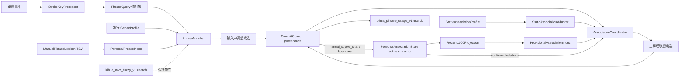

> 历史设计记录。当前交付以 README.md 与 docs/MVP.md 的 0.4.0 规格为准：F/7 分词、T/6 通配、折㇇、通配？、候选无注释、相邻错位容错关闭。

# 2026-10-14-0108-本地联想个人词库与分词通配架构

状态：`ready`

## 1. 问题、范围与非目标

### 1.1 要解决的问题

在现有 Windows 小狼毫/Rime 纯笔画方案上增加四种彼此可辨、可单独管理的能力：

1. **输入中的词组候选**：用户仍在输入笔画时，用分词边界表达多个字，候选区给出整个词组。
2. **上屏后的本地联想**：一次上屏完成且编码区为空后，根据刚上屏的上下文给出下一字或下一词。
3. **手动个人词库**：用户能明确新增、导入、导出、编辑和删除的词条集合。
4. **自动学习**：只调整既有词条用量，或把用户明确选中的临时个人联想晋升为正式个人联想；不能暗改标准笔画码表。

用户给出的个人联想设想原文必须作为产品约束保留：

> 关于智能的联想词功能，我的想法是这样的：第一，你可以自己上网去研究一下，看看有没有相关的论文、文章或者算法。是这样的：我们将用户的连续输入当成是在写一篇文章。但凡用户没有从我们的联想中选择词，那么在连续输入时，第一个字输入之后，下一个字就会作为我们自定义联想词的备选。如果用户选择了我们推荐的这个联想词，那么这个词就可以正式进入词库了比如说，我们只用用户输入的1000字，就是最后1000字来做这个首次的联想，当然，这以前的字是要撇除所有用户选择我们的，推荐字就是我们自带的联想词的情况。

另一个明确的键盘需求是：Windows MVP 中小键盘 `KP6` 为分词键，`KP7` 为通配符；主键盘数字 `1..9` 继续选候选。该映射是本产品合同。现有静态研究没有证实微信手机输入法 4.0.0 的 6/7 键具有同样语义，因此本文不把它描述成已复刻的手机标准。

### 1.2 约束

- Windows、小狼毫/Rime；默认简体，纯笔画，不在同一方案启用拼音。
- 用户侧键名为 `H/S/P/D/Z`；内部延续现有 `h/s/p/n/z`，`D` 与兼容键 `N` 都规范化为 `n`。
- 本地离线；无云服务、无独立安装器、无任意自定义 UI。
- 可以直接迁移现有 `bihua_local` MVP，不要求维护第二套回退方案；迁移前仍需备份个人数据。
- 商业 APK 及其派生表只用于本地研究和对比，不进入发行物。发行物中的静态词表、联想库必须有清晰的再分发许可和来源清单。
- 本设计不能阻塞当前单字码表、相邻错序和个人笔顺学习的独立实现与验收。

### 1.3 本轮非目标

- 不承诺复刻微信输入法未被静态或动态证实的排序公式、词库格式、键位语义和设置项。
- 不在本轮运行手机 APK。允许继续静态解析 `sw.bin` 等资产并生成哈希锁定的本地研究 profile；尚未形成可复现导出报告的内存解析结果只能作为后续线索，不能直接进入实现或发行物。
- 不实现任意乱序、神经语言模型、跨设备同步、云候选、应用内容读取或自定义设置界面。
- 不从宿主应用读取剪贴板、整篇文档、光标前全文或应用身份；“文章”只指本方案可观察到的连续上屏事件。

## 2. 现状证据与参考资料

### 2.1 工作区与本机证据

| 证据 | 已证事实 | 不能推出的结论 |
|---|---|---|
| [`rime/bihua_local.schema.yaml:13-25`](../../rime/bihua_local.schema.yaml#L13-L25) | 当前只有单字 Lua matcher；字母表是 `hspnz`；开启 user dict 和 completion，关闭 sentence。 | 当前方案已经支持词组或上屏后联想。 |
| [`rime/bihua_local.schema.yaml:37-52`](../../rime/bihua_local.schema.yaml#L37-L52) | `KP1..5` 映射五笔画，`KP6/KP7` 在有菜单时仍发 `Select`。 | 6/7 已具有分词或通配语义。实现时必须先解除这一冲突。 |
| [`rime/lua/bihua_matcher.lua:49-108`](../../rime/lua/bihua_matcher.lua#L49-L108) | 当前 matcher 只接受 `^[hspnz]+$`，直接前缀与相邻交换有明确上限，候选总量封顶 120。 | 现有数据结构可直接表达分词、通配或多字词组。 |
| [`rime/lua/bihua_matcher.lua:10-36`](../../rime/lua/bihua_matcher.lua#L10-L36) 与 [`bihua_learning_guard.lua:3-10`](../../rime/lua/bihua_learning_guard.lua#L3-L10) | 已有 `Memory`、显式选择授权和 exactly-once 写入模式，可作为持久化探针先例。 | 同一个 userdb 应同时拥有单字别码、词组用量和个人联想。 |
| [`bihua_association_store.lua:6-48`](../../rime/lua/bihua_association_store.lua#L6-L48) | 同一文件路径在进程内复用唯一 owner；active 缺失时可读取 `.previous`；坏 active 进入只读失败态。 | 这是跨进程互斥锁，或坏 active 会被备份静默覆盖。 |
| [`bihua_association_store.lua:57-94`](../../rime/lua/bihua_association_store.lua#L57-L94) | 保存前比较磁盘 revision；单行 envelope 含 payload 校验；写 `.pending` 并 flush/close，轮换 active 到 `.previous` 后替换 active；失败回滚内存状态。 | 乐观 revision 检测能消除两个进程同时通过检查后的竞态。 |
| [`bihua_association_runtime.lua:7-45`](../../rime/lua/bihua_association_runtime.lua#L7-L45) | Rime 适配器打开固定用户路径的唯一 store，并在每次 commit 分类/更新后调用 `Store.save`；保存失败会重新取得回滚后的 state 并写日志/状态属性。 | 该适配器已经接入用户当前桌面 schema，或私有探针等于 Windows UI 验收。 |
| [`bihua_association_core.lua:189-232`](../../rime/lua/bihua_association_core.lua#L189-L232) | payload 只保存有界 window、参数与 confirmed 关系；恢复拒绝超容量、乱序、非法字符/关系，并故意不恢复活动接龙 context。 | 快照会保留被窗口淘汰的完整手输历史，或重启后应自动续接未完成联想链。 |
| [`association-two-process-results.json:24-71`](../../.verification/association-processes-cfaae413f458477d9ab70b3b8a9f84b3/association-two-process-results.json#L24-L71) | 两个独立 OS 进程恢复 3 条逐步确认关系；“河→计→划”接龙、1000 手输槽不增加、strength/时间保存均通过。 | 已完成真实 Windows UI 部署。 |
| [`local-rime results.json:7-8`](../../.verification/local-rime-eee87acd36aa4b088a3a387f8e61c1f6/results.json#L7-L8) 与 [`association_store_spec.lua:15-52`](../../tests/lua/association_store_spec.lua#L15-L52) | 有界快照/校验、同进程唯一 owner、previous 恢复、损坏/不可写回滚、外部 revision 冲突测试通过。 | 外部管理程序可以不协调地并发写 active。 |
| [两进程真实 Rime 结果 `two-process-results.json:83-86`](../../.verification/learning-processes-b6a3d758fff4442ba1f160d99d88dc81/two-process-results.json#L83-L86) | 两个独立 OS 进程间，单字学习计数和排序持久化通过；测试没有驱动 Windows UI。 | 个人联想、词组和导入删除也已持久化通过。 |
| [同一结果 `:37-40,73-76`](../../.verification/learning-processes-b6a3d758fff4442ba1f160d99d88dc81/two-process-results.json#L37-L40) | 当前单字路径的 warm p95 约 29–30 ms，可作为新功能性能基线。 | 新的多段匹配和联想不会增加延迟。 |
| [`docs/微信手机笔画数据研究.md:11-14`](../微信手机笔画数据研究.md#L11-L14) | 已固定微信手机输入法 Android 4.0.0 APK 来源；`rsd.bin/sd.bin` 派生结果只在 `.verification`。 | 这些表可以再分发。 |
| [`export-report.json:17-46`](../../.verification/wetype-mobile/reproducible-export/export-report.json#L17-L46) | 哈希锁定的 `sw.bin`（version 1643，SHA-256 `095d2c9506c4fcac7b1cee5d498cf7a19cbb24e7718391f9cfe75e3bb3d14ead`）已可复现导出 4,323 个前字键、176,329 条 1–3 字续写，未解析键为 0；同一报告也保留笔画表计数。 | 静态存储权重等于语料次数、实时手机 UI 顺序或个人热词算法。 |
| [`stroke-native-strings.txt:105,139-143,179-197`](../../.verification/wetype-mobile/stroke-native-strings.txt#L105) | native 符号含 `MostLikelySequelCandidateID`、`UserHotWordCandidateID`、`StrokeWordsDict`、`UserStrokesDict` 等命名锚点。 | 已知这些类的格式、排序、生命周期或 6/7 键语义。 |
| [`Extract-Wetype-Mobile.py:222-275`](../../scripts/Extract-Wetype-Mobile.py#L222-L275) | continuation parser 接受实际声明的 1–3 个长度组，逐组校验 suffix 长度、边界、组内权重降序和 payload 尾部，并证明全部 key 已消费。 | 每个前字总有三个组；解析器不得把 group 数硬编码为 3。 |
| [`Build-Local-Profile.py:3,37-43`](../../scripts/Build-Local-Profile.py#L3-L43) | 构建脚本已强制商业派生输出停留在 `.verification`，并校验目标 APK 哈希。 | 当前本地研究 profile 可直接变成发行资源。 |

本机 `C:\Program Files\Rime\weasel-0.17.4\rime.dll` 可检出 `predictor`、`predict_translator`、`PredictDb` 等组件，但安装目录没有 `predict.db`。这证明二进制包含扩展入口，不证明本机部署后已能产出联想候选。

### 2.2 外部原始资料

- 官方 [`librime-predict` README](https://github.com/rime/librime-predict/blob/920bd41ebf6f9bf6855d14fbe80212e54e749791/README.md#L5-L38) 规定 `predict.db`、`predictor` processor、`predict_translator`、`prediction` switch、候选数与连续预测次数。
- 官方 [`predictor.cc:56-94`](https://github.com/rime/librime-predict/blob/920bd41ebf6f9bf6855d14fbe80212e54e749791/src/predictor.cc#L56-L94) 只取最后一次 commit 的文本作为查询；遇到 `punct/raw/thru` 清空，并以 `max_iterations` 限制联续推荐。
- 官方 [`predict_engine.cc:81-100`](https://github.com/rime/librime-predict/blob/920bd41ebf6f9bf6855d14fbe80212e54e749791/src/predict_engine.cc#L81-L100) 默认加载 `predict.db`，失败会明确报错。该插件适合作为静态联想适配器，但本身没有最近 1000 个手动字、来源排除或临时晋升合同。
- Jelinek 等人的 [1991 cache language model 论文](https://aclanthology.org/H91-1057.pdf) 在实验中使用最近 1000 词 cache，并组合 unigram、bigram、trigram；这为“有限近期窗口 + n-gram”提供直接先例，但单位是词、任务是语音识别，不能证明本项目的 1000 个汉字最优。
- Nepveu 等人的[自适应语言模型论文](https://aclanthology.org/W04-3225.pdf)讨论以经人工纠正的文本更新 cache，支持“只把可归因于用户的文本当适配证据”的方向；它没有定义本项目的 Rime 事件来源。
- Feng 等人的 [2004 论文](https://aclanthology.org/J04-1004.pdf)给出 accessor variety 等统计分词依据，可作为未来从连续字流发现词边界的研究路线；MVP 只枚举受限的 2–8 字连续片段并靠显式选择晋升，不声称这些片段已经完成统计分词。
- Grave 等人的 [continuous cache 论文](https://arxiv.org/abs/1612.04426) 证明“利用近期历史适配语言模型”有研究基础；它没有证明 1000 字窗口、二元字对或本文排序参数最优。
- King 与 Cook 的[个性化语言模型比较](https://aclanthology.org/2020.lrec-1.299/)表明少量个人文本也可用于下一词预测评价；它没有给出本项目可直接照搬的中文笔画实现。
- Bhat 等人的[预测文本交互小规模研究](https://aclanthology.org/2021.hcinlp-1.18/)观察到建议会影响用户写作。样本很小，不能当效果定论，但支持把“手输事实”和“系统建议产物”分源记录，避免自强化。

### 2.3 证据边界

当前可以实施和验证的是：Windows 键位合同、受限多段查询、手动个人词库、真实 Rime 持久化、可替换静态联想 profile 探针，以及最近 1000 个手动汉字上的 2–8 字临时片段、末尾 1–3 字检索和显式晋升。单字 bigram 可先用于证明事件来源与持久化，但不能作为整项本地联想的最终合同。

已经证实的是 `sw.bin` 的静态“前一字 → 1–3 字续写 + 存储权重”结构和全量可复现导出。仍未证实的是微信手机 4.0.0 的实时候选合并/重排、6/7 动态语义和个人热词算法。商业资源只可用于哈希锁定的本地研究 profile、对比与评测；不能进入发行物，也不能用公开库冒充微信参考数据。

## 3. 领域模型、术语与不变量

### 3.1 核心术语

| 术语 | 定义 |
|---|---|
| `StrokeSegment` | 一个字的笔画查询段，由规范笔画和可选通配符组成。 |
| `PhraseQuery` | 两到四个 `StrokeSegment`，由硬分词边界连接。 |
| `CompositionPhraseCandidate` | 编码区仍非空时，由 `PhraseQuery` 匹配到的多字候选。 |
| `StaticAssociationCandidate` | 上屏后由只读 `StaticAssociationProfile` 给出的下一字/词；profile 可为 local-research 或 distributable。 |
| `ObservedFragment` | 最近 1000 个合格手输字的同一连续段内，长度 2–8 的连续片段；它是临时候选证据，不是正式词条。 |
| `ContextSuffix` | 当前连续手输上下文的末尾 1–3 字；按最长后缀优先检索续写。 |
| `PredictionChainContext` | 会话级、最多保留 8 字的接龙上下文；包含普通手输字和用户选中的联想字，但后者不进入 1000 手输窗口。 |
| `ProvisionalPersonalCandidate` | 由 `ObservedFragment` 按 `ContextSuffix → next_char` 投影出的单字候选；携带支撑它的完整片段和剩余路径。 |
| `ConfirmedPersonalAssociation` | 用户每选一个联想字便持久化的一条 `context_suffix → next_char` 接龙边；可保留支撑片段用于解释，界面每次只显示一个下一字。 |
| `ManualPhraseEntry` | 用户主动新增或导入，可编辑、导出、删除的多字词条。 |
| `PhraseUsage` | 对既有词条的使用次数与最近使用信息，只影响排序，不拥有词条正文或标准码。 |
| `EventProvenance` | 一次上屏的来源：手输单字、输入中词组、静态联想、临时个人联想、正式个人联想、原始/标点等。 |

### 3.2 用户已经确定的规则

1. 最近窗口只保留 **1000 个用户通过笔画正常选出的汉字**；从普通单字候选中选字也算手输，联想字不占这 1000 个额度。
2. 只有用户没有选择自带联想、随后又通过笔画正常选字时，连续手输字才可形成临时候选证据；片段长度与上下文长度是可调实现参数。
3. 自带静态续词联想的上屏文本不进入手输窗口，也不能与边界两侧的手输字虚假拼成一对。
4. 每次联想只显示和上屏一个汉字；用户每选一个字就确认当时的“前文 → 下一字”关系，并更新独立接龙上下文继续预测，但该字不占最近 1000 个手输字额度。
5. Windows `KP6` 是分词，`KP7` 是通配；主键盘 `1..9` 保持选字。
6. 正式个人 edge 必须使用动态权重：只有显式选择才加权，长期不用会衰减并自动从候选隐藏；隐藏不等于删除。

为防止模型用自己的输出训练自己，MVP **推荐**把临时个人联想、正式个人联想和输入中多字词组候选也排除出手输窗口，并各自插入硬边界。这一扩展是工程防自强化规则；静态自带联想排除和“联想字不占额度”是用户已经确认的规则。真实验收应分别计数，后续可以据误断率调整，不能混写成论文结论。

### 3.3 推荐的 MVP 参数（算法效果仍需实测）

这些值是可实现的初始参数，不是论文或微信行为已经证明的最优值：

| 参数 | 推荐值 | 理由与再评估信号 |
|---|---:|---|
| 临时片段长度 | 2–8 字 | 覆盖短词到常用短语并保持索引有界；这是已向用户展示的推荐初值，不是用户确认或论文最优值。 |
| 检索上下文 | 当前连续手输内容的末尾 1–3 字，最长后缀优先 | 一字可召回，二/三字能消歧；bigram 只作为首个 probe，不替代完整短语合同。 |
| 窗口单位 | 通过笔画普通单字候选正常上屏的 Unicode 汉字码点，最多 1000 个 | 避免 UTF-16 单元或字节导致计数歧义。联想字和边界不占额度。 |
| 临时候选进入门槛 | 窗口内出现 1 次即可展示 | 尊重“下一个内容作为备选”；排序用上下文长度、次数与最近性抑制噪声。 |
| 单字投影 | 支撑片段“星河计划”在上下文“星”只展示“河”；选中后上下文成为“星河”，再展示“计”，然后“划” | 完整片段留在索引中作为路线，候选和 commit 始终为一个汉字。 |
| 临时候选排序 | 上下文长度降序、出现次数降序、最近序号降序、支撑片段长度降序、下一字升序 | 相同下一字先合并支撑路线再排序；可解释且确定。 |
| 正式确认粒度 | 每选择一个联想字，立即确认一条 `context_suffix → next_char` 边 | 用户已明确决定；中途退出不撤销此前已选中的边。 |
| 正式 edge 半衰期 | 7 天 | 推荐初值，不是用户指定；便于一至数周内淘汰不用的关系。 |
| 正式 edge 展示阈值 | 有效强度 0.2 | 推荐初值；低于阈值隐藏而不删除，再次手动观察并显式选择可恢复。 |
| 选择增量 / 强度上限 | `+1.0` / `8.0` | 当前实现和推荐初值；上限避免历史高 raw count 导致永不消失。raw count 可作诊断，不能直接决定曝光。 |
| 词组长度 | 2–4 个汉字 | 控制多段匹配空间；更长固定短语在真实语料命中后再扩。 |
| 上屏后候选数 | 5 | 与官方插件推荐示例一致，避免占满候选页。 |
| 接龙步数上限 | 7 | 2–8 字片段在首字已存在时最多还需 7 次单字联想；到达上限、路线结束或硬边界才停止。 |

### 3.4 不变量

- 标准码表、手动词条、单字别码学习、词组用量、个人联想各有唯一 owner；缓存、索引和候选 UI 都不是第二份真相。
- 每个候选携带不可变 `EventProvenance`、`context_suffix`、`next_char`、支撑 `full_phrase` 与 `remaining_route`。没有来源标记的 commit 一律不得进入手输窗口或触发确认。
- 正式 edge 的排序和可见性只使用按时间计算的 `effective_strength`。候选查询、曝光、翻页和取消都不得修改 `strength` 或 `last_used_at`；只有显式选择可写入。
- 选择联想产生的文本永不作为新的手输观察；选择事件之后插入边界，不能和下一次手输跨接。
- 通配符表达本次查询的不确定性，不是新标准码；选择通配或容错候选不能把 `?` 或错序码写入标准词条。
- 前缀命中分数、全码词条权重、个人使用加权分别保存。前缀位置或商业静态分数不能冒充语料词频。
- 任何存储、索引、插件或导入失败必须可见。失败时仍可输入单字，但不得显示“已学习”或静默创建第二份状态。

## 4. 唯一 owner 与持久化边界

| 业务事实 | 唯一 owner | 持久性 | 写入者 | 删除/导出边界 |
|---|---|---|---|---|
| 标准单字笔画与静态排序 | 发行版 `StrokeProfile`；当前商业派生 profile 仅为 `.verification` 研究对象 | 版本化只读 | 构建流程 | 随版本替换；商业派生物不导出、不发行。 |
| 手动个人词组 | `%RIME_USER_DIR%/bihua_personal_phrases.tsv` | 持久 | 个人词库管理脚本；运行时只读 | 支持单条删、合并/替换导入、完整导出。 |
| 手动词条运行索引 | `PersonalPhraseIndex` | 派生，可重建 | 部署/重建器 | 不单独导出；损坏时由 TSV 重建。 |
| 既有词组使用权重 | `bihua_phrase_usage_v1.userdb` | 持久 | 真实 Rime `Memory` 适配器 | 可单独重置；不能删手动词条正文。 |
| 单字相邻错序别码 | 现有 `bihua_mvp_fuzzy_v1.userdb` | 持久 | 现有 matcher | 本功能不得复用、迁移或重解释。 |
| 最近 1000 个手输字、边界、正式个人接龙边、`strength`、`last_used_at` 和确认计数 | `%RIME_USER_DIR%/bihua_personal_association_v1.jsonl` active 快照 | 持久 | `bihua_association_store.lua`，按路径同进程唯一 owner | 可分别清空窗口、删除正式边或同一支撑片段的边组、全量导出；`.previous` 只保留上一成功版本。 |
| 2–8 字片段、1–3 字 suffix 索引、计数与最近性 | `ProvisionalAssociationIndex` | 纯派生内存 | `bihua_association_core.lua` 从 active 快照重建 | 不单独持久化或导出。 |
| 当前接龙上下文、路线与步数 | `PredictionChainContext` | 会话内临时状态 | `AssociationCoordinator` | 不持久化、不导出；硬边界、方案切换和会话结束时清空。 |
| 当前时间 | `Clock` 端口 | 不持久化 | 系统时钟适配器；测试注入 fake clock | 领域层禁止直接读取系统时间，保证衰减和跨重启测试可重复。 |
| 自带静态联想 | `StaticAssociationProfile` + manifest | 版本化只读 | profile 构建流程 | `local_research` 可来自哈希核验的 `sw.bin` 派生物且只能留在 `.verification`；`distributable` 必须许可清晰。二者不得同包或混入个人备份。 |
| 功能开关和上限 | `bihua_local.custom.yaml` / schema patch | 持久 | 用户配置 | 导出配置，不复制词库内容。 |

`bihua_association_store.lua` 是上述个人状态的唯一持久化 owner。`bihua_personal_association_v1.jsonl` 虽保留 `.jsonl` 扩展名，实际是每次 commit 压缩后的**单行 JSON envelope 快照**，不是无限追加事件日志。payload 只保存当前不超过 1000 个手输字的窗口、边界所需 segment/sequence、正式关系及其动态权重；不会保留被窗口淘汰的全量手输事件。内存索引只是该快照的投影，不成为第二 owner。快照不记录应用名、窗口标题、剪贴板或宿主文档。

## 5. 分词、通配与词组编码合同

### 5.1 键与内部令牌

| 物理输入 | 语义 | 内部规范形式 |
|---|---|---|
| `H/S/P/D/Z` 或 `KP1..5` | 横/竖/撇/捺点/折 | `h/s/p/n/z` |
| `N` | `D` 的兼容键 | `n` |
| `KP6` | 硬分词边界 | `BOUNDARY`，序列化示例用 `|` |
| `KP7` | 恰好一个未知笔画 | `ANY_STROKE`，序列化示例用 `?` |
| 主键盘 `1..9`、空格、回车 | 候选选择 | 不进入编码 |

`|` 和 `?` 是领域层令牌的文档表示，不要求直接加入 Rime `speller/alphabet`。运行时探针决定 Lua processor 是注入安全哨兵还是构造独立查询对象；不得为了省事开放普通主键盘字符并破坏纯笔画约束。

### 5.2 语法与语义

```text
Stroke       := h | s | p | n | z
Atom         := Stroke | ANY_STROKE
Segment      := Atom+                 # 至少含一个具体 Stroke
PhraseQuery  := Segment (BOUNDARY Segment){1,3}
```

- 每个 `Segment` 对应词条中的恰好一个汉字；`BOUNDARY` 不匹配笔画，也不能被模糊交换跨越。
- `Segment` 可为该字完整标准码或非空前缀。只有个人/静态词组目录中真实存在的词条才可返回；禁止对单字候选做笛卡尔积临时造词。
- `ANY_STROKE` 每次只匹配 `h/s/p/n/z` 中的恰好一个笔画，不匹配零个或多个，也不跨越边界。
- 每段最长 24 个原子；整条查询最多 4 段、最多 2 个通配符。通配符查询至少含一个具体笔画，禁止 `?` 或 `??` 单独成段。
- MVP 中查询一旦含通配符，整条查询不再叠加相邻错序扩展；这样最多只扩展 `5²=25` 个受限模式。没有通配符时，每段至多允许一次相邻交换，但全查询仍受统一 lookup 上限。
- 示例：`sz | szh` 可匹配个人词条“中国”的两段前缀；`s? | szh` 的 `?` 只匹配第一字中的一个未知笔画。

### 5.3 匹配与排序

统一 matcher 依次执行：规范化 → 语法校验 → 词条索引查询 → 受限通配/错序 → 去重 → 排序。每个词条保持以下独立分量：

```text
final_score = lexical_weight
            + exact_full_code_bonus
            + phrase_usage_bonus
            - prefix_penalty
            - wildcard_penalty
            - adjacent_swap_penalty
```

`lexical_weight` 必须来自该词条的全码记录或明确语料权重；由某个前缀桶中的次序只能形成 `prefix_penalty`，不能覆盖全码权重。排序层级为完整精确码、精确前缀、通配、相邻错序；使用加权只能在同层或达到明确晋升阈值后调整，避免一次误选压过标准常用词。

### 5.4 异常输入

- 空编码时按 `KP6/KP7`：消费为无操作并记录诊断，不开始 composition，不选候选。
- 开头、结尾或连续两个 `KP6`：拒绝第二个操作，保留此前合法输入，不写任何学习状态。
- 超过段数、段长、通配数或 lookup 上限：停止继续扩展，候选标记为“查询过宽”；不得无界回溯。
- 有菜单时 `KP6/KP7` 仍是操作符；只有主键盘 `1..9`、空格、回车选择候选。processor 必须排在现有 key binder/selector 前并消费这两个小键盘键。
- 回删删除最后一个领域令牌；删到边界后恢复前一段。Escape 清空全部查询，不学习。

### 5.5 与学习的交互

- 选择输入中词组候选只增加该词条的 `PhraseUsage`；手动词条正文和标准码不变。
- 通配或错序命中可以增加词条用量，但不得把通配/错序查询写回词条代码，也不得进入现有单字别码 owner。
- 输入中词组候选的上屏来源为 `composition_phrase`，它不是手输单字，必须在个人联想窗口中形成硬边界。

## 6. 上屏后联想与个人学习合同

### 6.1 五类通道必须分开

| 通道 | 触发时机 | 查询键 | 选择后的写入 |
|---|---|---|---|
| 输入中词组候选 | composition 非空 | 多段笔画 `PhraseQuery` | 只写词组用量。 |
| 静态上屏后联想 | commit 后 composition 为空 | `PredictionChainContext` 的末尾 1–3 字或 profile 所需末字 | 只上屏一个 `next_char`；不写手输窗口，但追加学习边界并更新接龙上下文。 |
| 临时个人联想 | commit 后 composition 为空 | `PredictionChainContext` 的末尾 1–3 字 | 只上屏一个 `next_char`；不回流手输窗口，立即确认该 edge 并更新接龙上下文。 |
| 正式个人联想 | commit 后 composition 为空 | 已确认事实可匹配的末尾 1–3 字 | 显式选择后应用动态权重增量并增加诊断计数；只上屏一个 `next_char`，更新接龙上下文。 |
| 手动个人词库 | 用户管理动作后，在输入中查询 | 多段笔画 | 编辑 owner TSV；运行候选只写用量。 |

### 6.2 事件来源与连续边界

`manual_stroke_char` 必须同时满足：

1. 文本为一个简体或可规范到简体的汉字；
2. 来源是用户完成笔画 composition 后选择的普通单字候选；使用空格、回车、主键盘数字或翻页后选择都算，只要候选 provenance 是普通笔画单字；
3. 候选类型不是静态/临时/正式联想，也不是多字词组、标点、raw、thru；
4. commit 事件带有稳定来源标记；联想选择还必须命中当前 core revision 下实际发出的候选，过期候选以 `stale_candidate` 拒绝。

静态自带联想选择必须向 **1000 字手输窗口**追加 `learning_boundary`。MVP 推荐临时/正式个人联想选择、输入中词组选择和手动多字词组选择也追加该边界，以防自强化和跨排除内容拼接；但逐字联想选择同时追加到独立 `PredictionChainContext`，因此不会阻断“星 → 河 → 计 → 划”。标点或原始文本、ASCII 模式、切换方案、会话重建、明确取消，以及推荐的 30 分钟无输入间隔形成 `hard_boundary`，同时清空手输连续段和接龙上下文。换行和句末标点一定是硬边界；逗号是否为硬边界先保持“否”，通过误拼样本再调整。

宿主应用中的后续 Backspace、撤销和光标移动通常不回传给 Rime。本模型可能保留用户随后在宿主中删除的字；MVP 必须在限制说明中公开，不能宣称窗口等于最终文档。

### 6.3 最近 1000 个手输字算法

```mermaid
stateDiagram-v2
    [*] --> Waiting
    Waiting --> Collecting: manual_stroke_char(C)
    Collecting --> Collecting: manual_stroke_char(C) / append and rebuild 2..8 fragments
    Collecting --> Waiting: punctuation/session hard_boundary
    Collecting --> Suggesting: composition empty / query suffix length 3..1
    Suggesting --> Collecting: ignore suggestions then manually type C
    Suggesting --> Chaining: select one next_char / learning_boundary; chain += char
    Chaining --> Suggesting: route remains and steps < 7 / query next char
    Chaining --> Waiting: route exhausted, hard boundary, or step limit
    Suggesting --> Waiting: cancel or hard boundary
```



规则细化：

1. active 快照恢复按序的 `manual_stroke_char` 及其 `segment/sequence`；只保留最近 1000 个手输汉字以及维持断点所需的 segment。片段绝不跨 segment。
2. 每个连续段枚举长度 2–8 的连续 `ObservedFragment`。对片段 `F` 的前 `k=1..min(3, len(F)-1)` 字建立 `context_suffix → next_char + remaining_route` 投影，并记录完整片段、出现次数和最近序号。窗口只有 1000 字时，重建上限为约 7,000 个片段、约 21,000 个投影，禁止枚举任意长度子串。
3. 普通手输 commit 同时进入手输窗口和 `PredictionChainContext`。联想 commit 只进入后者并向前者写 `learning_boundary`，所以不会占 1000 字额度或形成训练片段，却能继续逐字预测。
4. 查询时从接龙上下文取长度 3、2、1 的 suffix，最长可用后缀优先。窗口曾手输“星河计划”且当前手输“星”时，候选只显示“河”；选择“河”后接龙上下文为“星河”，下一轮只显示“计”；再选后显示“划”。任何一轮都不得一次显示或上屏“河计划”。
5. 相同 `next_char` 的多条支撑片段合并成一个候选，保留最佳路线与所有 provenance。候选携带 `{context_suffix, next_char, supporting_full_phrases, remaining_route, count, last_sequence, chain_id}`。
6. 选择一个联想字后更新链而不立即因 `learning_boundary` 停止。路线结束、7 步上限、Escape、新的硬边界或新 composition 明确取消当前联想菜单时才结束；如果用户改为手输下一字，该字开始新的手输学习段，但仍可刷新接龙上下文。
7. 每次选择都以当时实际发出且 revision 仍有效的最长 `context_suffix` 和 `next_char` 更新一条正式关系，并立刻保存完整有界快照。选择“河”“计”“划”分别确认 `星→河`、`星河→计`、`星河计→划`；中途停止只保留已经成功保存的边。重复选择是新的显式加权，不是事件重放。
8. 确认失败时选中字照常上屏和更新会话链，但不得显示已学习；同一 edge 下次被显式选择时可用新事件重试。窗口滑动只淘汰临时片段；已经确认的 edge 继续存在，直到用户删除或重置。

### 6.4 正式个人 edge 的动态权重

正式 edge 保存上次显式选择后的 `stored_strength` 与 `last_used_at_utc`，查询时只计算投影：

```text
elapsed_seconds    = max(0, clock.now_utc - last_used_at_utc)
effective_strength = min(stored_strength, 8.0) * 2 ^ (-elapsed_seconds / (7 * 86400))

on_explicit_select:
  stored_strength = min(8.0, effective_strength + 1.0)
  last_used_at_utc = clock.now_utc
```

- `effective_strength < 0.2` 时，该正式来源从候选隐藏，但 owner 中的 edge、总确认次数和最后使用时间仍保留。隐藏不是 tombstone，不能在 UI 或日志中报告为已删除。
- 新 edge 的既有 `effective_strength` 视为 0；第一次显式选择后强度为 1。衰减在 profile/edge 加载和每次候选查询时计算即可，不要求后台定时任务，所以下一次查询必能看到过期关系已经隐藏。
- 如果相同关系又从最近 1000 手输字形成临时候选，临时来源仍可占预留席位。用户显式选择后，对同一正式 edge 应用衰减后的 `+1.0`，使其可能重新越过阈值；仅再次手动观察而未选择不会恢复。
- 去重时，低于阈值的正式来源不得吞掉同文本的临时来源；应先按来源判定可见性，再合并候选 provenance。
- raw selection count 只作诊断和导出，不直接进入可见性或排序。即使历史选择很多，`stored_strength` 也封顶，确保长期不用最终低于阈值。
- 系统时钟倒退时 `elapsed_days` 钳制为 0，不能反向增益；无效/缺失时间戳使该 edge 进入 `weight_repair_required`，不得用默认“刚刚使用”掩盖错误。
- 临时关系仍由 1000 手输字滚动窗口拥有；离开窗口即淘汰，不应用正式 edge 的时间衰减，也不保留第二份强度。

### 6.5 候选排序与来源展示

MVP 先采用确定性层级：可见的正式个人联想 → 静态联想 → 临时个人联想；同层按 `effective_strength`、上下文长度、窗口出现次数、最近性和静态权重排序。候选文本始终为一个汉字，每页最多 5 个。**只要存在可用临时候选，推荐初值就为临时来源保留至少 1 个席位**，其余 4 席按正式与静态层级填充；否则静态库总能给满 5 项时，核心发现机制永远无法曝光和确认。该配额是可调产品参数，不是用户确认值。去重后仍保留来源标签和支撑路线供学习守卫读取，候选注释可用简短的“个人”“临时”。

如果实测发现静态常用词长期被低质量个人关系遮挡，重新评估为混合打分；在获得真实点击/忽略样本之前，不引入无法解释的机器学习模型。

## 7. 组件边界与协作流程



### 7.1 适配器探针而非无限研究

领域合同不依赖某一种 Rime API。首个实施切片必须用真实 `rime.dll` 回答以下问题：

1. `StaticAssociationAdapter` 能否加载合成 fixture 和哈希核验的 `local_research` continuation profile，在 commit 后产生 prediction segment，并在下一次笔画、Escape、标点时正确消失；官方 `predictor/predict_translator` 是候选适配器之一，不是数据格式或最终实现的强制要求。
2. Lua commit/select notifier 能否读取被选候选的稳定类型，并在 composition 为空时安全创建个人联想候选 segment；若不能，是否可用不外露的哨兵输入触发 translator。
3. 候选合并后能否保留 `static/provisional/confirmed` provenance，且主键盘数字选择可被学习守卫 exactly-once 观察。

若第 2 项失败，允许把个人联想 translator 与 segment 协调下沉为最小 C++ librime 插件，但这会引入本地编译与分发成本，属于重新评估条件。不得用“插件可能不行”无限期禁止手动词库、分词和通配实现。

## 8. 设置合同

第一版通过 schema/custom YAML 和管理脚本提供，不做新 UI：

| 设置 | 默认 | 作用 |
|---|---:|---|
| `phrase_candidates` | 开 | 输入中多段词组候选。 |
| `local_prediction` | 开 | 上屏后静态本地联想。缺库时显示可诊断失败并自动关闭该来源。 |
| `personal_association` | 开 | 最近 1000 手输字、临时候选和显式晋升。 |
| `phrase_usage_learning` | 开 | 仅调整既有词组排序。 |
| `prediction_max_candidates` | 5 | 上屏后联想候选上限。 |
| `prediction_chain_max_steps` | 7 | 允许“星→河→计→划”逐字接龙；到达 2–8 字片段上限、路线结束或硬边界才停止。若使用官方 predictor，必须覆盖其 `max_iterations`，不能保留 1。 |
| `recent_manual_chars` | 1000 | 可配置范围 100–5000；MVP 默认与用户规则一致。 |
| `provisional_fragment_length` | 2–8 | 推荐初值；限定临时片段长度。 |
| `personal_context_suffix` | 1–3 | 推荐初值；查询最长后缀优先。 |
| `provisional_reserved_slots` | 1 | 有临时候选时至少曝光一项，避免被静态库挤没。 |
| `personal_edge_half_life_days` | 7 | 正式 edge 强度半衰期；可调推荐初值。 |
| `personal_edge_visibility_threshold` | 0.2 | 低于阈值从候选隐藏，不删除。 |
| `personal_edge_strength_cap` | 8.0 | 选择累积强度上限；与当前 core 默认值一致，防止高历史次数永久可见。 |
| `fuzzy_stroke_order` | 沿用当前 | 相邻错序；有通配查询时临时不叠加。 |

管理动作分开命名：`导入/导出手动词库`、`清空最近窗口`、`删除正式个人接龙边`、`重置词组用量`、`清除全部个人数据`。删除可针对单 edge，也可按同一支撑片段批量预览后删除。最后一项必须先生成备份清单，不能把多种 owner 暗中绑成一个“重置学习”。

## 9. 数据格式、导入导出与删除语义

### 9.1 手动词库 TSV

规范字段：

```text
schema_version  text  normalized_code  base_weight  enabled  created_at  updated_at  source
1               中国  sz|szh          100          1        ...         ...         manual
```

- `text` 为 2–4 个汉字，字符数必须等于代码段数；代码规范化为 `hspnz` 和 `|`，不允许 `?`、错序码或空段。
- 如果导入只给文本，只有在发行版许可清晰的 `StrokeProfile` 能唯一生成每字标准码时才可补码；否则整条拒绝，不能偷偷使用 `.verification` 商业 profile。
- 唯一键为 `(text, normalized_code)`。编辑生成新版本并保留原条目的 tombstone，部署后重建派生索引。

### 9.2 个人联想单行快照

active 文件每次保存都完整改写为一行 JSON envelope；`.jsonl` 只是现有扩展名，不表示追加日志：

```json
{"format":1,"revision":42,"payload":"<serialized snapshot JSON>","checksum":"<payload checksum>"}
```

`payload` 解码后由 `bihua_association_core.lua` 校验，字段合同为：

```text
version, capacity, sequence, segment,
half_life, minimum_weight, maximum_strength,
window[<=capacity] = {text, segment, sequence, observed_at}[],
confirmed = {phrase -> {count, recent, strength, last_used_at}}
```

- `capacity` 默认 1000，恢复时拒绝超限窗口、乱序 sequence、非汉字事件、非法参数和非法正式关系；因此每次 commit 都是一次压缩，不保留被窗口淘汰的无限全量手输事件。
- 正式关系用完整 `phrase` 作为 key：`星河` 表示 `星→河`，`星河计` 表示 `星河→计`，`星河计划` 表示 `星河计→划`。候选索引和 suffix 查询是其内存投影。
- `strength` 是最后一次显式选择后保存的强度，`last_used_at` 是其时间基准；恢复后由两者继续衰减。当前接龙 context、已发候选和应用会话不进入快照，重启不会续接未完成接龙。
- `checksum` 只覆盖 payload；envelope 的 `revision` 用于保存前的乐观版本检查。它不是锁，也不是跨进程 compare-and-swap。
- 同目录只维护 `active`、`active.pending` 与 `active.previous`。`.pending` 是未完成替换的临时文件，不是可读取 owner；`.previous` 只保留上一个成功版本。

### 9.3 保存、恢复与外部协调

- **进程内唯一 owner**：`Store.open(path)` 按路径缓存并返回同一个 owner；同一 Rime 进程内所有调用方共享 state、revision 和 `last_snapshot`。任何适配器不得绕过它维护第二份可写状态。
- **保存事务**：保存前读取 active 并比较 revision；随后把当前 state 编码为新 envelope，写入同目录 `.pending`，完成 write/flush/close；若已有 active，先移除旧 `.previous` 并把 active 重命名为 `.previous`，最后把 `.pending` 重命名为 active。成功后才推进 owner revision 和 `last_snapshot`。
- **失败不变性**：只读、校验、写、flush、close、轮换、替换或 revision 检查任一步失败，`Store.save` 返回可见错误并把内存恢复到 `last_snapshot`；不得显示“已学习”。选中的汉字可上屏，但失败关系不是持久事实。
- **启动恢复**：优先读 active。只有 active **缺失**时才尝试有效 `.previous`，并标记 `recovered_backup`；下一次成功保存重建 active。active 存在但损坏时进入 `read_failed:*` 只读态，保留原字节，不静默用 `.previous` 覆盖，修复或离线显式恢复后才能再写。
- **删除正式关系**：从 `confirmed[phrase]` 移除后走同一快照保存事务；批量按支撑片段删除前先列出将删除的全部 phrase。临时窗口仍可能重新产生同一候选，只有再次显式选择才可重新确认。
- **隐藏与删除分离**：衰减隐藏只改变查询投影，不改 active；隐藏关系仍在 `confirmed` 中并随导出保留。明确删除才改快照。重置动态权重与删除数据仍是两个管理动作。
- **导入与外部管理**：先停止或释放运行中的 owner，在离线临时文件完成格式、payload、checksum、revision 和 `Core.restore` 等价校验，再以同目录替换协议写回；默认 `merge`，只有用户明确要求才 `replace`。运行中 Rime、第二个进程和管理脚本之间必须使用互斥的维护窗口或等价外部锁，不能把 revision 检测当锁后并发写。
- **导出与备份**：协调关闭写入者后，使用 `Store.read` 等价校验导出个人 JSON、`manifest.json`、schema 版本和 SHA-256；默认不含静态词库、商业研究表或 `.verification`。需要原样备份时复制一致的 active 与可选 `.previous`，不得在轮换过程中复制并声称成功。
- **删除手动词条**：仍修改独立 TSV owner 并重建索引；静态发行词条仍可出现。如需屏蔽静态词条，应另建显式 suppression 记录，不能伪装成删除成功。

## 10. 失败、重试与可见状态

| 失败 | 对用户输入的影响 | 状态与重试 |
|---|---|---|
| 静态 profile 缺失、哈希/manifest 不符或格式错误 | 关闭静态联想来源；单字、词组和个人联想继续。 | Rime 日志和诊断属性标 `static_prediction_unavailable`；修复后重新部署加载。local-research profile 必须同时核验 APK、`sw.bin` 和导出报告。 |
| 手动 TSV 非法 | 继续使用最后一次成功索引。 | 导入/部署失败并给出行号；不做部分导入，用户修复后重试。 |
| 派生索引构建失败 | 保留旧索引。 | 原 owner 不变；记录哈希和错误。 |
| active 快照校验、payload 或领域状态非法 | 单字输入继续；个人联想 owner 只读，不能学习。 | 保留 active 原字节并标 `read_failed:*`；离线修复或明确用 `.previous` 恢复，禁止静默覆盖。 |
| active 缺失且 `.previous` 有效 | 从上一成功版本恢复个人联想。 | 状态标 `recovered_backup`；下一次协调保存重建 active。 |
| `.pending` 写入/flush/close、轮换或替换失败 | 已选单字可上屏；本次个人状态变更撤销。 | 内存回滚到 `last_snapshot` 并保留可见 `write_failed/rotate_failed/replace_failed`；清理故障后从 owner 当前状态重试新的用户动作。 |
| active revision 与 owner 不同 | 已选单字可上屏；本次个人状态变更撤销。 | 返回 `write_conflict` 且不覆盖外部字节；关闭旧 owner、协调唯一写入者并重新加载，禁止无条件盲重试。 |
| edge 时间戳缺失/非法 | 该正式 edge 不参与候选，临时来源仍可出现。 | 标 `weight_repair_required`；修复或明确重置后恢复，不能默认成当前时间。 |
| userdb 用量写入失败 | 候选仍可上屏，排序本次不变。 | `write_failed`；finish session 后重试，禁止同时写第二个文件补偿。 |
| 查询超过边界 | 截止扩展，保留已得的有界候选。 | 标 `query_too_broad` 和 lookup 计数；不学习截断查询。 |

Core 的 offer revision 只允许选择当前实际发出的候选；Store 的 envelope revision 只拒绝 owner 已观察后发生的外部改写。二者都不是事件幂等键或多进程锁：保存失败会回滚到 `last_snapshot`，界面不得声称已学习；两个进程仍可能同时通过读前检查后竞态写入，因此所有外部写操作都必须协调。

## 11. 技术决策、备选与再评估条件

### 11.1 采用的决策

1. **静态联想通过可替换 profile 端口接入，个人算法单独建状态机。** 哈希核验的微信 continuation 导出可作为 `local_research` profile；发行版 profile 必须许可清晰。官方 `librime-predict` 可复用其 commit 生命周期，但不得反过来强迫所有 profile 变成公开 `predict.db`。
2. **最近窗口和正式关系使用每次 commit 压缩的可校验有界快照，2–8 字片段和 1–3 字 suffix 索引都是投影。** 联想字进入独立接龙上下文而不进入手输窗口；每次选择即时确认一条 edge。这样既能连续逐字预测，也能阻断模型输出回流训练片段，且不会保留无限手输历史。
3. **分词是硬边界，通配恰好匹配一笔。** 语义简单、可测试、复杂度有界；手机端真实规则一旦获得证据再比较迁移。
4. **手动词库使用可移植 TSV，运行索引只作投影。** 用户能备份和编辑，索引损坏不丢业务事实。
5. **各种学习拆 owner。** 单字别码、词组用量、个人联想的删除与重置语义不同，混进一个 userdb 会让恢复和隐私控制不可证明。
6. **正式 edge 使用有上限的时间衰减强度。** 显式选择是唯一正反馈；查询和曝光只读。阈值隐藏与数据删除分离，使不用的候选自动消失又可审计恢复。
7. **个人状态由 `bihua_association_store.lua` 按路径提供进程内唯一 owner。** 同目录 `.pending → active` 替换并保留一个 `.previous`；乐观 revision 只检测已发生的外部改写，跨进程和外部管理必须协调为单写者。

### 11.2 未采用的备选

| 备选 | 暂不采用原因 | 重新评估条件 |
|---|---|---|
| 把所有功能放进一个 Rime userdb | 删除、导出和冲突归属不清；难区分自带与用户观察。 | librime 提供带命名空间的原子导入导出和稳定来源元数据。 |
| 从手输序列自动永久建词 | 容易把偶然相邻字固化，违反“显式选择后正式进入”。 | 用户明确改变规则，并有误建率/删除率证据。 |
| 用单字候选笛卡尔积生成词组 | 候选爆炸且会产生不存在的词。 | 有受许可词法模型能约束组合并通过性能门槛。 |
| 以累计 raw count 永久排序正式 edge | 早期高频关系会长期占位，违反“不用就自动消失”。 | 不重新采用；raw count 仅保留为诊断。 |
| 把 `sw.bin` 派生 continuation 直接放进发行物 | 静态结构虽已可复现解析，许可与实时 UI 等价性仍未验证。 | 来源许可审查允许再分发；否则始终只作 local-research profile。 |
| 直接上神经语言模型 | 对 MVP 的体积、延迟、解释性与本地部署成本过高。 | 2–8 字片段/suffix 索引与静态 profile 的真实命中率不足，且有可分发模型和性能预算。 |
| 云联想 | 违反本地离线目标。 | 用户重新定义产品与隐私边界。 |
| 追加式事件日志 | 会保留超出 1000 窗口的历史、增加隐私与坏尾恢复复杂度；当前状态可由一个有界快照完整表达。 | 未来出现必须审计完整历史、跨设备增量同步或事件溯源的明确产品需求。 |
| 把 revision 检查当多进程锁 | 两个进程可同时读取同一 revision 后分别轮换文件，检查不能提供互斥。 | 不重新采用；若需要并发写，增加经过验证的 OS 文件锁或单独写入服务。 |

### 11.3 论文与算法评估门槛

现有研究只说明近期缓存和小样本个性化值得实验，不证明本文的 1000 字、2–8 字片段、1–3 字 suffix、7 天半衰期和 0.2 阈值最优。产品化前记录至少：静态/临时/正式各来源曝光数、预留席位利用率、逐 edge 显式选择率、接龙完成深度、因衰减隐藏/重新激活/明确删除的 edge 数、跨边界错误样例、每候选来源的平均排名。指标只保存在本地诊断，默认不记录原文。若临时候选选择率持续低或删除率高，再比较窗口长度、片段长度、上下文长度、最小出现次数、半衰期和阈值；不要先扩成神经模型。

## 12. 最小实施切片与迁移顺序

各切片都可直接修改现有 `bihua_local`，无需新方案或 worktree；每步先备份对应个人 owner。当前单字工作无需等待后续切片。

### 切片 0：真实 Rime 能力探针

- 用 2–3 条合成关系构建最小静态 profile，验证 adapter 加载、候选、取消、标点清空和一次连续预测；另用哈希核验的微信 continuation local-research profile 验证同一端口，不进入发行包。
- 验证 Lua 能观察候选来源、commit 文本、显式选择，并能在空 composition 建立个人候选段。
- 保持现有存储探针通过：有界单行快照、payload 校验、同进程唯一 owner、`.previous` 恢复、损坏/不可写回滚、外部 revision 冲突，以及第二个独立 OS 进程加载 strength/时间与三条关系。该证据不替代真实 Windows UI 验收。
- 产物只在 `.verification`；探针失败必须给出具体 API/日志，不继续猜接口。

### 切片 1：KP6/KP7 与受限词组查询

- 在 key binder 前加入领域 processor，解除当前 `KP6/KP7 → Select` 冲突，保持主键盘 `1..9` 选字。
- 实现 `PhraseQuery` 解析、有界通配和个人词条索引查询；先用 20–50 个许可清晰或人工测试词条。
- 不引入联想或新学习 owner；选择只验证整词 commit。

### 切片 2：手动个人词库闭环

- 落地 TSV owner、索引构建、merge/replace 导入、导出、单条删除和部署失败原子性。
- 增加独立 `PhraseUsage` userdb，并验证一次重启后排序持久化。
- 发布扫描确认 `.verification`、APK、商业派生 TSV/Lua 未进入包。

### 切片 3：静态本地联想

- 接入 `StaticAssociationPort`。本地研究配置可加载可复现的微信 continuation profile；发行配置只加载许可清晰的 profile。候选统一打 `static` provenance。
- 实现新笔画开始时取消当前联想菜单、句末/换行清空、每轮最多 5 个单字候选和最多 7 步接龙；选择一字后必须再次产出下一字，不能以 `max_iterations=1` 截断。
- `sw.bin` profile 必须核验 APK SHA、资源 SHA、导出报告与 `unresolved_continuation_keys=0`；它用于微信参考研究，不进入发行物。合成 fixture 只做端口技术验收。

### 切片 4：最近 1000 手输字与显式晋升

- 以当前 `bihua_association_store.lua` 的单行快照为唯一持久化 owner，完成 1000 字投影、2–8 字片段、末尾 1–3 字检索、单字投影、临时候选预留席位、学习边界、独立接龙上下文、逐 edge 显式确认和动态权重。Clock 必须可注入；bigram 可作为第一步 probe，但该切片不能以 bigram 结束。
- 实现按 edge 删除、按支撑片段批量预览删除、清空最近窗口、协调导出与显式 `.previous` 恢复；保留损坏 active 不覆盖、保存失败内存回滚和外部 revision 冲突验收。
- 与静态候选去重但保留 provenance，证明静态/个人选择不会回流或跨边界造对。

### 切片 5：产品数据与算法调优

- 选择并记录可再分发的静态词组/联想数据源；微信商业资源只做本地离线对比。
- 用用户认可的常用样例、真实选择/忽略行为调排序和窗口参数。
- 只有在轻量方案指标不足后，才评估更长上下文、衰减模型或本地神经模型。

## 13. 验收证据

### 13.1 功能验收

1. **键位**：真实 Rime session 中 `KP1..5` 输入五笔画，`KP6` 插入边界，`KP7` 插入通配；主键盘 `1..9` 仍选择对应候选。空输入和非法双边界不选字、不学习。
2. **词组**：至少 20–50 个常用词条覆盖完整码、每段前缀、边界、一个/两个通配、相邻错序、重复候选去重；词条字符数和段数不一致必拒绝。
3. **通配边界**：`?` 恰好一笔、不跨 `|`；通配查询不叠加错序；选择后标准码和单字别码 userdb 均不增加通配记录。
4. **静态联想**：上屏 `A` 出现 fixture/profile 的单字候选；选中后可继续下一轮，输入任一笔画取消当前菜单；句末标点和 Escape 清空链；缺失/坏 profile 有明确错误且单字可输入。本地微信 profile 另核对 4,323 keys、176,329 rows、unresolved 0 和 1–3 字组边界。
5. **个人窗口与接龙**：手输“星河计划”后，再手输“星”只看到“河”，选“河”后只看到“计”，再选才看到“划”；任何一轮候选和 commit 都恰好一个汉字。联想字不增加 1000 手输字计数，但接龙上下文依次为“星河”“星河计”“星河计划”。
6. **曝光与逐边确认**：静态候选可填满 5 项时，仍至少出现 1 个可用临时候选。选择三次后分别持久化 `星→河`、`星河→计`、`星河计→划`；中途停在“计”时前两条保留、第三条不存在；旧 core revision 的候选必须以 `stale_candidate` 拒绝。
7. **边界**：静态/临时/正式联想选择均不进入手输窗口，也不能和前后手输字生成片段，但不妨碍当前逐字接龙；句末、换行、方案切换等硬边界同时清空学习段和接龙上下文。
8. **动态权重**：fake clock 下新 edge 选择一次强度为 1；只查询/曝光不改变强度或时间。推进 7 天约为 0.5，推进到低于 0.2 后候选隐藏但导出仍存在；手动再次观察形成临时候选，显式选择后恢复可见。连续高频选择受 8.0 上限约束。
9. **跨重启衰减**：关闭第一个测试进程，推进 fake clock 后在第二个独立 OS 进程确认 `last_used_at`、强度、隐藏状态连续；重启不得把年龄清零。一次真实 Weasel 重新部署/重启后，手动词条、词组用量、最近窗口和正式个人 edge 各自恢复。
10. **存储与管理**：同路径两次 `Store.open` 返回同一 owner；active 保存后 `.previous` 是上一成功版本；损坏 active 不覆盖、不可写/替换失败回滚内存、active 缺失从 `.previous` 恢复、外部 revision 冲突不覆盖均通过。外部 merge/replace、删除、导出和备份必须在协调的单写者维护窗口内完成。
11. **发行边界**：产物清单中没有 APK、`.verification`、商业派生表及其哈希命中；所有静态发行数据有 provenance 与许可证文件。

### 13.2 性能与资源门槛

- 对上述 20–50 个查询各采样冷启动一次、warm 至少 20 次，分别报告解析、索引 lookup、候选合并和总延迟。
- 以当前真实 Rime warm p95 约 30 ms 为基线；切片 1–4 的单键 warm p95 目标不高于 50 ms，任何查询超过 100 ms 或触发无界分配都视为失败并缩减索引/扩展范围。
- 单次词组查询 lookup 封顶 120，产出候选封顶 120；上屏后联想封顶 5；通配展开封顶 25；个人联想查询只查 3 个 suffix key，每个 key 在排序前最多读取 200 个派生记录。
- 快照恢复 1000 个手输字、重建约 7,000 个片段/21,000 个 suffix 投影和正式 edge 索引时，应在部署日志中记录耗时与内存；MVP 不以大规模 500 字语料或 10 次重启作为首个原型硬门槛，一次独立进程重启和一次真实 Weasel 重启足够证明初始持久化合同。

### 13.3 最小完成定义

切片 0–4 通过上述真实 Rime 验收，即可称为“本地联想与个人词库 MVP”。现有微信 continuation 静态解码足以进入哈希锁定的 local-research profile；实时 UI 对照、个人热词算法和发行许可仍是后续证据任务，不是无限期阻塞个人片段算法的前置条件。任何发行界面不得声称“微信同款”或“已复刻微信权重”，直到手机版本、实时行为和发行许可均有独立证据。

## 14. 高影响待决策

2026-10-14 实施补充：联想快照 owner 已在读取前通过 Rime 原生 `UserDb(name, "userdb")` 打开独立 LevelDB 并保持对象至进程退出，以数据库的 OS 锁覆盖读取、恢复和保存。第二个进程无法取得锁时进入只读失败态且拒绝写入，不依赖 revision 充当锁。`.verification/association-lock-9923b4d3a5fb47a192df9885676b5989/results.json` 证明同时运行的第二写者被拒绝且快照字节不变，原 owner 退出后第三进程恢复并在 fake clock 下从 1 衰减至 0.5、低于阈值后隐藏。维护工具仍必须遵循同一锁协议，不能只等文件存在或直接改快照。保存失败现在回滚学习事实并保留会话 context，废弃旧 offered/revision；正式关系索引限制每个上下文最多 200 条。用户明确提出复用内置用户词库；已有单字别码仍由 Rime Memory 保存，词组用量优先复用，新增联想规则与普通词库权重分开实现。

无。用户已确定逐字显示、联想字不占 1000 手输字额度、联想选择更新独立接龙上下文、“每选一个字就确认前文 → 下一字”，以及正式个人候选长期不用要自动消失。7 天半衰期、0.2 阈值和 8.0 上限是可调推荐初值，可由评测优化。若真实 Rime 证明 Lua 无法安全创建空 composition 联想段或连续触发下一轮，才需重新评估是否接受最小 C++ 插件的构建与分发成本。
