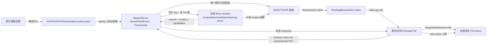
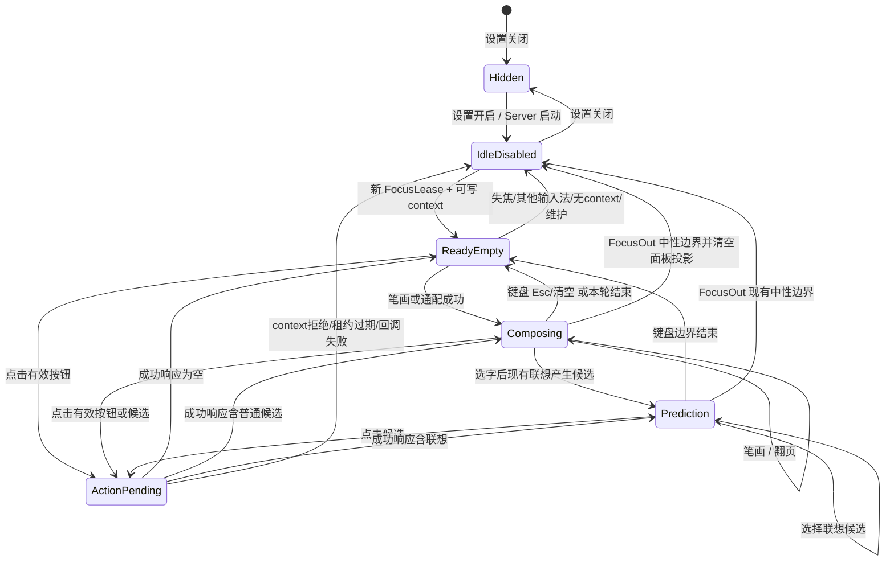

# 2026-10-17 21:09 鼠标常驻两行笔画面板架构

状态：`ready`

## 问题、范围与非目标

### 要解决的问题

用户开启「鼠标输入」后，需要一个在当前 Windows 登录会话中持续存在、且不会抢走目标输入框焦点的两行面板：

```text
一  丨  丿  丶  ㇇  ？   ‹  ›  │  已输入：一丨丿
候选字  候选字  候选字  …
```

- 第一行只有五种笔画、通配、上一页、下一页、分隔线和只读的「已输入」。分词、退格、清空继续用键盘。
- 第二行固定保留候选区域；选字后在原位置显示现有逐字联想。
- 空输入、无候选、目标应用失焦或切到其他输入法时，面板仍然存在。没有可安全写入的 TSF 编辑上下文时，面板进入空闲禁用态；点击不得向任何应用发送字母或笔画编码。
- 跨应用切换只能有一个面板。重新获得合格输入焦点后，它绑定新的会话并继续工作。
- 关闭开关后恢复现有键盘输入及现有候选窗行为。
- 入口是现有原生「笔画设置」，右键菜单仍只有「笔画设置」。

### 受影响范围

1. WeaselServer 中的全局面板生命周期与两行布局。
2. TSF 前端与后台 IPC：将全局面板的语义动作交给当前焦点 TSF 客户端，在目标 `ITfContext` 的读写编辑会话中执行并上屏。
3. Rime 语义动作入口：绕过可配置物理键映射，但继续进入既有候选、分词、通配、学习和联想处理链。
4. 原生设置、配置事务、发行构建、32/64 位 TSF 前端和验证。

### 非目标

- 不实现手写识别、轨迹采样或鼠标手势。
- 不在面板增加分词、退格、清空、设置或关闭按钮。
- 不新增常驻 EXE、WebView、UI 框架或第二套候选/联想引擎。
- 不改变标准笔画码、个人词库、动态权重、反馈快照或本机研究 profile 的数据格式。
- 不把本机商业研究字码、个人词库、学习记录或迁移资料放进公开安装包。
- 不改变日常右键菜单。
- 本文只给出设计；不修改运行代码、不部署、不创建或推进 Claw plan，也不新建 worktree。

## 现状证据与参考资料

### 项目事实

- 当前实际运行后台已经是 `0.6.3`：2026-10-17 的只读检查得到 `WeaselServer.exe` 进程路径为 `%LOCALAPPDATA%\BihuaWeasel\0.6.3\WeaselServer.exe`，同目录 `release-manifest.json` 的版本也是 `0.6.3`。构建源码的版本锚点为 `scripts/Build-Release.py:10-12`，安装全局收据写入锚点为 `packaging/Install-Release.py:166-178`。`.claw/truth/windows-stroke-input.md` 中仍有部分 0.6.2 历史文字，实施时不得据此降级。
- WeaselServer 已经拥有全局 `UI` 实例，并在单一后台消息循环中创建和销毁窗口：`.verification/weasel-native/weasel-0.17.4/WeaselServer/WeaselServerApp.cpp:5-41`。当前 `_UpdateUI` 明确跳过 TSF 会话，只为非 TSF 会话显示后台面板：`.verification/weasel-native/weasel-0.17.4/RimeWithWeasel/RimeWithWeasel.cpp:572-604`。因此把鼠标模式的唯一常驻面板放回该现有全局 owner，不需要新进程。
- 现有 TSF 候选窗则在每个目标应用进程内创建。它缓存当前焦点 `ITfContext` 和活动视图窗口：`.verification/weasel-native/weasel-0.17.4/WeaselTSF/CandidateList.cpp:245-266`；当前只有 `status.composing` 时显示：同文件 `201-219`。若直接把它改成常驻，每个加载 TSF 的应用都可能各自保留一份窗口，无法满足跨应用唯一性。
- 现有候选窗已经使用 `WS_EX_NOACTIVATE` 并以 `SW_SHOWNA` 显示：`.verification/weasel-native/weasel-0.17.4/WeaselUI/WeaselUI.cpp:39-48,85-101`；`WM_MOUSEACTIVATE` 返回 `MA_NOACTIVATE`：`.verification/weasel-native/weasel-0.17.4/WeaselUI/WeaselPanel.cpp:236-242`。这些行为应原样复用，以保持目标输入框焦点。
- 现有鼠标候选点击先经 IPC 选中候选，再用 `SendInput(VK_SELECT)` 人工制造键盘事件以取回响应并进入编辑会话：`.verification/weasel-native/weasel-0.17.4/WeaselTSF/CandidateList.cpp:381-392`。这是本功能不能继续依赖的链路：全局后台面板可能面对失焦、其他输入法或高权限目标，模拟键存在竞态，也无法证明不会把物理按键送给错误应用。
- TSF 当前通过 `ITfContext::RequestEditSession` 进入 `DoEditSession`，再解析后台 commit/context 并更新候选：`.verification/weasel-native/weasel-0.17.4/WeaselTSF/Composition.cpp:380-388`、`.verification/weasel-native/weasel-0.17.4/WeaselTSF/EditSession.cpp:6-45`。这条链才是鼠标动作可靠上屏的 owner。
- 焦点信号已经存在：TSF 键事件 sink 在前后台切换时调用 `FocusIn/FocusOut`：`.verification/weasel-native/weasel-0.17.4/WeaselTSF/KeyEventSink.cpp:65-73`；文档焦点切换由 `ITfThreadMgrEventSink::OnSetFocus` 处理：`.verification/weasel-native/weasel-0.17.4/WeaselTSF/ThreadMgrEventSink.cpp:12-25`；后台目前用 `m_active_session` 记录焦点会话，但 `FocusOut` 无条件清零：`.verification/weasel-native/weasel-0.17.4/RimeWithWeasel/RimeWithWeasel.cpp:393-407`。实施时需把它收紧成带代次的唯一焦点租约。
- Rime 后台处理物理键后统一 `_Respond` 和 `_UpdateUI`：`.verification/weasel-native/weasel-0.17.4/RimeWithWeasel/RimeWithWeasel.cpp:311-338`；响应包含 commit、状态、preedit、候选和风格：同文件 `793-943`。鼠标动作应复用这份响应协议，不创建第二套候选状态。
- 可配置物理键在 `rime/lua/bihua_query_keys.lua:1-68` 归一化，递归注入时用 `env.forwarding` 绕过二次物理映射：同文件 `70-95`；ADR 已将此定为标准编码和学习不随键位变化的合同：`.claw/truth/adr/0003-configurable-physical-key-normalization.md:7-13`。
- 显式数字选字由既有学习守卫识别并记录选择输入：`rime/lua/bihua_learning_guard.lua:113-118`。鼠标选字应转成同一页内数字选择语义，才能与键盘选择共享动态权重和联想反馈。
- 原生设置已经以 `%APPDATA%\Rime\bihua_mvp.custom.yaml` 和 `weasel.custom.yaml` 为配置事务目标，并在保存后调用本包 `WeaselDeployer.exe /deploy`：`scripts/Settings-Panel.py:162-186`；读取编译后的 schema 与 `build/weasel.yaml`：同文件 `188-213`；保存具有预览、并发检测、备份、编译回读和失败回滚：`scripts/Settings-Panel.py:216-312`。新开关必须进入这条事务，不能另写注册表或私有 JSON。
- 发行构建是白名单，并明确排除 `.userdb`、`bihua_personal`、`migration-preserved`、`wetype-mobile`：`scripts/Build-Release.py:1,21-58,121-127`；安装包声明不含个人词库、学习历史或手机输入法研究数据：同文件 `59-79`。新前端源码和二进制必须沿用该边界。
- 个人数据与公开 profile 的边界已由 `.claw/truth/adr/0001-personal-learning-and-local-profile-boundaries.md:7-15` 接受；独立身份、菜单、安装和焦点边界由 `.claw/truth/adr/0002-current-user-native-settings-entry.md:7-28` 接受。

### Windows 官方依据

- [Edit Contexts](https://learn.microsoft.com/en-us/windows/win32/tsf/edit-contexts)：当前 edit context 应由 `ITfThreadMgr::GetFocus` 取得活动 document manager，再由 `ITfDocumentMgr::GetTop` 取得栈顶 context；修改文本必须先取得 edit session 锁。
- [ITfContext::RequestEditSession](https://learn.microsoft.com/en-us/windows/win32/api/msctf/nf-msctf-itfcontext-requesteditsession)：读写请求可能异步；只读文档返回 `TS_E_READONLY`，已断开 context 返回 `TF_E_DISCONNECTED`，锁冲突返回 `TF_E_LOCKED`。设计必须把这些结果当作失败，不能先改 Rime 再假装上屏成功。
- [ITfThreadMgrEventSink::OnSetFocus](https://learn.microsoft.com/en-us/windows/win32/api/msctf/nf-msctf-itfthreadmgreventsink-onsetfocus)：无文档获得焦点时 `pdimFocus` 为 `NULL`，可作为禁用路由的明确边界。
- [WM_MOUSEACTIVATE](https://learn.microsoft.com/en-us/windows/win32/inputdev/wm-mouseactivate)：`MA_NOACTIVATE` 不激活面板且保留鼠标消息，符合可点击但不抢输入焦点的要求。
- [ChangeWindowMessageFilterEx](https://learn.microsoft.com/en-us/windows/win32/api/winuser/nf-winuser-changewindowmessagefilterex)：允许指定窗口接收来自较低完整性进程的一个明确消息。可用于后台唤醒高权限目标进程中的 TSF 回调窗口；消息只作 wake-up，不携带可执行动作。

## 领域模型、术语、不变量与唯一 owner

### 术语与 owner

| 概念 | 含义 | 唯一 owner |
|---|---|---|
| `MouseInputPreference` | 用户是否开启鼠标输入 | `%APPDATA%\Rime\weasel.custom.yaml` 中 `patch/bihua_mouse/enabled`；由现有 `Settings` 事务读写 |
| `MousePanelHost` | 唯一常驻两行 HWND、布局、命中区域、启用/禁用投影 | WeaselServer 进程中的现有 `weasel::UI` / `WeaselPanel` |
| `FocusLease` | 当前可以接收鼠标动作的 TSF session、callback HWND、PID、焦点代次和 capability | WeaselServer 的会话协调器；任一时刻最多一个 |
| `MouseAction` | `stroke_h/s/p/n/z`、`wildcard`、`page_prev/next`、`candidate(0..8)` | UI 只产生不可变意图；Rime session 执行业务语义 |
| `PendingMouseAction` | 一次点击的 token、目标 session、焦点代次和执行状态 | WeaselServer；单 in-flight、一次执行 |
| `Composition/Candidates/Prediction` | 已输入编码、候选、页状态、联想与学习 | 现有 Rime session；面板只读投影 `_Respond/_GetContext` |
| `EditTarget` | 真正允许上屏的当前栈顶 `ITfContext` | 目标应用进程内的 `WeaselTSF` |

### 不变量

1. 开关开启时只有 WeaselServer 的一个面板 HWND 可见；TSF 进程内的普通候选窗在鼠标模式不显示。开关关闭时反向恢复现状。
2. 面板不保存可编辑笔画串、候选或联想副本；「已输入」和第二行只来自当前 Rime session 的响应。失去 `FocusLease` 时立即清空投影，不能展示可点击的旧候选。
3. 点击绝不调用 `SendInput`，也不把 `h/s/p/n/z/t` 或用户自定义物理键注入 OS 输入队列。
4. Rime 只有在目标 `ITfContext` 已授予读写 edit session、且服务端验证 session 与焦点代次仍匹配后才执行 `MouseAction`。
5. `TS_E_READONLY`、`TF_E_DISCONNECTED`、`TF_E_LOCKED`、callback 投递失败、会话过期或后台断线都保持 Rime composition、目标文本、个人学习数据不变；面板回到禁用或可重试状态。
6. 一个 action token 最多执行一次。执行结果不确定时不自动重放，避免重复笔画或重复上屏。
7. 鼠标选字等价于现有当前页数字选字；笔画和通配进入 `bihua_query_keys` 的标准语义注入路径；翻页等价于 `Page_Up/Page_Down`。因此分词、通配限制、个人词库、逐字联想、动态权重和反馈仍由现有链路负责。
8. 面板保持两行高度。空候选时第二行留空；联想候选替换原候选投影，不创建第三行或新窗口。
9. 切到其他输入法、无文档焦点或后台维护时，面板继续显示但禁用；只有关闭设置或退出本包后台才隐藏。

## 技术决策及每项决策的原因

### 决策 1：常驻面板由唯一后台承载

强推荐在 WeaselServer 已有 `m_ui` 上增加鼠标模式，而不是让每个 TSF DLL 的 `CCandidateList` 常驻。后台已经是登录会话内的单实例、拥有窗口消息循环和输入位置投影；它能在切换应用或输入法后继续存在。TSF 本地窗口无法在「一直挂着」和「跨应用不重复」之间同时成立。

鼠标模式下，`RimeWithWeaselHandler::_UpdateUI` 对 TSF 会话也取得 context 并更新后台两行面板；非鼠标模式保留当前 `!is_tsf` 分支。TSF 响应增加 `config.mouse_panel_enabled`，`CCandidateList::UpdateUI` 据此抑制本地候选 HWND。面板继续使用现有 `WS_EX_NOACTIVATE`、`MA_NOACTIVATE`、DirectWrite、DPI 和 caret 定位设施。

### 决策 2：后台只发意图，目标 TSF 在 edit session 内执行

后台不能直接写目标应用，也不能通过模拟键间接唤醒 TSF。新增一个很窄的反向唤醒合同：

1. 新版 TSF 建立 session 后创建 message-only callback HWND，以 IPC 注册 `{session_id, hwnd, pid, capability=MOUSE_ACTION_V1}`。Server 用管道来客 PID 校验 `GetWindowThreadProcessId(hwnd)`。
2. callback HWND 只允许一个 `RegisterWindowMessage` 得到的 wake-up 消息；需要跨完整性级别时，用 `ChangeWindowMessageFilterEx(hwnd, message, MSGFLT_ALLOW, ...)` 只放行该消息。
3. 消息不携带动作。面板点击后 Server 生成一次性 token，绑定当前 `FocusLease` 并 `PostMessage` 唤醒。TSF 再通过已认证的现有 IPC session 领取 token 和只读 action。
4. TSF 重新用 `ITfThreadMgr::GetFocus` + `ITfDocumentMgr::GetTop` 取得当前 context，并请求 `TF_ES_ASYNCDONTCARE | TF_ES_READWRITE`。只有 `DoEditSession` 获得 edit cookie 后，才调用 `ExecuteMouseAction(token, focus_generation)`。
5. Server 原子验证 token、session 和代次，执行一次 Rime 语义动作，调用现有 `_Respond`，TSF 在同一命令 edit session 中消费 response 并复用现有 composition/commit/UI 更新逻辑。

这保留现有命名管道为数据和身份边界，只增加一个无数据 wake-up 消息；不用新增双向长连接线程或新进程。伪造 wake-up 只能触发一次空的 `TakeMouseAction`，不能伪造动作。

### 决策 3：用 Rime 内部语义触发器复用现有处理链

新增 `MouseAction` IPC 枚举，不传物理键：

- 五种笔画与通配：Server 设置短生命周期 context property `bihua_mouse_action`，再向 Rime 内部处理一个保留的 F24 触发器。`bihua_query_keys.lua` 在最前面读取并清除 property，以现有 `env.forwarding=true` 递归注入标准 `h/s/p/n/z` 或 `KP_6`。即使 Lua 与前端版本不匹配，F24 也只在 Rime 内部成为未处理键，不会流入目标应用。
- 上一页/下一页：内部处理 `Page_Up/Page_Down`，继续走现有页状态和曝光反馈。
- 候选 `0..8`：内部处理当前页数字 `1..9`，继续经过 `bihua_learning_guard` 和 selector；不要调用绕过显式选择标记的第二套选字实现。

每个 action 都在一次 Server 命令中完成 `process_key -> _Respond -> _UpdateUI`。不改词典、用户库或关联快照格式。

### 决策 4：配置放入现有 weasel.custom 事务

增加布尔字段 `mouse_input` 到 `scripts/Settings-Panel.py` 的严格字段集合，在原生「输入与键位」页增加「开启鼠标输入（面板常驻）」复选框。持久化键为 `weasel.custom.yaml` 的 `patch/bihua_mouse/enabled`，因为它控制 Windows 前端生命周期，不是输入 schema 业务开关。

保存继续执行预览、备份、原子写、`WeaselDeployer /deploy`、编译 `build/weasel.yaml` 回读和失败回滚。Server 初始化与重新部署后从编译配置恢复面板；设置开启而暂无焦点时直接进入 `IdleDisabled`。不增加托盘/语言栏命令。

### 决策 5：焦点用单租约和代次协调

把当前 `m_active_session` 收紧为 `FocusLease`：`FocusIn` 或有效 `OnSetFocus` 成功注册 callback 时递增 generation 并替换租约；`FocusOut/RemoveSession/Deactivate` 只有在 session 与当前租约相同才释放，旧会话迟到的 FocusOut 不能清掉新会话。

Server 始终保留面板 HWND。租约释放时清空 Rime 投影并禁用命中；新租约到来后用现有 `UpdateInputPosition` 重新锚定并显示该 session 的空输入/候选状态。切换到其他输入法会注销租约，但不销毁面板。

## 协作合同：入口、状态变化、事件或投影、失败与重试语义

### 上下文与数据流



### 面板状态机



### 命令合同

`RegisterMouseActionTarget(session_id, hwnd, capability)`：成功后建立或更新该 session 的 callback 信息；PID 不匹配、旧协议或无 session 时拒绝。注册本身不获得焦点租约。

`AcquireFocusLease(session_id, context_generation)`：仅由新版 TSF 在自身输入法激活、线程前台且 `GetFocus/GetTop` 成功后调用。成功替换旧租约、清空旧 pending action，并投影当前 session。其他输入法激活或 `pdimFocus == NULL` 时不得调用。

`QueueMouseAction(action)`：仅面板命中处理器调用。没有可用租约时不排队，面板保持禁用。已有 in-flight token 时忽略重复点击并保持按钮禁用。

`ExecuteMouseAction(token, lease_generation)`：只能由 token 绑定的 IPC session 调用。验证成功后从 `pending` 原子转为 `executing`，执行一次 Rime action 并生成现有 response；重复调用返回已执行状态，不再次输入。

`CompleteMouseAction(token, result)`：TSF 成功消费 response 后确认。Server 删除 token、刷新投影。若 edit session 请求在执行前失败，TSF 回报 HRESULT，Server 丢弃未执行 token并禁用当前租约；Rime 和目标文本不变。

### 失败和重试

- wake-up `PostMessage` 失败：token 未执行，立即丢弃并释放不可达租约；面板保持 `IdleDisabled`。等待下一次真实 FocusIn/注册，不自动模拟键。
- `TS_E_READONLY`、`TF_E_DISCONNECTED`、`TF_E_LOCKED`：token 未执行，记录明确错误并禁用当前投影；焦点或 context 变化后可重新取得租约。
- IPC 断线或 Server 重启：未进入 `executing` 的 token 丢弃；已执行但未确认的 token不自动重放。客户端走现有重连，Server 从配置恢复一个禁用常驻面板。
- Rime 拒绝 action 或没有候选/没有上一页：响应成功但状态不变；不伪造候选、不提交裸编码。
- 焦点 generation 不匹配：视为陈旧点击并拒绝，不能路由到新应用。
- 配置保存/部署失败：沿用现有事务回滚，保留旧开关值和旧运行行为，错误必须对设置窗口可见。

## 备选方案、取舍与重新评估条件

### 采用方案：Server 唯一面板 + TSF edit-session 执行

收益是同时满足一直可见、跨应用单实例、不抢焦点和可靠上屏；候选事实仍在 Rime，编辑目标仍在 TSF。代价是需要一个小型反向 wake-up 合同、focus generation 和一次性 token。

### 备选 A：每个 TSF 进程内常驻候选窗

改动较少，也能直接取得 `ITfContext`，但切换应用或输入法时无法可靠维持唯一可见实例；失去承载进程或卸载该 TSF 实例时也无法继续挂着。因此不采用。只有产品明确改成「仅在当前笔画输入法焦点内显示」时才重新评估。

### 备选 B：Server 面板使用 `SendInput`

实现最短，但焦点检查和按键送达之间有竞态；切换其他输入法时可能把字母、自定义物理键或功能键发给错误应用。也无法把上屏失败与 Rime 状态变更组成可验证合同。因此禁止。

### 备选 C：独立悬浮面板 EXE

可获得全局生命周期，却重复现有 Server 的单实例、窗口循环、配置和 IPC，并扩大安装、启动、权限与恢复面。现有 Server 已具备 UI host，不采用。只有未来需要与 WeaselServer 生命周期完全独立、或 Server 无法承载辅助功能时才重新评估。

### 备选 D：直接用 Rime candidate-selection API

现有鼠标候选点击使用该 API，但还要靠 `VK_SELECT` 拉取响应，并可能绕过键盘显式选择标记。新路线用当前页数字语义复用 selector/learning guard。只有真实 Rime 回归证明 API 与数字选择在联想反馈、词频和 commit 边界完全等价，且 response 可在同一命令返回时才可重新评估。

## 实施切片、迁移或兼容边界、验证证据

### 最小垂直切片

1. **配置闭环**：在 `Settings-Panel.py`、`Native-Settings.py` 和现有网页兼容页增加 `mouse_input`；写 `patch/bihua_mouse/enabled`，编译回读并覆盖回滚测试。此切片暂不展示面板。
2. **唯一常驻空面板**：让 Server 的现有 `m_ui` 在开关开启时显示固定两行，空闲时禁用；实现精确布局和命中区域；TSF 本地候选窗在配置开启时抑制。此时按钮不执行动作。
3. **焦点租约与 callback**：新增 capability 注册、callback HWND、单一 `FocusLease`、generation 和 wake-up 消息；验证跨应用和切换其他输入法始终只有一个后台面板。
4. **一笔端到端**：只接 `stroke_h`，先获 TSF RW edit session，再执行 token，走 Rime 内部 F24 语义触发器、现有 `_Respond` 和 commit/context 更新。证明拒绝 edit session 时 Rime 没变化。
5. **完整动作与两行投影**：补齐其余笔画、通配、翻页和 1–9 候选；第一行显示 Rime preedit，第二行显示当前候选；选字后原位显示联想。
6. **打包与物理安装**：同时构建 x86/x64 TSF、Server、Lua、设置及源码包；执行发行白名单扫描、安装升级和真实 Windows 跨应用验收。

### 迁移与兼容边界

- 默认 `mouse_input=false`，升级后现有行为完全不变；无数据迁移。
- 开启只增加一个 weasel 配置键，不修改或删除任何个人词库、UserDb、联想 JSONL、研究 profile 或备份。
- 该功能要求 Server、32/64 位 TSF 和 Lua 同版。旧应用进程已加载旧 DLL 时无法理解 `MOUSE_ACTION_V1` 或抑制本地候选，安装器/更新流程必须沿用现有模块检查并明确要求重新打开这些应用；不能把混版状态报告为已生效。
- Server 只向声明 `MOUSE_ACTION_V1` 的 session 建立可执行租约。旧 client 存在时面板保持禁用且不发送动作，避免字母泄漏；完成进程重启后恢复。
- `FocusOut` 继续调用 `BihuaNeutralFocusOut`，保持普通未完成笔画不提交、不清除的既有 Rime 合同；面板可以清空显示投影，但不得借此清空普通 composition。
- 发行仍由 `Build-Release.py` 白名单产生，需把实际修改的 Weasel 源码、Lua 和测试纳入 source zip；禁止复制活动 `%APPDATA%\Rime` 或 `.verification/independent-package-0.5.2` 中的私有数据到公开 payload。

### 必须取得的验证证据

1. **配置事务**：开关读取、预览、编译回读、并发修改拒绝、部署失败回滚；Server 重启后从持久配置恢复 `IdleDisabled` 面板。
2. **协议与失败单测**：HWND/PID 不匹配拒绝、旧 capability 拒绝、迟到 FocusOut 不清新租约、陈旧 generation 拒绝、单 token 至多执行一次、`PostMessage` 失败和各 TSF HRESULT 均不执行 Rime action。
3. **真实 Rime 等价回归**：六个输入按钮、上下页、九个候选点击分别与对应键盘路径得到相同 preedit、候选、commit、个人词频和联想反馈；无候选、首页/末页、宽泛通配保持现有失败语义。
4. **TSF 上屏探针**：验证动作执行发生在目标 `ITfContext` 获得 RW edit cookie 之后；只读/断开 context 时目标文本、Rime composition 和个人数据均不变；彻底移除鼠标路径中的 `SendInput(VK_SELECT)`。
5. **真实桌面 E2E**：在记事本、浏览器、Office 类应用和一个 32 位应用之间切换，只有一个面板且跟随新 caret；空输入和空候选仍是两行；选字后联想原位出现。
6. **常驻安全 E2E**：切换到其他输入法、无输入焦点、目标关闭、后台维护和高权限目标时，面板继续存在但禁用；反复点击不产生任何字母、F24、笔画编码或应用快捷键。高权限目标覆盖 `ChangeWindowMessageFilterEx` 路线。
7. **默认模式回归**：关闭开关后 Server 面板隐藏，现有 TSF 候选窗、键盘分词/通配/翻页/联想、Return/KPEnter 收起和个人学习行为不变。
8. **发行与数据边界**：x86/x64 前端、Server、Lua、设置、source zip 和 `/validate` 同版；安装可独立运行且不依赖项目、Codex 或外部 Python；manifest 扫描继续拒绝个人、本机研究和迁移资料；升级前后用户资料哈希与学习记录保持。

### 已知假设

- 假设 WeaselServer 的现有单实例/计划任务边界继续成立；若实际存在两个定制 Server 实例，必须先以现有管道所有权规则修复单实例，不能在 UI 层互相隐藏。
- `ChangeWindowMessageFilterEx + wake-up message + authenticated IPC pull` 尚未在本任务中运行验证；它是基于官方 UIPI 合同的实施假设。若某类沙箱应用禁止该消息，失败语义仍是面板禁用且 Rime 不变；不得回退到 `SendInput`。
- 现有 response 应用代码会在 `DoEditSession` 中再发若干异步编辑请求。实现一笔垂直切片时应优先抽出「使用当前 edit cookie 应用 response」的小函数，确保 mouse command 的 commit 与 context 更新属于已获准的同一编辑会话；若目标应用兼容性迫使继续异步嵌套，必须用真实应用证据证明不会先消费 commit 后上屏失败。

## Open decisions

无。上述路线不需要中途产品决策；布局、常驻语义、按钮集合、设置入口、失焦禁用和数据边界都已由需求与现有合同确定。

## 实施记录

实现使用 `RimeWithWeaselHandler` 唯一拥有的 `BihuaMousePanel` 原生 GDI 窗口；普通 `m_ui` 保留原用途。IPC 线程只更新受锁保护的只读投影并通知 UI 线程刷新；窗口创建、绘制和显示留在后台主线程。没有另起面板进程，也没有新增日常菜单项。

新版 TSF 通过 message-only HWND 接收无数据 wake-up，注册和领取动作均校验操作系统管道来客 PID。`BihuaMouseState` 保存唯一焦点代次和在途 token；普通 FocusOut 只能撤销同一会话的租约。动作在 RW edit session 和只读/当前 context 预检之后执行，响应直接使用本次 edit cookie 上屏。意外的执行后写入失败不会自动重放，并撤销输入路由；它不是 Rime 与应用文本之间的分布式事务。

面板在鼠标按下时记录投影修订与焦点代次，松开时再次校验；服务端入队时再次比对显示代次。目标或候选在按下、松开之间变化时取消点击。`MouseStateProbe.cpp` 与 `MousePanelProbe.cpp` 覆盖过期代次、重复执行、迟到失焦及实际 HWND 中的按下/松开边界。

新鼠标模式没有 SendInput。默认模式原有本地候选窗的鼠标路径保持兼容，本次未重写其既有 VK_SELECT 路径。面板继承当前配色和字体，采用适合两行布局的紧凑字号范围；位置是窗口几何缓存，保存在 `HKCU/Software/BihuaInputMethod/MousePanel`，不参与输入方案或个人学习。

真实桌面验证使用隔离的公开 profile 和受控 32/64 位 RichEdit 测试窗口；结束后恢复用户 RimeUserDir 和专属后台。未用个人词库输入测试文字。0.6.6 的 `mouse-desktop-066.json` 已通过完整流程，包含 Enter 后常驻、关闭回归、只读/失焦/其他输入法禁用、重启和焦点代次保护；`live-mouse-enabled-066.json` 确认真实用户开关已启用、五个私有文件哈希未变、学习序号保持 183，生产后台通过不限时的永久启动任务运行。干净 Windows、Office/浏览器逐一兼容性和高权限目标窗口仍不在已取得的实测证据内。

实际安装暴露了原管道实现共享响应缓冲、持有全局 Rime API 锁发送并调用 FlushFileBuffers 的问题。0.6.6 改为每连接拥有缓冲，业务处理仍由全局锁串行化，释放锁后直接写回复，不等待客户端消费。`IPCIsolationProbe.cpp` 以一个不读响应的连接和四个并发客户端验证 12 次会话响应隔离，799 毫秒完成且零失败。测试任务结束时只恢复永久启动任务，不再让生产后台成为有限时长测试任务的子进程。

安装器对开始菜单快捷方式先生成临时文件，再纳入安装备份与回滚，避免 WScript 原位保存旧快捷方式失败；新装、升级、第二个快捷方式写入失败回滚和卸载恢复均有事务测试。本机升级与重复安装已通过。发行包、嵌入 payload、全部 65 个项目源文件和 281 个原生源文件的字节一致性及 ZIP CRC 通过核对，详见 `dist/BihuaInput-0.6.6-validation.json`。
