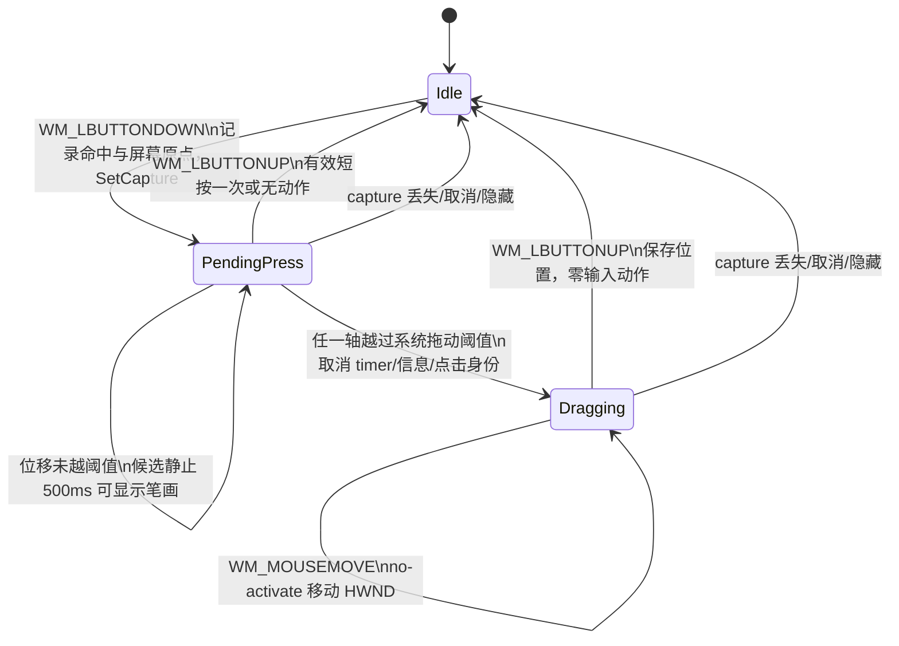

# 2026-10-18 16:44 鼠标面板全域阈值拖动架构

状态：`ready`

## 问题、范围与非目标

当前常驻鼠标面板只有命中空白区域时才能拖动，而且按下后立即进入拖动；笔画按钮、翻页、退格、展开按钮、候选字、联想字及五行展开候选都被点击或长按手势占用。目标是在面板任意客户区按住左键并移动超过 Windows 拖动阈值后，拖动整个面板；未超过阈值的短按继续执行原按钮或选字动作，候选静止长按 500 ms 继续只读显示默认笔画。

本次是 `BihuaMousePanel` 内部的局部手势仲裁，不改变候选投影、TSF 安全动作、Rime 输入和学习合同。覆盖区域包括：空闲六键、完整视图全部工具键、预编辑显示区、候选／联想第一行、展开后的第二至第五行、展开按钮和面板留白。拖动一旦越过阈值即锁定为拖动，之后即使指针回到原控件，松开也不得输入笔画、翻页、退格、展开、选字或触发长按；拖动不建立后端动作 token，不改变候选身份、视图修订或联想权重。

必须继续满足：

- `WS_EX_NOACTIVATE`、`MA_NOACTIVATE` 和 `SWP_NOACTIVATE` 保持，拖动不夺取宿主输入焦点。
- 空闲六键缩略、输入／联想完整视图、最多五行真实候选、Enter 宿主透传、键盘英文与鼠标中文分离保持原合同。
- 短按与静止长按行为不变；候选、联想、词组以及第五行候选使用同一手势规则。
- 不新增设置项、持久化 Schema、IPC 消息、线程或通用手势框架；阈值取操作系统配置。
- 不强制关闭用户软件，不修改私人码表、个人词库、联想快照或学习记录；位置继续只写既有 `HKCU\Software\BihuaInputMethod\MousePanel` 的 `X/Y`。

非目标包括触摸／笔输入、多指手势、窗口缩放、吸附、惯性、候选重排、改变长按 500 ms 时长，以及改写普通键盘候选窗。

## 现状证据与参考资料

项目代码索引未包含本仓库，因此按技能允许的回退路线使用 `rg` 定位并精读源码；没有索引结论被当作运行时证据。

- 当前产品 Truth 明确：唯一后台拥有不抢焦点的置顶面板，位置拖动保存到当前用户注册表；在途动作只禁用交互而不隐藏（`.claw/truth/windows-stroke-input.md:21-23`）。空闲六键、完整视图与五行候选合同见同文件 `:25-29`；候选／联想长按 500 ms、移动取消且松开不提交见 `:31`。
- 鼠标动作绑定会话、焦点代次、语义投影、视图修订和绝对候选索引，最终经 TSF 可写 edit session 执行；失败不重放且不用 `SendInput`（`.claw/truth/windows-stroke-input.md:35`；`.claw/truth/adr/0004-persistent-mouse-panel-and-tsf-actions.md:21-23`）。
- 窗口以 `WS_EX_NOACTIVATE | WS_EX_TOOLWINDOW | WS_EX_TOPMOST` 创建，初始位置从现有注册表键读取（`native/BihuaMousePanel.h:26-55`）；`WM_MOUSEACTIVATE` 返回 `MA_NOACTIVATE`（`:303-316`）。
- 当前按下会记录命中 id、焦点代次、UI 修订和视图修订并取得 capture；只有 `pressed < 0` 的空白处会立即把 `dragging` 设为真（`native/BihuaMousePanel.h:396-418`）。因此按钮、候选和联想不能拖动，而空白处没有阈值。
- 当前移动路径用 `SM_CXDRAG/SM_CYDRAG` 只取消长按计时；仅已有 `dragging` 为真时才通过 `SetWindowPos(... SWP_NOACTIVATE ...)` 移窗（`native/BihuaMousePanel.h:422-442`）。松开时先计算点击有效性，空白拖动则保存 `X/Y` 并返回（`:451-503`）。
- 候选长按定时器只在显示身份仍有效时发动作 19；短按候选发动作 18，展开发动作 20（`native/BihuaMousePanel.h:353-367`、`:451-502`）。后端动作 19 只显示校验后的笔画信息，动作 18 才进入候选选择；一般按钮／选择动作从 `_QueueMouseAction` 才创建 token（`native/BihuaMouseBackend.h:108-129`、`:168-197`）。
- 面板绘制后的曝光回调只传可见范围；后台按同一 session/projection 合并最大可见数，真正的 expose 只在下一次 Rime mutation 前消费（`native/BihuaMousePanel.h:833-839`；`native/BihuaMouseBackend.h:81-105`）。因此拖动不得制造 mutation 或视图变化，重复重绘继续由既有身份去重。
- `MousePanelProbe` 已覆盖短按、目标／候选变化取消、五行绝对候选、曝光、DPI／字号／主题和不激活（`native/MousePanelProbe.cpp:9-104`）；`MouseInteractionProbe` 已覆盖候选短按、500 ms 长按不选字、移动取消长按和弹层不激活（`native/MouseInteractionProbe.cpp:50-72`）。现有 `.verification/native-mouse-0619.json` 为这些原行为提供通过记录，但尚未覆盖“从控件拖动”。
- `scripts/Patch-Mouse-Input.py:195-211` 把后台增量接入固定 Weasel 源码，`:274-275` 从项目 `native/` 复制 canonical header；实现后必须从项目头文件进入这条可重建路径。
- Windows 将 `SM_CXDRAG/SM_CYDRAG` 定义为按下点周围、在开始拖动前允许移动的像素范围；鼠标 capture 保证按钮按住期间窗口可继续接收移出边界的消息：[GetSystemMetrics](https://learn.microsoft.com/windows/win32/api/winuser/nf-winuser-getsystemmetrics)、[Mouse Input](https://learn.microsoft.com/en-us/windows/win32/inputdev/mouse-input)。`WM_CAPTURECHANGED` 即使主动 `ReleaseCapture` 也会发送，处理时只能清理状态，不得重新 capture：[WM_CAPTURECHANGED](https://learn.microsoft.com/en-us/windows/win32/inputdev/wm-capturechanged)。项目已有 Per-Monitor DPI 行为，阈值应优先使用 DPI-aware 系统指标：[High DPI Desktop Application Development](https://learn.microsoft.com/en-us/windows/win32/hidpi/high-dpi-desktop-application-development-on-windows)。

## 领域模型、术语、不变量与唯一 owner

本次只新增一个暂态概念：**面板指针手势**。它由 `BihuaMousePanel` 的 UI 线程唯一拥有，不进入 `BihuaMouseState`、IPC 或 Rime。

| 事实 | 唯一 owner | 说明 |
| --- | --- | --- |
| 指针手势阶段、按下点、窗口原点、按下控件身份、长按是否已消费 | `BihuaMousePanel` | 仅存于一次左键按下至释放／取消的生命周期 |
| 面板实时位置及 `X/Y` 几何缓存 | `BihuaMousePanel` | 沿用现有 HWND 与注册表路径，不是输入配置或学习事实 |
| 展开／收起、导航索引、视图修订 | `BihuaMouseView` | 拖动只移动 HWND，不写这些字段 |
| 会话租约、语义投影、待执行动作 token、绝对候选索引 | `BihuaMouseState`／`RimeWithWeaselHandler` | 只有有效短按 callback 才能进入该边界 |
| 候选、联想回合、曝光和长期权重 | Rime 与现有 Lua Episode | 拖动不调用 mutation；重绘继续按既有投影身份去重 |

手势阶段只需三个局部枚举值，不建立可复用框架：

- `Idle`：没有被本窗口捕获的左键手势。
- `PendingPress`：已记录按下快照并 capture；尚未越过拖动阈值，仍可能成为短按或候选长按。
- `Dragging`：指针已越过阈值；点击和长按永久作废，只允许移动窗口，直到释放或取消。

不变量：

1. 每次左键手势最多产生一种结果：短按动作、长按信息、拖动、无效取消；拖动与任何输入动作互斥。
2. `PendingPress -> Dragging` 是单向锁存；越界后回到按下控件也不能恢复点击。
3. 拖动可以从任何客户区开始，不以 `Valid(id)` 为前提；`Valid` 只决定未拖动松开时能否执行短按。
4. 静止 500 ms 的候选长按可以显示信息并标记 `hold_consumed`；之后仍可越阈值拖动，但松开仍不选字。
5. `Dragging` 不调用 `clicked`、`displayed` 之外的新回调、`_QueueMouseAction`、`_BeforeMouseMutation` 或任何 Rime API。因窗口重绘发生的既有 `displayed` 回调仍以相同 projection/range 合并，不形成额外学习权重。
6. capture 丢失、取消模式、窗口隐藏或指针身份失效都回到 `Idle`，不补发点击、不重放。
7. 窗口始终用 no-activate 路径移动；宿主前台 HWND 在整个手势前后保持不变。

## 技术决策及每项决策的原因

### 1. 在 `BihuaMousePanel` 内把现有布尔拖动改为三态仲裁

将 `dragging` 布尔值替换为局部 `PointerGesture { Idle, PendingPress, Dragging }`（或等价最小字段），复用现有 `pressed`、generation/revision/view 快照、`hold_consumed`、按下屏幕坐标和窗口原点。手势事实和 Win32 消息都在同一 UI 线程，留在面板可避免新增锁、IPC 和第二份状态。

### 2. 所有左键按下先进入 `PendingPress`

`WM_LBUTTONDOWN` 无论命中工具键、候选、联想、预编辑还是空白，都记录：`pressed = Hit(clientPoint)`、现有点击身份快照、`press_screen = GetCursorPos()`、`window_origin = GetWindowRect().left/top`，然后 `SetCapture(hwnd)`。只有候选／联想且长按开关开启时启动现有 500 ms 定时器。空白短按自然无动作，控件短按仍由原有效性检查决定。

### 3. 使用 Windows 配置的矩形阈值，并在越界时锁存拖动

在 `PendingPress` 的 `WM_MOUSEMOVE` 中以屏幕像素比较 `abs(current.x - press_screen.x)` 与 X 阈值、`abs(current.y - press_screen.y)` 与 Y 阈值；任一轴超过阈值即进入 `Dragging`。优先动态调用 `GetSystemMetricsForDpi(SM_CXDRAG/SM_CYDRAG, GetDpiForWindow(hwnd))`，旧系统或 API 不可用时回退 `GetSystemMetrics`，并把异常的非正值钳制到至少 1 像素。这样遵循系统鼠标容错设置，并与已有多 DPI 窗口一致；不新增用户配置。

进入 `Dragging` 的同一条消息必须：停止长按 timer、隐藏笔画信息浮层、把 `hold_consumed` 置真、清除按下／hover 视觉、使短按目标不可再恢复，然后按 `window_origin + current_screen - press_screen` 调用现有 `SetWindowPos(... SWP_NOSIZE | SWP_NOACTIVATE | SWP_NOZORDER)`。后续移动只走这条位置路径。

### 4. 在释放前按最终阶段决定唯一结果

`WM_LBUTTONUP` 先快照最终阶段并重置为 `Idle`，再使用现有 `releasing_capture` 防护调用 `ReleaseCapture`：

- `Dragging`：只对最终位置执行既有工作区约束／读取窗口矩形并写现有 `X/Y`；直接返回，不计算或派发控件动作。
- `PendingPress` 且 `hold_consumed == false`：沿用当前“松开命中同一 id + generation/revision/view 未变 + Valid”检查，派发一次短按。
- `PendingPress` 且已长按、空白、无效控件或身份变化：无动作。

`WM_CAPTURECHANGED`、`WM_CANCELMODE` 和现有 `WM_APP+47` 指针取消入口统一清 timer、隐藏信息浮层、清按下视觉并回到 `Idle`。主动 `ReleaseCapture` 触发的 `WM_CAPTURECHANGED` 由 `releasing_capture` 识别，只做幂等清理。若跨显示器拖动触发 `WM_DPICHANGED`，`Dragging` 阶段必须保留；布局可按现有逻辑更新，不能因此恢复点击。

### 5. 位置写入仍是几何缓存，不扩展为业务事务

沿用既有注册表位置键和 `Resize`/工作区限制。注册表写失败不回滚已经可见的窗口移动，也不触发输入；本次进程内位置保留，下一次成功拖动可重试，重启时仍读取上次成功值。`SetWindowPos` 失败同样只保留最后成功位置并等待后续移动／手势，不降级为输入动作。

## 协作合同：入口、状态变化、事件或投影、失败与重试语义

入口合同为 Win32 UI 消息，不新增公开接口。成功拖动的可观察结果只有 HWND 位置与既有 `X/Y` 缓存变化；候选投影、Rime input、宿主文本、`BihuaMouseView`、动作 token 和学习文件保持不变。成功短按和长按继续使用原 callback 签名及身份校验。

失败与重试：

| 情况 | 结果 | 保持不变的状态 | 重试语义 |
| --- | --- | --- | --- |
| 按下后投影、焦点代次或视图修订变化，且未拖动 | 松开无动作 | 宿主文本、Rime 输入、学习 | 用户重新按下当前画面 |
| 越阈值后又回到原控件 | 仍按拖动结束 | 不派发按钮／选字／长按 | 下一次独立手势才能点击 |
| 长按信息已显示后开始拖动 | 隐藏信息并移动，松开不选字 | 候选和学习 | 下一次静止长按可再查看 |
| capture 丢失、`WM_CANCELMODE`、面板隐藏 | 取消手势 | 不派发任何动作 | 用户在面板恢复后重试 |
| `SetWindowPos` 失败 | 停在最后成功位置 | 所有输入与学习状态 | 同一手势后续 move 或下次拖动可重试 |
| 注册表写入失败 | 当前进程位置仍有效，重启可能回到旧位置 | 输入配置与个人资料 | 下次完成拖动再次写入 |
| DPI-aware metrics API 不可用 | 使用 `GetSystemMetrics` | 手势语义不变 | 无需用户处理 |

## 备选方案、取舍与重新评估条件

1. **保留空白拖动，另加标题栏／拖动柄。** 实现最简单，但不满足笔画按钮、候选和第五行都能拖动；紧凑六键视图也没有稳定空白。拒绝。
2. **使用 `DragDetect` 阻塞式检测。** 它能使用系统拖动矩形，但会把现有异步 `WM_TIMER` 长按、绘制和 capture 生命周期拆成嵌套控制流，难以证明短按／长按互斥。现有消息循环直接比较系统阈值更小且可测。拒绝。
3. **在后端新增 Drag 动作或 IPC。** 位置和手势完全属于后台窗口 UI；进入 `BihuaMouseState` 会把无业务语义的移动混入 TSF/Rime 安全动作，并增加错误重试面。拒绝。
4. **按住固定时长才拖动。** 会与 500 ms 候选笔画查看争用，而且用户明确要求按位移阈值拖动。拒绝。

只有在未来明确支持触摸／笔、多指、拖放目标或多个可拖窗口时，才重新评估抽取通用 pointer gesture 组件；当前不得提前抽象。

## 实施切片、迁移或兼容边界、验证证据

### 最小实施切片

1. 只修改 canonical `native/BihuaMousePanel.h`：增加三态局部手势与 DPI-aware 阈值 helper，重排 `WM_LBUTTONDOWN/WM_MOUSEMOVE/WM_LBUTTONUP/WM_CAPTURECHANGED/WM_CANCELMODE/WM_APP+47`。不改 callback、后端、TSF、Rime 或配置。
2. 扩展 `native/MousePanelProbe.cpp` 与 `native/MouseInteractionProbe.cpp`，随后通过 `scripts/Patch-Mouse-Input.py` 将同一头文件复制进固定 Weasel 构建树；发行时按项目现有流程重生成补丁／源码清单，避免只改 `.verification` 副本。
3. 在受控公开 profile 和新建 32／64 位编辑器中做真实桌面回归；不操作用户个人 profile，不强制关闭现有软件。该变更位于后台面板，安装／更新仍遵循既有后台维护与版本验收边界。

无配置、IPC、注册表 Schema 或个人数据迁移。旧 `X/Y` 直接继续读取；关闭鼠标模式仍回到普通候选窗。现有长期运行应用的前端版本边界和 Enter／键盘路由提示保持原样，本功能不能被用来宣称旧前端已自动更新。

### 必须取得的验证证据

- **阈值与锁存：** 从空白、笔画键、退格、展开按钮、首行候选、联想候选和第五行候选分别拖动；低于阈值的抖动仍按原短按处理，越阈值后返回原点再松开也零 callback。
- **短按／长按回归：** 工具短按只触发一次；候选短按只选一次；静止 500 ms 只显示默认笔画且松开不选；500 ms 前越阈值不显示信息，500 ms 后再越阈值会隐藏信息并拖动，均不选字。
- **视图覆盖：** 空闲六键、输入完整视图、联想完整视图及 N=1/3/9 的五行展开都可从真实命中格开始拖；展开／导航状态和绝对候选身份不变。
- **焦点与取消：** 每次拖动前后 `GetForegroundWindow()` 相同；验证 `WM_CAPTURECHANGED`、`WM_CANCELMODE`、目标隐藏、投影更新、DPI 变化和禁用交互期间不误派发动作。
- **输入与学习不变：** 真实沙箱记录拖动前后宿主文本、Rime input、候选序列、`BihuaMouseState` token 和公开沙箱反馈文件；它们应完全不变。移动引起的重复 paint/exposure 以同一 projection/range 合并，不能形成额外结算。不得用私人码表、个人词库或真实学习快照做测试。
- **既有合同回归：** 复跑 `MousePanelProbe`、`MouseInteractionProbe` 以及当前桌面测试中的空闲缩略、五行选择、长按、键盘英文／鼠标中文、主／小键盘 Enter 宿主透传；96/144/192 DPI 至少覆盖阈值两侧和跨 DPI 拖动。
- **位置持久化：** 只有实际进入 `Dragging` 才更新 `X/Y`；短按、长按和取消不写位置。正常释放后新建面板读回相同的工作区内位置；模拟注册表写失败时无输入副作用。

完成证据应单独声明其范围；原 `.verification/native-mouse-0619.json` 只能作为变更前回归基线，不能证明新增全域拖动。

## Open decisions

无。系统拖动阈值、全客户区覆盖、拖动优先级、短按／长按兼容、焦点与学习不变性均可由现有需求和项目合同确定，不需要额外产品决策。
