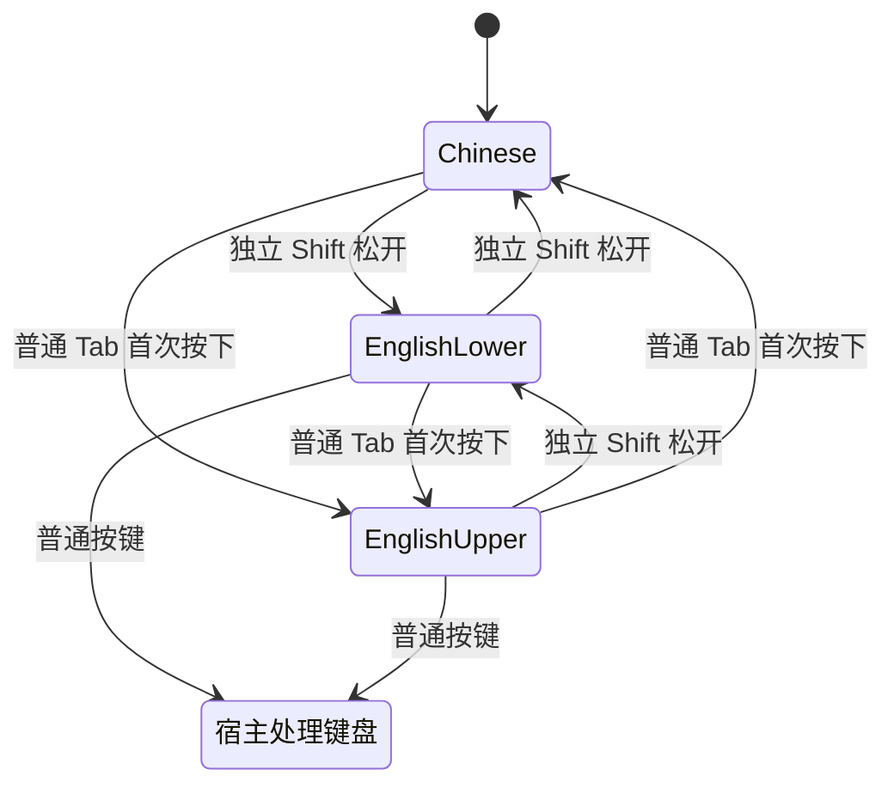
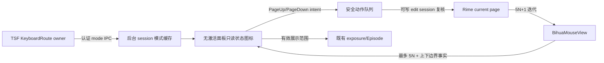

# 2026-10-18 17:46 状态按钮与候选翻页及个人笔顺交互

**状态：ready**  
**范围标记：** 本轮实施状态按钮、Shift/Tab 三态路由、移除横向翻页键、五行候选纵向翻页与方向键边界；“复制单字稳定入口 + 可用时选区增强 + 自定义个人笔顺”仅完成交互与数据边界设计，后续另立任务实施。本设计不修改 claw 状态、安装包、运行时源码或用户数据。

## 问题、范围与非目标

鼠标面板需要在最左侧明确显示当前键盘路由：中文时显示自有绿色“折”笔画标志，英文路由显示 `a`，大写英文路由显示 `A`。鼠标始终走中文笔画；物理键盘在中文态走输入法，在两种英文态交给宿主。`a/A` 是路由提示，不代表或控制 Windows 的实际字母大小写。

现有顶栏左右翻页键与五行展开重复。应删除它们，把翻页意图放到展开视图的纵向边缘：还有上一页时显示向上翻页；已到最前时同一位置变为收起；还有后续候选时显示向下翻页。方向键在五行边缘执行同一语义。

本轮必须保留：空闲六个输入键缩略、输入/联想完整视图、最多五行、鼠标短按输入或选字、长按查看默认笔画、全区域阈值拖动、Enter 宿主透传、候选曝光与学习、鼠标中文/键盘英文分流、无激活窗口。拖动松开不得触发输入/选字/长按或学习。

本轮不启用剪贴板监听，不添加个人笔顺文件，不改设置页，不修改系统 CapsLock，不模拟键盘大小写，不覆盖系统码表，不改个人词库或学习记录，不强制关闭任何应用，也不建立通用手势或通用状态框架。

## 现状证据与参考资料

### 项目事实

- 项目 truth 已定义：鼠标面板唯一后台拥有且不抢焦点；空闲保留六个输入键；展开从当前 Rime 页开始最多五行；预取不算曝光；Shift/Tab 只改变物理键盘路由；Enter 始终透传；方向键导航、长按默认笔画和安全动作管线已有稳定合同：`.claw/truth/windows-stroke-input.md:21-37,41-49`。安全边界的 ADR 是 `.claw/truth/adr/0004-persistent-mouse-panel-and-tsf-actions.md`。
- `BihuaKeyboardRoute` 当前只以 `bool english` 表示中/英二态。独立 Shift 在松开时切换，带组合键、双侧 Shift 或期间按过其他键不切换；Tab 在普通首次 keydown 切换并去除自动重复：`native/BihuaKeyboardRoute.h:4-28`。
- TSF 是键盘路由真值 owner。`_RouteMouseKey` 先透传 Enter，再处理 Shift/Tab；英文态把键盘交给宿主，中文态才接管候选方向键和 Space/KP0：`native/BihuaMouseTSF.h:52-102`。可写焦点复核与编辑会话失败不回放在同文件 `45-50,104-151`。
- `BihuaMouseView` 是展开与导航唯一 owner；当前首行 Up 直接收起，末行 Down 不能跨页：`native/BihuaMouseView.h:5-39`。
- 后台从当前 Rime 页起最多预取 `5 * page_size` 个候选，并把 `page_no * page_size` 作为绝对基址：`native/BihuaMouseBackend.h:38-79`。现有安全动作 `6/7` 已映射为 Rime `Page_Up/Page_Down`：`native/BihuaMouseBackend.h:168-196`。
- 面板当前把顶栏 `6/7` 作为左右翻页，把 `18` 作为展开/收起；候选 ID 从 8 起且第二行后跳过 18：`native/BihuaMousePanel.h:166,204-293,313-320`。新增控件不能继续依赖这些碰巧不冲突的裸数字。
- 面板已经用 `WS_EX_NOACTIVATE`、`MA_NOACTIVATE`，并用 `Idle/PendingPress/Dragging`、系统拖动阈值、鼠标捕获和版本核验仲裁短按与拖动；进入 Dragging 后清除 pressed/hovered，松开不派发动作：`native/BihuaMousePanel.h:35,137-187,331-345,418-514`。新按钮与候选必须复用此仲裁。
- IPC enum、Client 方法、后台字段以及原生头复制均由 `scripts/Patch-Mouse-Input.py:36-55,118-143,213-274` 维护；源码与 patch 必须同时更新，避免发行构建漂移。
- 标准码表由 `scripts/Build-Open-Profile.py:21-41,55-64,78-81` 生成，默认码另导出校验 TSV；个人词条则由 `scripts/Manage-Personal.py:34-70` 写入独立 TSV，并复用 `scripts/personal_data.py:18-61` 的互斥锁与原子替换。设置保存已有预览、备份、部署、编译回读与回滚：`scripts/Settings-Panel.py:219-318`。
- 原生设置现有六页与个人词条 CRUD 位于 `scripts/Native-Settings.py:17-18,331-398,541-568`。发布清单禁止 `bihua_personal` 文件进入包：`scripts/Build-Release.py:121-128`。
- 本仓库未出现在当前 GitNexus 索引中；上述关系通过 `claw search` 发现 truth/ADR 后，用 `rg` 和逐文件精读核实。

### 外部事实与本设计建议

**官方事实。** 微软说明 `AddClipboardFormatListener` 在内容改变后向注册窗口投递 `WM_CLIPBOARDUPDATE`；`GetClipboardSequenceNumber` 为每个 window station 的剪贴板变化提供递增序号。监听器用于通知，序号用于确认缓存有效性，不应轮询。见 [AddClipboardFormatListener](https://learn.microsoft.com/en-us/windows/win32/api/Winuser/nf-winuser-addclipboardformatlistener)、[GetClipboardSequenceNumber](https://learn.microsoft.com/en-us/windows/win32/api/winuser/nf-winuser-getclipboardsequencenumber) 和 [Using the Clipboard](https://learn.microsoft.com/en-us/windows/win32/dataxchg/using-the-clipboard)。

**官方事实。** UI Automation `TextPattern.GetSelection` 能返回一个或多个选区；只有插入点时返回退化空范围，没有插入点时还可能返回空，且控件可以完全不支持文本选择。提供者应通过 selection-changed event 通知，但微软明确提醒客户端不能假定所有提供者都会发出所有事件。TextPattern 依赖跨进程调用且没有同等模式缓存，逐字符读取代价高；提供者不应暴露密码等受保护文本。见 [TextPattern 概览](https://learn.microsoft.com/en-us/dotnet/framework/ui-automation/ui-automation-textpattern-overview)、[GetSelection](https://learn.microsoft.com/en-us/dotnet/api/system.windows.automation.textpattern.getselection?view=windowsdesktop-9.0)、[订阅 UI Automation 事件](https://learn.microsoft.com/en-us/windows/win32/winauto/uiauto-eventsforclients) 和 [IsPassword](https://learn.microsoft.com/en-us/dotnet/api/system.windows.automation.automationelement.ispasswordproperty?view=windowsdesktop-10.0)。`TextPattern2/ITextProvider2.GetCaretRange` 只补充当前 caret 位置，不解决“取出非空选中文字”的提供者覆盖问题，见 [GetCaretRange](https://learn.microsoft.com/en-us/windows/windows-app-sdk/api/winrt/microsoft.ui.xaml.automation.provider.itextprovider2.getcaretrange?view=windows-app-sdk-2.0)。

**官方事实。** TSF 的 `ITfContext::GetSelection` 必须在具有有效 edit cookie 的 edit session 中读取；`ITfTextEditSink::OnEndEdit` 可通过 `ITfEditRecord::GetSelectionStatus` 判断选择是否因 edit session 改变。只读读取应请求 `TF_ES_READ` 文档锁。见 [ITfContext::GetSelection](https://learn.microsoft.com/en-us/windows/win32/api/msctf/nf-msctf-itfcontext-getselection)、[Edit Contexts](https://learn.microsoft.com/en-us/windows/win32/tsf/edit-contexts)、[ITfTextEditSink::OnEndEdit](https://learn.microsoft.com/en-us/windows/win32/api/msctf/nf-msctf-itftexteditsink-onendedit)、[GetSelectionStatus](https://learn.microsoft.com/en-us/windows/win32/api/msctf/nf-msctf-itfeditrecord-getselectionstatus) 和 [Document Locks](https://learn.microsoft.com/en-us/windows/win32/tsf/document-locks)。

**官方事实。** 普通完整性级别进程不能依赖 UI Automation 读取更高权限应用；绕过 UIPI 的 UIAccess 要求可信数字签名和安全安装目录，并扩大安全能力。见 [UI Automation 安全说明](https://learn.microsoft.com/en-us/dotnet/framework/ui-automation/ui-automation-textpattern-overview) 和 [UIAccess/UIPI 要求](https://learn.microsoft.com/en-us/previous-versions/windows/it-pro/windows-10/security/threat-protection/security-policy-settings/user-account-control-allow-uiaccess-applications-to-prompt-for-elevation-without-using-the-secure-desktop)。Chromium 官方资料说明 Windows 可通过可访问性树暴露文本/selection，但网页区域的完整可访问性支持可能按辅助技术探测启用，且历史上 UI Automation 支持和 iframe 选区存在实现差异；Electron 还取决于所带 Chromium 版本及网页控件。见 [Chromium Windows accessibility](https://new.chromium.org/developers/accessibility/windows-accessibility/) 和 [Accessibility technical documentation](https://new.chromium.org/developers/design-documents/accessibility/)。

**本设计推断与建议。** 无法以低成本承诺“全 Windows、所有应用都可靠检测选中文字”。可行的低打扰路线是 TSF 当前上下文优先、UIA 当前焦点控件有限回退；两者都只读、事件驱动、从不模拟 `Ctrl+C`、从不改剪贴板。复制单字保留为稳定明确入口，选区仅是可用时增强。DPI 不影响按文本范围读取的语义；禁止用屏幕坐标或 OCR 猜选区，因此也不引入 DPI/缩放命中问题。

## 领域模型、术语、不变量与唯一 owner

| 概念 | 含义 | 唯一 owner |
|---|---|---|
| `KeyboardRouteMode` | `Chinese`、`EnglishLower`、`EnglishUpper` 三态；只决定物理键盘是否进入输入法 | 当前活动 TSF 实例内的 `BihuaKeyboardRoute` |
| `ModeProjection` | 面板显示的绿色折笔画标志、`a` 或 `A`；不接受点击切换 | 后台按已认证 TSF 会话缓存，面板只绘制 |
| `CandidateWindow` | 从当前 Rime 页基址起最多五行的可见窗口 | `BihuaMouseView` 拥有展开/导航；Rime session 拥有候选与页 |
| `hasPreviousPage` | 当前绝对基址 `base > 0` | 后台由 Rime context 计算，view 只消费 |
| `hasMoreAfterWindow` | 五行窗口之后还有至少一个真实候选 | 后台迭代器用第 `5N+1` 个哨兵计算 |
| `PendingEdgeMove` | 跨页后需恢复的列和目标边缘（top/bottom） | `BihuaMouseView`，仅一次性消费 |
| `PersonalStrokeAlias` | 单个汉字的一条当前个人笔顺码；覆盖只发生在个人记录之间，系统码始终并存 | **未来** `bihua_personal_strokes.tsv`，`Manage-Personal.py` 是唯一写者 |
| `SingleCharacterOffer` | 来自可靠复制入口或可用选区增强的单字提示；同字合并为一个编辑流程 | **未来** 后台聚合 owner；来源探测器只上报只读 observation |
| `SelectionObservation` | 当前焦点代次下，由 TSF 或 UIA 读出的非空单选区及来源 token | **未来** TSF 当前上下文优先；UIA 只作有限回退 |
| `PersonalRecordView` | 无激活、只包含单字 offer 或个人笔顺采集/保存的视图；不具备 Rime 输入能力 | **未来** 后台面板；显隐不以 TSF 可写上下文为前提 |

必须始终成立的不变量：

1. 鼠标笔画始终走中文 Rime 语义；`a/A` 仅改变物理键盘路由。`EnglishUpper` 不写 CapsLock、不合成 Shift，实际大小写仍由宿主和系统键盘状态决定。
2. 状态投影丢失不能改变键盘路由；面板不知道状态时显示中性占位并重试同步，不能擅自显示中文。
3. 展开/收起和纯导航不提交、不清空、不改变长期权重；只有既有候选选择和既有曝光结算能影响学习。
4. 五行预取之外的哨兵只证明“还有”，不进入显示、曝光或候选选择范围。
5. 所有页变更仍经过会话、焦点代次、投影版本、视图版本、绝对索引和 TSF 可写编辑会话复核；失败不回放、不降级 `SendInput`。
6. 任何区域按下后超过系统阈值即只拖动；松开不得触发状态切换、笔画、候选、翻页、收起、长按或曝光学习。
7. 保存个人笔顺可以新增或覆盖同字的**个人记录**；即使个人码与系统码相同也允许保存并提示覆盖/并存。系统码、默认笔画提示、个人词条和联想学习文件永不被覆盖。

## 技术决策及原因

### 决策 1：三态由 TSF 路由状态机拥有，状态按钮只读

把 `bool english` 改为显式枚举。继续沿用现有“独立 Shift 在 keyup 生效”和“普通 Tab 在首次 keydown 生效”的防误触规则；只替换转换函数：

| 当前态 | 独立 Shift | 普通 Tab | 物理键盘 | 图标 |
|---|---|---|---|---|
| `Chinese` | `EnglishLower` | `EnglishUpper` | 输入法中文 | 绿色折笔画标志 |
| `EnglishLower` | `Chinese` | `EnglishUpper` | 宿主英文 | `a` |
| `EnglishUpper` | `EnglishLower` | `Chinese` | 宿主英文 | `A` |

同一个选择键再次按下回到中文，交叉按键直接从 `a` 切到 `A` 或反向切换，符合现有二态肌肉记忆，也无需引入循环键。Shift 事件继续交给宿主；Tab 仅在无 Ctrl/Alt/Win/Shift 修饰时由鼠标模式消费并去重。两个英文态都走现有宿主透传分支；Enter 仍最先透传。

状态按钮是显示件，不承担点击切换：用户已给出 Shift/Tab 入口，额外点击语义会与全区域拖动及短按仲裁增加冲突。图标使用项目自己的折线：圆角绿色底上以一条柔和、连续但明显转折的“横—折—竖钩”负形/浅色线条构成，不复制第三方轮廓；`a/A` 使用同一绿色底和字体光学居中。实现放在现有 `DrawToolIcon` 相邻的局部绘制函数，不引入图片资源或品牌框架。

### 决策 2：用专用认证 IPC 同步只读模式投影

新增窄接口 `WEASEL_IPC_MOUSE_KEYBOARD_MODE(mode)`，不把状态塞入 `MOUSE_VIEW` 位字段。TSF 在成功状态转换、目标注册/重连和重新激活时发送 `0/1/2`。后台按已认证 session/target 保存模式，当前前台目标变化时投影到唯一面板；未知值显示中性占位。发送失败只标记 dirty，在既有焦点刷新/重连后重试；不回滚本地键盘模式，也不阻断输入。

原因是键盘事件发生在宿主 TSF 进程，唯一后台面板无法可靠自行推断 Shift/Tab；专用命令可保持所有权清楚，并让 `scripts/Patch-Mouse-Input.py` 同时维护接口与注入点。

### 决策 3：删除顶栏左右键，纵向控件表达视图边界

顶栏不再布局/命中/绘制 action `6/7`，笔画键、问号、退格按现有顺序重排；状态按钮占最左一格。空闲仍是“状态 + 六个输入键”，没有候选、退格、翻页或空白候选行。

完整候选的右侧使用单独的局部 `ViewControl` 几何，不复用候选数字 ID：

- 收起态：有第二行候选时，显示向下展开。
- 展开态上缘：`hasPreviousPage=true` 显示向上翻一页；否则显示收起。
- 展开态下缘：`hasMoreAfterWindow=true` 显示向下翻一页；否则不显示/禁用。

每次翻页移动一个 Rime page，即一行 `N` 个候选。这样新窗口与旧窗口重叠四行，视线连续；一次跳五页会跳过连续浏览，故不采用。后台预取上限改为读取最多 `5N+1`：前 `5N` 投影，额外一个只生成 `hasMoreAfterWindow`。

为避免现有 `6/7/18` 与候选 ID 的隐式碰撞，面板局部引入 `enum class HitKind { Status, Stroke, Candidate, Backspace, Expand, Collapse, PageUp, PageDown }` 和 `{kind,index}` 映射；最终动作仍复用既有 `6/7/20/Candidate`，不扩展成通用 UI 框架。

### 决策 4：方向键与鼠标纵向控件共用边缘转移合同

`BihuaMouseView::Navigate` 的普通行内移动保持不变。边界改为返回 `LocalMove / Collapse / PageUp / PageDown / NoOp`：

- 收起态 Down：展开；展开态非末行 Down：下移一行。
- 展开态末行 Down 且 `hasMoreAfterWindow`：安全排队 PageDown，记录当前列和 `Bottom`。
- 展开态首行 Up 且 `hasPreviousPage`：安全排队 PageUp，记录当前列和 `Top`。
- 展开态首行 Up 且没有上一页：收起。

翻页成功并收到新 projection 后，一次性恢复相同列：PageDown 落到新窗口最后一行，PageUp 落到新窗口第一行；若该行不足则夹到最后真实候选。失败或边界变化时清除 pending、保持展开和原导航，不选择候选、不循环。鼠标上下控件走相同安全排队动作，但不创建导航焦点。

### 决策 5：拖动仲裁包住所有新增控件

状态、纵向控件、五行候选和联想候选全部先进入现有 `PendingPress`。只有未越过阈值、未长按消费、按下与松开仍命中同一稳定投影才派发短按。越过阈值立即进入 `Dragging`、清空 pressed/hovered、取消长按计时器；拖动期间候选刷新只更新待绘投影，不把松开解释成新投影上的点击。移动完成后只保存面板位置。这个合同直接复用当前实现，不增加区域白名单。

### 决策 6（未来）：复制是稳定入口，选区是有限增强，两者共用单字 offer

未来功能随鼠标面板提供：复制单字入口默认可用，可在“个人笔顺”设置关闭；选区增强为独立开关，初版默认关闭，避免普通选字频繁改变操作栏。两个入口都保留：

1. **可靠保底：复制单字。** 使用 `AddClipboardFormatListener`，只读 `CF_UNICODETEXT`，按 clipboard sequence 去重；绝不清空、替换或回写剪贴板，也不轮询。复制单字本身很少见，意图明确，适合作为稳定入口。
2. **可用时增强：当前选区。** 优先在已经加载本输入法的活动 TSF 上下文中订阅选择变化，在异步 `TF_ES_READ` edit session 中读取非空选择；TSF 路径不可用时，对**当前前台窗口内的焦点文本元素，或拥有该焦点的最近 Document/TextPattern provider** 订阅 UIA focus/selection 事件并尝试 `TextPattern.GetSelection`。后者允许正确实现 UIA TextPattern 的静态网页和只读文档提供入口。监听范围不越出当前前台文档，不监听整个桌面树，不用低级鼠标/键盘 hook，不模拟复制，不申请 UIAccess。

两个来源都只接受“恰好一个非空选区、其 plain text 恰好一个汉字 Unicode 标量”。UIA 多选区、退化 caret、无 TextPattern、密码 `IsPassword=true`、TSF password input scope、只读失败、焦点/前台代次已变、锁屏/UAC 安全桌面或高权限目标一律静默忽略。TSF 无法明确排除受保护字段时也拒绝读取；隐私边界优先于召回率。

来源 observation 进入同一个 `SingleCharacterOffer` 聚合器。若当前 offer/草稿已经是同一字，来自选区和复制的后续 observation 只合并 source token，不再弹第二次，也不重置用户已输入的笔顺。`×` 在当前焦点代次内抑制该字的两种来源，直到选择/复制了另一个字或焦点代次改变；它不改剪贴板、不改变选区、不删除个人码。有既有 Rime 输入、候选/联想、在途动作、拖动或长按时只暂存最新有效 observation；恢复空闲后重新核对来源 token 和前台窗口，仍有效才显示宽按钮 `为“字”自定义笔顺` 与 `×`。

正常输入视图和个人记录视图使用两条显隐条件：

- **正常输入视图**继续要求当前输入法活动且存在可写 TSF 目标；失焦、只读、静态网页文本或切到其他输入法时，笔画、候选、翻页和学习入口照现有合同隐藏。
- **`PersonalRecordView`** 不向宿主写文字，因此不要求可写 TSF 目标。只要鼠标功能/个人笔顺入口已启用、当前仍是普通同完整性级别前台窗口、来源 observation 有效且非受保护内容，即可在静态网页或只读文档上显示 offer；点击后把单字复制到本地草稿并显示五种笔画、退格、保存/覆盖保存、取消。该视图必须硬禁用所有 Rime `MouseAction`、候选曝光和学习，只能调用个人笔顺 manager。面板仍为 `WS_EX_NOACTIVATE`，不会夺走网页选区焦点。

若前台窗口/焦点代次改变、UIA provider 失效、进入锁屏/UAC 安全桌面、鼠标功能关闭或输入法 profile 不再活动，offer 立即隐藏。用户已点击进入编辑后，目标字成为本地不可变草稿，不再依赖原选区持续有效；隐藏只暂停显示，回到允许显示的普通前台环境即可继续。后续选择/复制别的字不得替换草稿；只在用户保存或明确取消时结束草稿，不自动保存，也不因失焦丢弃。这个有限只读模式能覆盖**提供 TextPattern 及 selection event 的部分静态网页/只读文档**，但 Chromium/Electron/provider/权限缺口仍存在，产品不得宣称所有软件可用。复制单字不依赖 UIA，继续作为可靠保底。

选区检测难度与覆盖边界如下：

| 路径 | 难度 | 可覆盖 | 明确缺口 | 建议 |
|---|---|---|---|---|
| 当前 TSF context + `ITfTextEditSink` | 中 | 支持 TSF text store、且本输入法已加载的普通编辑控件；同进程读取，不抢焦点 | 应用未正确报告 selection edit、非 TSF 文档、保护输入 scope、上下文快速失效 | 首选增强；用原生 probe 建立应用白名单式能力证据，不宣称全覆盖 |
| 当前焦点 UIA `TextPattern` | 中高 | 正确实现 TextPattern 和 selection event 的标准/网页文本控件 | 提供者缺 pattern/事件、Chromium/Electron 版本和网页编辑器差异、iframe/多选、跨进程超时 | 只作回退；超时/不支持即静默放弃，不能轮询补偿 |
| 更高权限应用 | 高且安全代价不合适 | 取得 UIAccess 后可能扩大覆盖 | 需可信签名、安全安装位置并跨 UIPI；增加敏感文本读取能力 | 不为此功能申请 UIAccess；明确不支持管理员目标 |
| 坐标/OCR/模拟 `Ctrl+C` | 表面低、实际脆弱 | 个别可见文本 | 抢焦点、污染剪贴板、DPI/缩放/遮挡、密码与竞态 | 禁止 |

因此本功能可以低打扰实现“有限覆盖选区增强”，不能低成本可靠实现“全系统选择单字监控”。产品文案只写“在部分应用中，选中单字也会出现入口”；复制入口始终可用并是验收基线。Chromium/Electron 必须按具体 Chrome、Edge 和至少一个 Electron 编辑器做真实矩阵；不根据一个浏览器通过推断全体网页控件。

点击宽按钮进入面板内的临时采集态：显示目标字、只读系统默认笔顺、五种笔画键、退格、保存、取消。采集只接收鼠标，不抢宿主焦点，键盘继续按当前路由。草稿不是 Rime 输入，不产生候选曝光或学习。保存交给未来扩展的 `Manage-Personal.py strokes` 唯一写者；UI 不直接写文件。

`bihua_personal_strokes.tsv` 以 `character` 为唯一键，保存的是该字当前个人笔顺；系统笔顺是另一只读来源并始终并存。字符必须是一个汉字标量，码仅含五种标准笔画且长度 1..52。用户反复编码同一字仍允许保存：若已有个人记录，主按钮直接显示 **“覆盖保存”**，旁边短提示“仅覆盖个人笔顺，系统笔顺不受影响”；点击即视为确认并执行 upsert，不再弹第二个确认框。新码与旧个人码相同也完成幂等覆盖并提示“已覆盖”；新码即使与系统码相同也允许写个人记录，只提示“与系统笔顺相同，已保存为个人记录”，绝不删除或改写系统码。写入沿用锁、`.previous`、原子替换、部署/回读失败回滚；失败保留草稿并显示错误，运行时继续使用旧有效快照。设置新增独立“个人笔顺”页，支持编辑/覆盖、删除个人记录、查看只读系统码、整批校验导入和只导出个人码；个人词库页和联想学习文件不承担此职责。

## 协作合同：入口、状态变化、事件或投影、失败与重试语义

| 入口 | 前置条件 | 成功状态变化/投影 | 失败与重试 |
|---|---|---|---|
| Shift/Tab 转换 | 鼠标模式活动；满足既有独立/普通手势 | TSF 原子更新枚举并发送模式投影 | IPC 失败仅置 dirty，焦点刷新/重连重试；不撤销本地路由 |
| 状态绘制 | 当前认证 session 有已知模式 | 绘制 logo/`a`/`A`；无点击动作 | 未知或越界值画中性占位，不猜测中文 |
| 展开/收起 | generation、projection、view revision 一致 | 只变 view revision | 过期意图丢弃，用户在新投影重试 |
| PageUp/PageDown | 相应边界事实为真且无在途动作 | 旧曝光先结算，Rime 翻一页，新投影保持展开 | 队列/编辑会话/Rime 失败不回放、不选字；刷新边界并清 pending |
| 边缘方向键 | 中文键盘路由且方向导航开启 | 行内移动、展开、收起或排队一次翻页 | 英文态交宿主；过期导航意图丢弃 |
| 拖动 | 任意面板区域按下并越过系统阈值 | 只移动位置，取消短按和长按 | 捕获丢失/焦点代次变化则取消整个手势 |
| 未来复制 observation | 用户显式启用、剪贴板恰为单汉字 | 与同字选区 observation 合并为一个 offer，按 sequence 去重 | 剪贴板暂时被占用则等待下一更新；不轮询、不写剪贴板 |
| 未来选区 observation | 普通权限当前前台文档；TSF 或 UIA 焦点/最近 Document provider 给出单一非空选区；非密码 | 与同字复制 observation 合并为一个 offer；只读文档可进入 `PersonalRecordView` | 不支持、超时、事件缺失、焦点变更或高权限目标均静默放弃；不模拟复制 |
| 未来保存 alias | 草稿合法；已有个人记录时按钮已标为“覆盖保存”；管理锁可取 | 单击即 upsert 个人 TSV、部署并回读；系统码不变 | 锁/写入/部署/回读失败回滚旧文件并保留草稿；用户可再次保存 |

## 备选方案、取舍与重新评估条件

| 方案 | 取舍 | 结论 / 重新评估条件 |
|---|---|---|
| 状态按钮可点击循环三态 | 入口直观，但与全区域拖动和现有快捷键形成第二写入口 | 本轮不采用；若可用性测试显示用户找不到 Shift/Tab，再评估显式点击菜单 |
| 把大写态等同 CapsLock | 图标与输出可能看似一致，但会篡改全局系统状态并影响宿主 | 禁止采用 |
| 五行末尾一次跳五个 Rime 页 | 立即得到全新五行，但视觉断裂且跳过候选 | 不采用；保持一页/一行滚动 |
| 继续使用顶栏左右页键 | 改动小，但与纵向五行浏览语义重复 | 删除 |
| 用 `is_last_page` 判断五行末尾 | API 简单，但只描述当前 Rime 页，无法证明第五行之后是否还有候选 | 不采用；使用 `5N+1` 哨兵 |
| 后台根据按键猜测 `a/A` | 少一个 IPC，但后台不是键盘事件 owner，跨进程/焦点会漂移 | 不采用 |
| 复制单字立即弹设置窗口 | 实现快，但抢焦点且高打扰 | 未来采用内联草稿；若原生面板无法安全承载异步保存，再降级为显式打开设置页 |
| 只做选区监听、移除复制入口 | 少一个来源，但 UIA/TSF 都有覆盖缺口，用户会遇到无入口 | 不采用；复制是可靠保底，选区只作增强 |
| 为选区监听申请 UIAccess | 能读部分管理员目标，但要求签名/安全安装并扩大权限 | 不采用；管理员目标明确不支持 |
| 全桌面 UIA 递归监听或轮询 | 可能提高召回，但跨进程开销、事件不可靠和隐私面过大 | 不采用；只跟随当前焦点元素，TSF 优先 |
| 把个人码写进系统字典 | 查询简单，但升级覆盖、来源混淆、不能并存 | 禁止采用 |

没有需要用户补充的高影响决策。未来功能进入实施前，用原生探针确认：clipboard listener 归属、`CF_UNICODETEXT` 单标量判定、TSF selection sink 的真实事件覆盖、UIA 当前焦点 TextPattern 的超时/密码/权限边界、双来源 offer 去重、异步 manager 回执和 Rime matcher 合并顺序；这些是实现验证，不是产品决策问题。

## 实施切片、迁移或兼容边界、验证证据

### 切片 1：三态路由与状态投影（本轮实施）

1. 在 `native/BihuaKeyboardRoute.h` 引入枚举和上表转换，保留现有手势去抖；扩展 route probe 覆盖单 Shift、组合键、双侧 Shift、Tab 自动重复、`C→a→A→C` 和 `C→A→a→C`。
2. 在 `BihuaMouseTSF.h` 用 `mode != Chinese` 替代 bool 分支，并在真实状态变化/注册/恢复时同步专用 IPC；保持 Enter 提前返回。
3. 同步修改 `scripts/Patch-Mouse-Input.py` 的 IPC enum、Client/Server 声明、字段和复制清单，后台按 session 缓存模式。
4. 在 `BihuaMousePanel.h` 最左添加只读状态格和自有矢量图标；用 100%、150%、200% DPI、浅/深主题核对居中和清晰度。

验收证据：单元 probe 加真实 32/64 位宿主矩阵；三态图标与键盘路由一致；CapsLock 开/关及 Shift 组合下实际字母由宿主决定；鼠标五键仍输入中文；Enter、空闲缩略和焦点显隐回归通过。

### 切片 2：纵向分页与边缘方向键（本轮实施）

1. 面板移除顶栏左右键，建立局部强类型 hit 映射；状态、候选、上/下/收起控件全部走既有 gesture arbitration。
2. 后台获取 `5N+1`，向 view 同步 `hasPreviousPage/hasMoreAfterWindow`；额外哨兵不得进入 candidates、displayed count 或 exposure。
3. 扩展 `BihuaMouseView` 返回边缘意图和一次性列恢复；后台仍用 action `6/7` 的安全队列执行。
4. 候选 N=1、3、9；总数 0、1、N、N+1、5N、5N+1、跨多页；普通候选与逐字联想都做鼠标和键盘验证。

验收证据：首屏 Up 收起；非首屏 Up 翻一页；末行 Down 有后续则翻一页、无后续则无动作；页后列稳定且残行夹取正确；顶栏无左右键；翻页不提交；曝光只含真正显示的最多五行，重叠行不被重复学习；拖动所有控件及五行候选后松开零动作。

### 切片 3：完整回归和交付边界（本轮实施）

运行现有原生 panel/view/state/interaction probe、patch drift 校验、真实 Rime 候选与联想回归、受控 32/64 位编辑器路由测试。记录旧应用可能仍加载旧 DLL，只提示用户重开应用或注销登录；不得强制关闭。安装/升级前后核对个人词库、联想快照、用户词频及标准码 hash 不变。

### 切片 4：双入口与个人笔顺（未来，当前禁止实施）

另立任务后才增加显式设置、clipboard listener、TSF/UIA 选区增强、统一 offer/采集态、`Manage-Personal.py strokes`、个人 TSV 和 matcher 合并。实施顺序是：先交付复制入口与事务；再以功能开关加入 TSF 选区探针；证据足够后才加 UIA 当前焦点回退。任何选区增强失败都不能阻塞复制入口。迁移从“文件不存在”开始，绝不从个人词库或系统字典推导；卸载/升级沿用 `bihua_personal` 排除与保留规则。

未来验收至少包括：复制入口默认可用且能关闭，选区增强独立开关；复制的单字/多字/空白/emoji/代理对、占用与快速变化；选区的退化 caret、多选区、密码框、可写编辑框、静态网页/只读文档、标准 Win32/WPF/WinUI、Chrome/Edge、一个 Electron 编辑器、管理员目标和锁屏/UAC；无可写 TSF 时只显示 `PersonalRecordView` 且所有 Rime 动作/曝光为零；已有输入时延迟提示；同字双来源只出现一个 offer；草稿不被新 observation 替换，失焦隐藏后可恢复；取消不改剪贴板/选区；绝不模拟复制；已有个人记录时按钮直接显示“覆盖保存”与短提示，单击无二次弹窗并覆盖个人记录，包含新旧相同和与系统码相同；系统码 hash 不变；损坏导入整批拒绝；锁冲突和部署失败回滚；系统默认笔画提示不受个人 alias 影响；选择个人码候选只走既有候选学习合同。DPI 100%/150%/200% 只验证面板绘制，因为选区读取禁止坐标/OCR 路径。

## 开放问题

无阻塞开放问题。品牌图标的最终像素微调属于实现验收；未来个人笔顺功能的具体启用文案可在该切片中做可用性校对，不改变本设计 owner 与失败语义。

