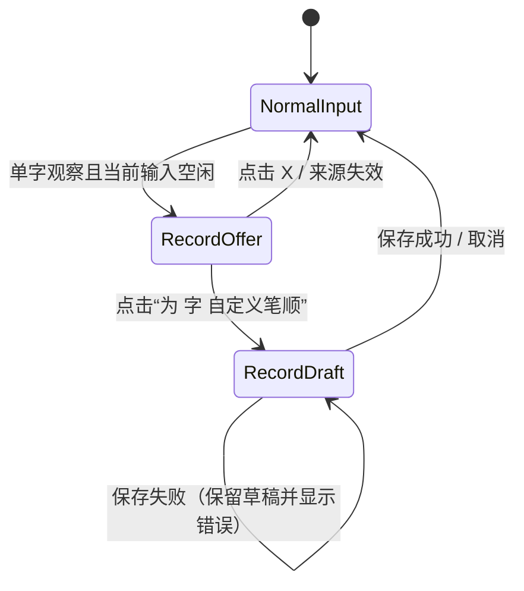
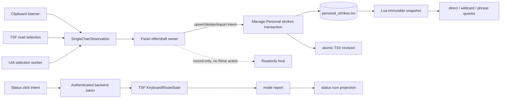

# 2026-10-18 19:38 个人笔顺双入口与独立记录实施架构

状态：`ready`

## 问题、范围与非目标

用户现在需要的是能实际使用的个人笔顺功能，而不是只显示入口：复制一个汉字后可在鼠标面板创建自己的笔画码；可靠时也可从系统选区得到同一入口；保存后的个人码必须参加单字前缀、`?` 通配和 `|` 分词查询。一个字保留一条当前个人记录，重复保存直接覆盖该个人记录，系统码始终并存且不被改写。设置页应能独立管理这些记录。

本轮实现范围还包含两个已暴露的状态按钮缺口：单击状态图标在中文与键盘英文间切换；Shift 切换中文与键盘英文；用户随后纠正了按键：大写锁定使用 Caps Lock，不使用 Tab。Caps Lock 开启时从中文或英文都直接进入 `A`，关闭后从 `A` 回到 `a`；输入法不模拟或改写系统 Caps Lock。Tab 保留宿主功能，面板不因此隐藏。

本轮实施范围：

- 新增个人笔顺文件、唯一写入事务、Rime 查询合并、设置管理页。
- 复制单字稳定入口、选区有限增强、offer/editor 及无可写宿主时的只读记录模式。
- 状态图标单击切换合同、Shift/Caps Lock 三态路由、Tab 宿主透传与状态逐层验证。
- 无可写焦点时保留极简面板；输入目标、候选投影和个人记录入口分别按能力启用。
- 已安装用户迁移、原子发布/热加载失败语义和发行物边界。

非目标：

- 不修改或生成系统码表，不覆盖个人短语、联想学习或既有学习记录。
- 不实现全系统无遗漏的选区监控，不申请 UIAccess，不读取密码/安全桌面/高完整性应用，不模拟 `Ctrl+C`，不写剪贴板。
- 不把个人笔顺扩展成通用别名框架；每个汉字只维护一条当前个人记录。
- 不改变鼠标中文、键盘英文分流；不把记录模式当成 Rime 输入目标。
- 不关闭用户应用，不随包发布本机研究资料或任何个人数据。

## 现状证据与参考资料

### 项目事实

- `.claw/truth/windows-stroke-input.md:21-37` 指定 TSF、鼠标面板、非激活窗口、会话鉴权和模式路由边界；`:43-49` 规定个人短语/联想数据归用户目录并与发行物隔离。当前 truth 还明确个人笔顺仅有设计、尚未实施。
- `rime/lua/bihua_matcher.lua:9-27,36-48` 初始化静态码表、短语和联想运行时；普通 `hspnz` 查询只读 `env.data.prefixes[input]`。个人码若只做 UI，实际输入不会命中。
- `rime/lua/bihua_phrase_runtime.lua:57-124` 分别处理 `|` 查询和单字 `?` 展开；两个路径当前都只消费静态前缀或现有短语索引。
- `rime/lua/bihua_phrase_query.lua:6-20,23-50,52-118` 定义最多四段、最多两个 `?` 的查询语法，并按每个字的规范码前缀建立短语索引。
- `rime/lua/bihua_phone_phrases.lua:5-65` 用静态首字前缀和尾字规范码扫描内置短语，并已有 120 次查找、20,000 行扫描、120 个结果的边界。
- `rime/lua/bihua_association_runtime.lua:225-245` 只把既定候选类型计为显式手动笔画选字；个人候选若新增 provenance，必须显式加入该白名单。
- `scripts/Manage-Personal.py:15-70,74-95` 已有整批解析、`.previous` 备份、原子写入和按文件加锁做法，但只管理短语/联想；`scripts/personal_data.py:18-61,75-77` 提供路径派生锁、`fsync + os.replace` 和汉字校验。
- `scripts/Settings-Panel.py:162-217,219-349` 已有读取、预览、部署、读回和回滚协调；`scripts/Native-Settings.py:17-18,331-398,524-568` 目前只有六页，个人词页可作为交互样式参考但不能成为个人笔顺第二个 writer。
- `scripts/Build-Release.py:11,34-56,121-128` 构建会显式打包脚本和 Rime Lua，并拒绝任何 `bihua_personal`/`.userdb` 进入发行物。`packaging/Install-Release.py:182-307` 用安装日志复制托管文件并在卸载时保留用户修改；新个人文件必须继续是不受安装器管理的用户数据。
- `native/BihuaMousePanel.h:14-56,146-190,341-349,520-576` 的窗口带 `WS_EX_NOACTIVATE`，状态图标已有独立 hit target，且按下、阈值拖动、松开点击有统一仲裁；当前状态 target 在松开时被映射成 `action=-1`，所以单击不会发出切换意图。
- `native/BihuaMousePanel.h:593` 起的 `DrawStatusIcon` 已把模式 `1` 画成 `a`、模式 `2` 画成 `A`，说明用户所见问题不能只靠改字形解决。
- `native/BihuaMouseBackend.h:14-83,111-143` 当前面板显隐依赖可写 Rime 目标，模式值来自 TSF 回传；普通鼠标动作必须通过目标校验。
- `native/BihuaKeyboardRoute.h:6-30` 定义 `Chinese/EnglishLower/EnglishUpper`，但当前 Shift/Tab 转换与用户确认的三态合同不完全一致；`native/BihuaMouseTSF.h:45-85` 负责将路由结果同步给鼠标后端。用户已复现“先 Shift 进入 `a`，按 Tab 后仍显示 `a`”，因此必须从按键枚举、TSF 回传、IPC 缓存到绘制逐层找出第一个偏差。
- `scripts/Patch-Mouse-Input.py:36-58,98-145,278-280` 定义已鉴权的鼠标 IPC、后端 profile 投影和原生头文件补丁入口；新增状态切换应沿用这一通路，不能让面板直接改投影。

GitNexus 当前没有该工作区索引；以上关系通过 `claw search` 发现 truth/设计锚点后，以 `rg` 和精读源码确认。

### 外部事实与推断边界

- 微软规定 `AddClipboardFormatListener` 通过 `WM_CLIPBOARDUPDATE` 通知变更；`GetClipboardSequenceNumber` 可去重，不应用轮询替代通知：[AddClipboardFormatListener](https://learn.microsoft.com/en-us/windows/win32/api/Winuser/nf-winuser-addclipboardformatlistener)、[GetClipboardSequenceNumber](https://learn.microsoft.com/en-us/windows/win32/api/winuser/nf-winuser-getclipboardsequencenumber)、[Using the Clipboard](https://learn.microsoft.com/en-us/windows/win32/dataxchg/using-the-clipboard)。
- UI Automation `TextPattern.GetSelection` 只能在 provider 支持时返回选区；事件也并非所有 provider 都完整发送，跨进程取文本有成本，密码元素不得读取：[TextPattern 概览](https://learn.microsoft.com/en-us/dotnet/framework/ui-automation/ui-automation-textpattern-overview)、[GetSelection](https://learn.microsoft.com/en-us/dotnet/api/system.windows.automation.textpattern.getselection?view=windowsdesktop-9.0)、[UIA 客户端事件](https://learn.microsoft.com/en-us/windows/win32/winauto/uiauto-eventsforclients)、[IsPassword](https://learn.microsoft.com/en-us/dotnet/api/system.windows.automation.automationelement.ispasswordproperty?view=windowsdesktop-10.0)。`TextPattern2.GetCaretRange` 只补充 caret，不能提高非空选区覆盖率：[GetCaretRange](https://learn.microsoft.com/en-us/windows/windows-app-sdk/api/winrt/microsoft.ui.xaml.automation.provider.itextprovider2.getcaretrange?view=windows-app-sdk-2.0)。
- TSF `ITfContext::GetSelection` 必须在有效只读 edit session 中调用；`ITfTextEditSink::OnEndEdit` 可借 `GetSelectionStatus` 判断选择变化：[GetSelection](https://learn.microsoft.com/en-us/windows/win32/api/msctf/nf-msctf-itfcontext-getselection)、[Edit Contexts](https://learn.microsoft.com/en-us/windows/win32/tsf/edit-contexts)、[OnEndEdit](https://learn.microsoft.com/en-us/windows/win32/api/msctf/nf-msctf-itftexteditsink-onendedit)、[Document Locks](https://learn.microsoft.com/en-us/windows/win32/tsf/document-locks)。
- 普通进程不能承诺读取高完整性窗口；UIAccess 需要签名和安全安装位置并扩大权限面，因此本功能不采用：[UIAccess/UIPI](https://learn.microsoft.com/en-us/previous-versions/windows/it-pro/windows-10/security/threat-protection/security-policy-settings/user-account-control-allow-uiaccess-applications-to-prompt-for-elevation-without-using-the-secure-desktop)。Chromium/Electron 的选区可见性取决于可访问性树和所带 Chromium/provider 行为：[Chromium Windows accessibility](https://new.chromium.org/developers/accessibility/windows-accessibility/)。

据此推断：复制入口可以稳定交付；选区入口只能声明“当前同完整性级别、provider 可用的 TSF/UIA 文本控件”有限覆盖。静态网页或只读文档在 UIA 能返回单字选区时可显示记录入口，但不能以此承诺所有浏览器、PDF、Canvas、远程桌面或 Electron 应用。

## 领域模型、术语、不变量与唯一 owner

| 概念 | 含义 | 唯一 owner | 只读投影/适配器 |
|---|---|---|---|
| 系统笔顺 | 随发行物生成的规范字码 | `bihua_local_data` 构建产物 | Rime Lua 查询 |
| 个人笔顺记录 | 用户为一个汉字保存的一条当前码 | 用户目录 `bihua_personal_strokes.tsv`，仅 `Manage-Personal.py` 写 | 设置页、面板、Lua 快照 |
| 个人笔顺快照 | Lua 从某一 TSV revision 全量验证后构建的不可变内存索引 | `bihua_personal_stroke_runtime.lua` | matcher/phrase runtime |
| 单字观察 | 来自 clipboard、TSF selection 或 UIA selection 的候选汉字及 source generation | 鼠标后端观察协调器 | offer 按钮 |
| 编辑草稿 | 正在录入但未保存的字符、码、来源、draft id | 鼠标后端 panel session | 面板 editor |
| 键盘模式 | 中文、英文 `a`、英文 `A` | 当前 TSF frontend 的 `KeyboardRouteState` | IPC profile、状态图标 |
| 模式租约 | 最近一个仍存活且确认笔画 profile 激活的 TSF frontend；不要求可写 edit context | 鼠标后端只维护租约身份，模式事实仍归该 TSF | 状态单击路由、最近权威投影 |
| 输入目标租约 | 当前可写、可接收 Rime edit action 的 TSF context | 鼠标后端鉴权 + 当前 TSF context | 笔画键、候选和在途 action |

不变量：

1. 系统笔顺只读；个人记录相同、不同或与系统码相同都可保存，两者并存。
2. 每个汉字最多一条个人记录；`upsert` 是幂等覆盖，已有记录按钮写“覆盖保存”并附短提示，点击即确认，不再弹第二层确认框。
3. 面板和设置页不直接写 TSV；所有写入、版本递增、验证和原子替换均由个人数据命令事务完成。个人记录变化不触发完整 Weasel deploy。
4. 个人码是查询别名，不取代短语行内的系统规范码，也不改变联想/短语学习的持久化格式。
5. 同字同一观察代际只出现一个 offer；clipboard 与 selection 只是来源标记，不创建两份草稿。
6. 有未完成笔画 composition 或在途选字时不弹 offer；空输入联想可以暂时让位给记录视图，底层候选不变且隐藏时不计曝光；进入草稿后新的 clipboard/selection 不能替换草稿。
7. 无可写 TSF 目标时，极简面板和记录视图仍可见，但候选必须清空、所有 Rime action 均禁用且后端拒绝投递。切换到其他输入法、锁屏或安全桌面时整个面板隐藏。
8. 状态图标只是 TSF 模式投影。单击只发“切换意图”；后端和面板不得先行伪造 `a/A/中文`，不得改变 CapsLock。
9. 阈值拖动进入 `Dragging` 后，松开不得触发状态切换、保存、输入或选字。

## 技术决策及原因

### 1. 个人记录采用独立、版本化 TSV，由现有个人数据命令独占写入

文件位于 Rime 用户目录，文件名 `bihua_personal_strokes.tsv`。首行是 `# bihua-personal-strokes-v1<TAB>revision`，`revision` 为从 1 开始的单调递增无符号整数；数据行是 `汉字<TAB>hspnz码`。字符必须是一个受支持汉字；码只允许 `hspnz`，长度 `1..52`；文件最多 20,000 条。文件顺序无业务语义，写回按 Unicode 排序，避免 UI 操作影响候选排序。最后一条删除后保留只有版本头的文件，不能用“文件消失”丢失变更代际。

`Manage-Personal.py` 新增 `strokes list/upsert/delete/import/export`。普通 `upsert` 覆盖同字，批量导入必须先解析全文件；批内重复键、非法行或超限使整批失败，不产生部分写入。每次实际内容变化在持锁期间将 revision 加一；相同 operation id 或相同最终内容返回幂等成功且不重复加一。复用 `personal_data.py` 的路径锁、临时文件、`fsync`、`os.replace` 和 `.previous`。这样设置页与面板不会形成两个 writer。

### 2. Lua 运行时在既有三个查询路径中合并个人别名

新增局部模块 `bihua_personal_stroke_runtime.lua`。每次相关 translator 查询先打开文件、只读第一行版本头并立即关闭；revision 未变时直接复用快照。revision 变化时才重新打开该次原子文件版本、全量读取和验证，并构建：

- `by_char[汉字] = 个人码`；
- `prefixes[前缀] = 排序后的汉字数组`；
- 查询辅助函数 `matches(char, pattern)`，以个人码或系统码任一匹配为真。

直接输入：`bihua_matcher.lua` 先返回个人前缀命中，再返回静态前缀命中，以字符去重；个人命中候选类型为 `bihua_personal_stroke`。同一字若个人码与系统码都命中，只出现一次且保留个人 provenance。个人命中按 Unicode 排序，随后保持现有系统顺序。

单字 `?`：`bihua_phrase_runtime.lua` 对每个现有通配展开同时查询个人和静态前缀，沿用总候选上限和去重。

`|` 分词：

- `bihua_phrase_query.Query.new(rows, aliases)` 在短语每个字位上，以系统规范码和该字当前个人码的所有前缀建立索引；`row.codes` 仍保存系统规范码。
- `bihua_phone_phrases.query(..., aliases, budget)` 的首段合并个人/静态前缀，尾段对实际字符使用“系统码或个人码”匹配，仍共享既有 120/20,000/120 预算。
- 短语学习、Memory 和导出继续写系统规范码，个人别名不会泄漏为第二种短语持久化格式。

`bihua_association_runtime.lua` 的显式笔画候选白名单加入 `bihua_personal_stroke`，使用户从个人码选字时沿用现有联想观察；不增加“别名学习”或额外权重。删除个人记录后，下一次相关查询发现新 revision 即不再命中该别名，系统码仍在。

个人短语的 `Query` 缓存同时记住其构建时的 personal revision；发现 runtime revision 改变时，只重建该个人别名索引。内置短语扫描直接消费新快照。这个机制只服务一个 TSV 和三个既有查询入口，不扩展成通用热刷新框架。

### 3. 原子替换与按版本热加载构成一个不中断输入的发布事务

面板和设置页调用同一命令：`Manage-Personal.py strokes <mutation> --json`。命令在单一文件锁内完成：读取旧字节和 revision、构造并全量验证新模型、写入带新 revision 的临时文件、`fsync`、`os.replace`、再读回校验。只有原子替换和读回都成功才返回 `applied`。个人保存不调用 `WeaselDeployer`，不重建 schema，不重启 Server/TSF，也不清除任何正在进行的 composition、候选或模式投影。

写临时文件或 replace 失败时旧文件保持不变，保留草稿并返回可重试错误。replace 后读回失败时，以新的原子替换恢复 `.previous`；恢复也失败则返回 `recovery_required`，UI 不得显示“已保存”。设置页只有在同时修改 schema/config 时才沿用原有完整 deploy；单独增删改个人笔顺永远走此局部路径。

Lua 在 revision 变化后用临时表全量构建；只有全部校验与个人短语别名索引重建成功才一次替换 last-good。加载失败时继续使用上一 revision，并设置显式 `bihua_personal_stroke_load_status` 与日志错误；fresh process 遇到非法文件则使用空快照并报告同一错误。失败 revision 记为 `rejected_revision`，后续查询只读版本头而不反复全量解析；更高的有效 revision 到来后才重试。不能部分接纳、静默按空文件成功或回写 TSV。

### 4. 复制入口稳定默认开启，选区入口是独立有限增强

Clipboard listener 归鼠标后端 UI window：注册 `AddClipboardFormatListener`，按 sequence 去重，只读取 `CF_UNICODETEXT` 且要求内容恰为一个汉字，不 trim。`OpenClipboard` 被短暂占用时，只对同一 sequence 做最多三次 50/100/200ms 定时重试；此后可见记录诊断并等待下一事件，不做全局轮询。

选区检测分两条局部适配：

- TSF frontend 在现有 context 上用只读 edit session 读取非空单字选区；它不复用要求“可写”的 `_MouseContext`，也不发 Rime action。
- 一个后端专用 MTA worker 订阅当前前台 UIA 文本 provider 的 selection/focus 事件，只读取当前前台 generation 的非密码、非空单字选区，再以不可变 observation `PostMessage` 回 UI 线程。跨进程调用不阻塞面板线程，超时/旧 generation 结果丢弃。

UIA 只覆盖同完整性级别、provider 正常的前台元素；不启用 UIAccess。选择增强使用独立设置开关，默认关闭；复制入口随鼠标面板默认可用并可关闭。若 UIA 的 Notepad/Edge 静态文本探针无法通过超时隔离和稳定去重验收，则本轮只启用 TSF 有限增强，保留代码开关关闭 UIA，复制仍是完整功能的稳定入口，不影响 `ready` 实施路径。

### 5. 面板存在性、模式能力与输入能力分离

后端引入三个明确的局部 panel state：`NormalInput`、`RecordOffer`、`RecordDraft`，不搭建通用页面框架。

不再用单一 `targetVisible` 同时决定窗口存在和输入能力，改为三个投影条件：

- `panelVisible`：功能开启、笔画输入法 profile 仍激活、当前桌面不是锁屏/安全桌面。它不要求可写 context；成立时至少显示状态图标和五个笔画键组成的极简面板。
- `inputEnabled`：存在当前可写输入目标租约。只有它成立时笔画键、候选、联想和 Rime action 可用。
- `recordVisible`：存在 offer 或 draft，且没有锁屏/安全桌面；不要求可写输入目标。clipboard offer 和保存中的草稿不会因焦点离开而消失，支持 UIA 的静态网页/只读文档也能显示记录视图。

可写目标失效时立即递增 input generation、撤销 pending action、清空旧 composition/candidates/association 投影并折叠为极简面板；已经投递但未消费的 token 由 target/generation 校验拒绝，绝不在下一目标重放。切到新可写目标后只从新 session 拉取候选。笔画键在 `inputEnabled=false` 时保留布局和拖动命中，但呈 disabled 且松开不发动作。

窗口仍 `WS_EX_NOACTIVATE`。记录态使用独立 callback，不包含候选 id 或 Rime action；即使 UI 错发，`_QueueMouseAction` 仍因没有可写 target 而拒绝。切换到其他输入法会撤销 profile/mode/input lease 并隐藏；锁屏、用户切换和安全桌面也隐藏且清除短生命周期观察，解锁后须由当前 profile 重新报告才能显示。

草稿带单调 `draft_id`。保存期间按钮禁用但草稿不消失；worker 完成后以 `draft_id` 回投，过期结果不得关闭新草稿。已有记录显示“覆盖保存”和“将覆盖个人记录；系统笔顺保持不变”的短提示；点击按钮即执行事务，不再弹确认框。

### 6. 状态单击由 TSF 确认，大小写来自系统 Caps Lock

用户最终纠正：大写键是 **Caps Lock**，Tab 保留宿主功能。状态单击继续复用点击/阈值拖动仲裁，只发送绑定当前活跃 frontend 的一次性切换意图，TSF 消费后更新路由并回报，面板不乐观改图标。

- Shift / 状态单击：中文进入英文；英文回中文。进入英文时按系统 Caps Lock 选择 `a/A`。
- Caps Lock 从关到开：中文或英文均进入 `A`，键盘字母直接交给宿主。
- Caps Lock 从开到关：若当前为 `A`，进入 `a`；之后 Shift 可回中文。
- Tab 与 Enter：交给宿主，不送进 Rime、不改候选；失去输入焦点也保留极简面板。
- TSF 只观察系统键盘队列的 Caps Lock 状态，不模拟该键、不修改实际锁定状态；测试仅在受控编辑器自己的键盘队列设置测试状态。

后端一次性 token 绑定 mode owner、面板语义/view generation 与 1500ms 时限；旧 owner、失活 profile、重复或超时消费均拒绝。模式切换不要求可写 edit context。TSF 是模式转换的唯一 owner，mode report 是图标更新依据。

路由与集成门禁覆盖 `C -> Caps Lock -> A -> Caps Lock -> a -> Shift -> C`、`C -> Shift -> a -> Caps Lock -> A`、Tab 透传且面板可见、状态单击、无可写目标单击与拖动不触发；同时检查新进程真正加载的 32/64 位 DLL。

## 协作合同：入口、状态变化、投影、失败与重试

### 个人记录命令

输入：`char`、规范化 `code`、operation id。`upsert` 对不存在记录创建，对已存在记录覆盖；重复 operation id 可返回同一最终结果，不能重复递增 revision 或累积记录。

成功：新 revision 已原子发布，返回 `{status:"applied", revision, char, code, replaced}`；Rime 在下一次相关查询按版本头惰性切换快照。失败：

- `invalid`：整批不写；调用方修正后可重试。
- `busy`：锁未取得，文件不变；指数退避后可重试，UI 保留草稿。
- `write_failed`：临时写入或原子替换失败，旧文件/快照不变；用户可重试。
- `readback_failed_rolled_back`：新文件读回失败，旧字节已原子恢复；用户可重试。
- `recovery_required`：replace 后读回失败且旧字节恢复也失败；设置页提供 `.previous` 恢复入口，面板保持草稿，不能宣称成功。
- `runtime_reload_failed`：文件已由唯一 writer 成功发布，但 Lua 在查询时拒绝该 revision；继续使用 last-good 并显式暴露加载错误。修复实现或用管理页写出更高的有效 revision 后自动重试，不能执行完整 deploy 掩盖错误。

### 观察与草稿

`SingleCharObservation {char, source, source_generation, foreground_id}` 进入后先按 `(char, foreground_id)` 去重。NormalInput 只有在无笔画 composition、无在途候选操作、无现存 draft 时才能变成 offer。offer 的 X 仅 dismiss 当前 generation；同一剪贴板 sequence 不再立即弹出。新复制/选区不写草稿、不改剪贴板。

可写焦点离开时 draft 保持在面板中，可继续编辑和保存个人记录；只有 Rime 输入能力转为 disabled。切换其他输入法或锁屏时 draft 暂停并随面板隐藏，返回笔画 profile 后恢复。draft 只有保存成功或明确取消才清除；进程退出前未保存 draft 不持久化，避免制造第二份个人记录事实。

### 状态切换

状态单击成功的唯一证明是 TSF 回传的新 mode；IPC 超时或 mode lease 变化时保持原图标并记录失败，不进行 UI 乐观更新。Shift/Caps Lock 与单击若并发，由 TSF 单线程路由顺序决定，回传的最后已提交状态获胜。Tab 不改模式并按宿主路径透传；Enter 继续宿主透传，鼠标键在有输入目标时继续中文 Rime 输入。

## 备选方案、取舍与重新评估条件

1. **直接修改系统码表。** 查询接入简单，但破坏系统码只读、发行可复现和卸载/升级边界，拒绝。
2. **让设置页和面板各写一份 JSON/TSV。** 短期省命令调用，却产生两个 writer 和版本竞态，拒绝。
3. **把个人记录编译成第二套 Rime schema。** 隔离清楚但会复制直接、通配、分词和学习链，且不符合“同一输入体验”，当前不采用。若未来一字需多套命名、同步账户或独立排序规则，再评估数据库/schema。
4. **只监控 UIA 选区。** 静态文本体验更直接，但 provider、权限和 Chromium/Electron 差异无法成为可靠入口，故复制为稳定入口，UIA 只作增强。
5. **状态按钮由后端直接切换缓存。** 响应快但形成第二份模式真相并可能与 TSF 分叉，拒绝。若未来模式迁出 TSF，再整体重定 owner，而不是双写。

无待用户决策的高影响事项。UIA 是否默认开启由兼容矩阵证据决定；当前推荐保持关闭，复制默认开启。

## 实施切片、迁移或兼容边界、验证证据

### 切片 1：个人数据事务与设置页

- 扩展 `Manage-Personal.py` 和 `personal_data.py`，增加带 revision 的 v1 TSV、全量校验、upsert/delete/import/export、原子替换、读回和恢复结果。
- `Settings-Panel.py` 加 strokes 状态/事务适配，`Native-Settings.py` 加“个人笔顺”页；展示字符、个人码、系统码只读参考、编辑/删除/导入/导出。
- 验证：新建、相同码覆盖、不同码覆盖、与系统码相同、批量重复键拒绝、并发锁、replace 失败、读回失败恢复及恢复失败可见。断言系统数据文件逐字节不变且没有调用 deployer。

### 切片 2：Rime 查询闭环

- 新增个人 runtime；接入 matcher、wildcard、个人短语索引和内置短语扫描；扩展 association 候选白名单。
- Lua 规格覆盖：直接完整码/前缀、`?`、四段 `|`、首/中/尾字符别名、系统与个人去重、revision 未变不重建、revision 变化一次性重建、非法新 revision 保留 last-good、删除恢复、预算上限、短语 Memory 仍保存系统规范码。
- 真实 Rime 验证：保留一段未完成 composition 保存个人码，composition/候选/模式均不变且下一次相关查询命中；删除后下一次查询个人路径消失；新 session 同样命中；已有候选学习权重不因保存动作改变。

### 切片 3：复制 offer/editor 与只读模式

- 在 backend UI window 加 clipboard listener、观察去重和三个 panel state；保存走 worker + draft id。
- E2E：Notepad 可写目标复制单字、点击 offer、笔画录入、保存、覆盖保存、X、拖动；composition 存在时不打断；保存松开不触发候选；失去可写焦点后极简面板/offer/draft 保持、旧候选清空且笔画键不发动作；静态只读来源中记录态从不发送 Rime action；面板不夺焦点；切换其他输入法和锁屏时隐藏。

### 切片 4：选区有限增强

- 先接 TSF 只读 selection；再以独立 MTA worker 接 UIA 前台 provider，受 feature flag 控制。
- 验证矩阵至少含：Notepad 编辑选区、Edge/Chrome 静态网页文本、只读文档、无 selection provider、密码框、管理员窗口、Electron。后四类失败须安静且不泄露文字；静态网页若 provider 返回单字，应出现 record-only offer。
- 若 UIA 调用不能被 worker 隔离或 Edge/Chrome 基线不稳定，则发布时关闭 UIA flag，只交付 TSF selection + clipboard，不宣传全局选区支持。

### 切片 5：状态单击与 A 投影修复

- 增加一次性 toggle intent IPC；让 TSF 成为唯一状态转换 owner；沿用 panel 的点击/拖动仲裁。
- 跑 `Chinese -> click -> a -> click -> Chinese`、`Chinese -> Caps Lock -> A -> Caps Lock -> a -> Shift -> Chinese`、`Chinese -> Shift -> a -> Caps Lock -> A`、Tab 宿主透传、无可写目标时状态单击、拖动状态图标、stale mode token、32/64 位宿主实测。
- 对“Tab 后仍显示 a”保存五层探针证据和实际修复层；没有 `mode=2` 全链路证据不得关闭缺陷。

### 迁移、发行与恢复

- 文件缺失等同无个人记录，不需迁移；首次保存才创建。旧版个人短语、联想和学习文件不改格式。
- 构建版本递增，发行物包含新 Lua/脚本/原生补丁，但持续断言不含 `bihua_personal_strokes.tsv`、`.previous`、个人词库、研究 profile 或用户学习数据库。
- 安装升级只替换托管程序文件；个人 TSV 位于用户目录且不进 receipt，卸载保留。安装失败沿既有 journal 回滚程序文件，不能删除个人 TSV。
- 下一次组件升级可在现有已提权的 machine helper 中增加一项窄清理：枚举 HKLM `Software\Microsoft\Windows\CurrentVersion\Run` 的 32/64 位视图，仅当某个值解析出的可执行文件规范路径**精确等于** `C:\Program Files\Rime\weasel-0.17.4\WeaselServer.exe` 时处理。先把 hive、view、值名、类型、原始数据和哈希写入安装事务备份，再删除该值；名称相同但路径不同、路径相同但含未知包装器/参数、无法解析、权限不足或已被第三方改动时一律不碰并报告。回滚仅在该值仍缺失时恢复原值；若已出现新值则停止，不能覆盖管理员或其他安装器的修改。
- HKLM Run 是整机共享入口，删除会影响所有用户，必须随现有 machine helper 触发 Windows UAC 并记入 receipt；用户拒绝 UAC 时本次升级继续保留该值并给出可复制的管理员手动清理说明。没有等价且可靠的 HKCU 删除可替代对 HKLM 的修改；不得通过写未文档化的 `StartupApproved` 二进制状态绕过。当前用户的 `BihuaWeasel` HKCU Run 和 `BihuaInputMethod` 计划任务只负责启动本包，不能冒充“已清掉”机器级旧入口。
- 该清理只防止下次登录再次启动原版 Server，不终止进程、不卸载原版、不关闭任何应用。已加载到应用进程中的旧 TSF DLL 不能靠重启 WeaselServer 卸载；升级验证应明确区分“后台已是当前版本”和“既有应用仍缓存旧前端”，后者只能等待应用自然退出/重新打开或用户注销，不能强制处理。
- 发布门禁：Python/Lua 单元规格、真实 Rime 热加载查询、面板交互探针、选择兼容矩阵、32/64 位状态路由、升级/卸载保留数据全部有证据；任一原子发布或加载错误在 UI/日志可见。

### 完成证据

实现者交付以下最小证据集即可证明合同：

1. 一条个人记录在 direct、prefix、`?`、个人短语 `|`、内置短语 `|` 五条路径命中，同时系统码仍命中。
2. 覆盖保存只原子替换个人 TSV 且不调用 deployer；相同码和系统同码均可保存；非法新 revision 后查询保持 last-good 并显示错误。
3. 复制单字能完成 offer→编辑→保存；当前 composition、候选选择、联想权重、宿主焦点均不受保存手势影响。
4. 静态 UIA 支持目标能打开 record-only editor，且没有可写 TSF target 时 Rime action 数为零；不支持目标安静退化到复制入口。
5. 状态按钮点击由 TSF 确认后切换；拖动不切换；Caps Lock 的同一代际路由、backend mode 与截图都为 `2/A`，实际字母大小写仍随系统状态。
6. 升级测试夹具中的精确旧 HKLM Run 值被备份并删除，非匹配值逐字节不变；UAC 取消、并发改值和回滚恢复均有结果，且测试全程不结束用户应用进程。

# 0.6.24 交付补充

用户最后确认：个人笔顺只增加编码，权重沿用原字，不额外置顶。普通查询合并个人与系统候选后按原分数排序；通配移除固定高分；静态分词头字沿用同一原字分数，个人词组的基础权重及学习键保持不变。系统码与个人码命中同字时仍去重。原字权重从标准笔顺相同长度的前缀获取；被索引截断时回查其完整码及较长前缀，没有系统记录时不加分。

自定义入口使用主题的候选高亮底色和高亮文字色，取消按钮保持低调。浅、深色和悬停已通过原生实际绘制验证；打开个人笔顺管理页会刷新刚保存的记录。

最终安装及本机发行版本为 0.6.24，保护前端仍为 0.5.11。实际升级及重复安装保留 6 份个人/研究数据，学习历史不倒退；唯一后台路径、无限运行时限、159 份受管文件哈希及源码一致性均通过。证据：`.verification/personal-weight-0624.json`、`highlight-0624.json`、`package-validation-0624.json`、`live-install-0.6.24.json`。未变化的前端交互沿用 `.verification/mouse-desktop-0623.json` 的 32/64 位实测；本次只重测相关排序和绘制路径，不宣称重新运行全部桌面用例。公开产物不含个人记录或商业研究资料。

