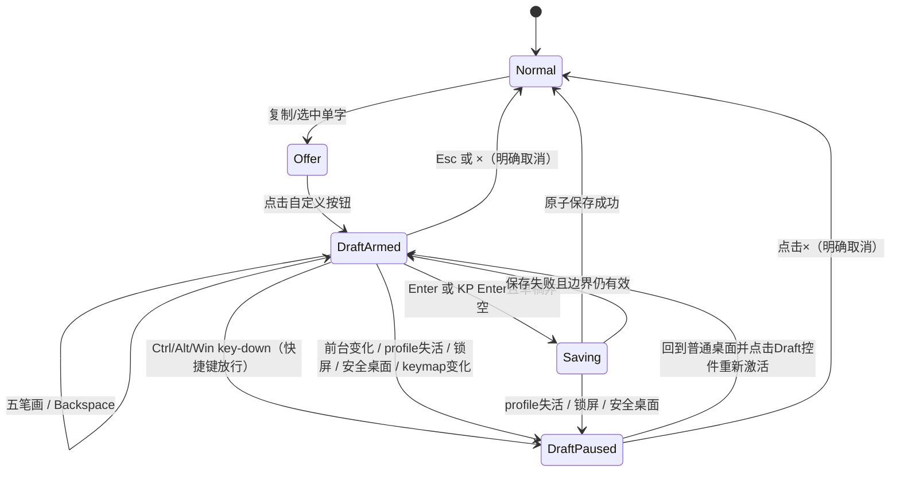
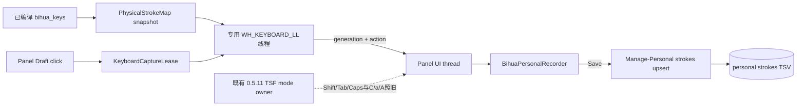

# 2026-10-18 21:15 个人笔顺键盘录入架构

交付补充：已实现并安装、本机发布 **0.6.25**，保护前端保留已发布的 **0.5.11** 原字节。实现限定在 `BihuaPersonalKeys.h`、面板及配置投影；TSF/IPC/KeyboardRoute 未增加协议。编译 schema 显式物化 Python 键位 owner 的默认值，实际后台只读编译结果，`.verification/personal-live-0625.json` 确认键位快照有效。入口最终为 `自定义「字」的笔顺`。

测试使用独立原生窗口和私有 Win32 hook 事件源，未捕获或注入用户实键，也未替换真实剪贴板。三种布局分别覆盖字母、小键盘 Num Lock 开/关，交错 C/a/A 视图；按下/重复/释放、52 笔、鼠标键盘交替、Backspace、两种 Enter、Esc、非法键/操作符、Shift/Tab/Caps 透传、Ctrl/前台/profile 暂停恢复及旧代消息丢弃均通过。证据 `.verification/personal-keyboard-0625.json`。跨应用物理键盘完整链路未完成实键验收，不将私有事件源冒称硬件 E2E。

测试发现并修正了两处生命周期细节：新租约等待捕获线程就绪后才显示可输入；上次未捕获区间收不到 key-up，因此重新安装 hook 时清空旧的未捕获 ledger，只在旧 hook 正排空已吞按键时保留配对状态。回归覆盖快捷键暂停、重新激活后同一物理键再次输入。

实际升级及重复安装、159 份受管文件与源码哈希、个人数据与学习历史保留均通过；旧 0.6.23/0.6.24 公开发行文件哈希未变。原字权重排序沿用已通过的 0.6.24 证据，本轮未改 Lua 权重。实际全新 Windows 首装、重启及安全桌面的手动测试仍未完成。原生密码 Edit、较高完整性前台及非 Default 桌面不启用捕获；不声称能发现所有第三方自绘密码控件。

状态：`ready`

## 问题、范围与非目标

个人笔顺 editor 已能用鼠标追加五种笔画、退格、保存与取消，但用户希望编辑时也能用当前字母键和数字小键盘绑定录入。这个追加功能必须覆盖无可写焦点、只读来源和键盘英文 `a/A` 状态，同时不能把编辑按键写入宿主正文，不能让面板取得焦点，也不能留下未释放按键或常驻全局 hook。

本轮范围：

- 个人笔顺 `Draft` 的物理键盘捕获、当前绑定投影、退格、Esc 和保存键。
- offer 入口固定显示为 `自定义「编」的笔顺` 这类格式，即 `自定义「当前单字」的笔顺`；使用中文直角引号，不使用双引号或方头括号。
- 草稿、前台应用、输入法 profile、锁屏/安全桌面之间的捕获租约。
- 鼠标点击与键盘录入复用同一草稿 owner、保存事务和失败语义。
- 下一发行版本的隔离边界；已安装并本机发布的 `0.6.24` 产物不得覆盖，已安装的 `0.5.11` 保护前端不得只因 editor 键盘录入而升级或重新注册。

非目标：

- 不改变普通 Rime 输入、候选选择、联想学习、个人码权重或系统码；不新增个人数据格式。
- 不把鼠标面板改成可激活编辑框，不使用 `SendInput`、焦点劫持或模拟按键。
- 不长期监控/记录键盘；不捕获密码、安全桌面、高权限应用输入，也不保存原始按键日志。
- 不改变中文/`a`/`A` 的现有 owner、Caps Lock 或宿主实际大小写。
- 不关闭用户应用，不新建 worktree，不修改 Claw 生命周期。

## 现状证据与参考资料

### 项目事实

- `.claw/truth/windows-stroke-input.md:15-18` 规定字母与小键盘分别支持预设/自定义七项绑定，查询前统一成 `hspnz`；系统码和学习记录不随键位变化。该 truth 的版本/部分显隐文字落后于当前代码，版本事实以 `scripts/Build-Release.py:11-14` 的 `0.6.24` 和当前源码为准。
- `.claw/truth/adr/0003-configurable-physical-key-normalization.md:7-13,21-25` 将绑定校验交给 `scripts/key_bindings.py`，将查询归一化交给 `bihua_query_keys.lua`，并要求按键释放/失焦重置临时状态。
- `scripts/key_bindings.py:4-28` 是七项绑定的校验 owner：五笔画、通配、分词；字母允许 A–Z，小键盘允许 1–9、`/`、`*`，同设备不得重复。
- `scripts/Settings-Panel.py:188-218,221-260,267-309` 从已编译 schema 读 `bihua_keys/letter` 与 `bihua_keys/keypad`，保存时写回并部署/读回。因此个人 editor 必须读取这组已编译配置，不能复制另一份键位文件。
- `rime/lua/bihua_query_keys.lua:4-18,33-67` 用同一 `bihua_keys/*` 配置把物理键映射为标准动作；它属于 Rime 查询链，不能替代无 Rime context 时的 editor 捕获。
- `native/BihuaPersonalRecorder.h:10-20,35-56` 已是 UI 线程草稿 owner；`Stroke(index)` 与 `Backspace()` 分别追加标准 `hspnz` 和删除最后一笔，最多 52 笔。`:62-90` 通过异步 `Manage-Personal.py strokes upsert` 保存，并以 `draft id` 忽略过期回执。
- `native/BihuaMousePanel.h:15-24,36-68` 的唯一面板是 `WS_EX_NOACTIVATE`；它不会获得常规键盘焦点。`:270-285` 已有 Draft 布局，`:382-397` 在无可写目标时仍允许个人记录控件，`:580-643` 将稳定短按映射到 recorder，拖动不会误触。
- `native/BihuaMousePanel.h:999` 当前 offer 已绘制为 `自定义「单字」的笔顺`；键盘录入实现不得回退成双引号、方头括号或笼统“自定义笔顺”。
- `native/BihuaMousePanel.h:460-481,645-653` 已有 UI 消息循环、150ms heartbeat 和销毁边界，但没有 editor 键盘消息或 hook 生命周期。
- `native/BihuaMouseBackend.h:3-28,38-55` 已以 Default input desktop、前台进程和 TSF profile lease 决定面板/输入能力；`:131-163` 使所有 Rime 动作继续要求有效目标。键盘草稿动作不能绕进这条 Rime 写入管线。
- `native/BihuaMouseTSF.h:106-163` 拥有鼠标模式的键盘三态与宿主透传；英文态直接把按键交给应用。个人草稿捕获必须先于宿主正文生效，但不得把模式事实移到后台。
- `packaging/Install-Release.py:159-170` 与 `native/BihuaProfileSetup.cpp:71-82` 都把已注册保护前端固定在 `%ProgramFiles%/BihuaInputMethod/0.5.11`，安装器还能按注册路径和 payload 哈希判断现有前端是否合格。因此本功能可以只更新后端，不需要新增 TSF 消息、替换前端 DLL 或触发 UAC。
- `scripts/Native-Settings.py:176-221` 已证明项目可用 `WH_KEYBOARD_LL` 做短生命周期按键录入，并在 Esc、失焦、错误设备和系统切换快捷键处结束/放行；连续草稿录入需要更严格的释放配对和前台代际合同，不能原样复制。
- `scripts/personal_strokes.py:7-16,56-108` 是个人记录唯一 writer，执行版本化 TSV 的锁、原子替换、读回和恢复；`scripts/Manage-Personal.py:74-113` 是现有命令入口。键盘与鼠标只改变同一内存草稿，不新增 writer。
- `native/MousePersonalProbe.cpp:32-74` 已覆盖无焦点面板、草稿、保存、覆盖、拖动和 profile 隐藏/恢复；新验证应扩展该探针，不另造一套假 recorder。
- `scripts/Build-Release.py:11-22,87-105,121-134` 当前写固定 `0.6.24` 目录和同名归档，创建目录时允许已存在；下一包必须换未占用版本，并在任何目标已存在时 fail closed。

GitNexus 当前未索引此工作区；以上关系是在 `claw search` 找到 truth/ADR 后以 `rg` 和逐段源码核对所得。

### Windows 官方事实

微软说明 `WH_KEYBOARD_LL` 会在键盘事件进入目标线程队列前回调，返回非零可以阻止事件继续送达；回调运行在安装 hook 的线程，该线程必须有消息循环，并应立即把工作交出，超时可能导致 hook 被系统静默移除：[LowLevelKeyboardProc](https://learn.microsoft.com/en-us/windows/win32/winmsg/lowlevelkeyboardproc)、[SetWindowsHookExW](https://learn.microsoft.com/en-us/windows/win32/api/winuser/nf-winuser-setwindowshookexw)。`KBDLLHOOKSTRUCT` 提供 `vkCode`、scan code、extended、injected 和 key-up 标志，可用于区分物理键、主 Enter/KP Enter、注入事件及成对释放：[KBDLLHOOKSTRUCT](https://learn.microsoft.com/en-us/windows/win32/api/winuser/ns-winuser-kbdllhookstruct)。

`WTSRegisterSessionNotification` 可让窗口接收本会话锁定/解锁通知，且销毁前必须反注册：[WTSRegisterSessionNotification](https://learn.microsoft.com/en-us/windows/win32/api/wtsapi32/nf-wtsapi32-wtsregistersessionnotification)。项目仍须以 `OpenInputDesktop == Default` 作为安全桌面第二道门禁。

由此得出：Raw Input 只能观察，不能可靠阻止正文收到按键；TSF key sink 又无法覆盖无 context/只读来源。仅在显式草稿期安装、快速回调并完整释放的 `WH_KEYBOARD_LL` 是满足本需求的最小路径。

## 领域模型、术语、不变量与唯一 owner

| 概念 | 含义 | 唯一 owner | 投影/适配器 |
|---|---|---|---|
| `PersonalStrokeDraft` | 当前字符、`hspnz` 草稿、draft id、busy/error | `BihuaPersonalRecorder` | 面板绘制、键盘动作 |
| `PhysicalStrokeMap` | 当前已编译字母/小键盘的五笔画键与保留操作键 | Rime 已编译 `bihua_keys/*` | 后端只读不可变快照 |
| `KeyboardCaptureLease` | 哪个 draft generation 可在何前台/桌面/profile 捕获键盘 | 新增局部 `BihuaPersonalKeyCapture` | panel hint |
| `PressedLedger` | 已被吞下的物理 key-down，等待对应 key-up | capture thread | drain-only 状态 |
| `PersonalEditAction` | `Stroke(0..4)`、`Backspace`、`Save`、`Cancel`、`Invalid` | capture 只归一化，recorder 执行 | `PostMessage` 到 UI 线程 |

不变量：

1. recorder 是草稿唯一 owner；鼠标与键盘都调用同一 `Stroke/Backspace/Save/Cancel`，不能各存一份 code。
2. `PhysicalStrokeMap` 只从当前编译配置生成；预设与自定义、字母与小键盘具有相同效力。通配/分词键不是个人笔顺，按下只提示，不写 `?`/`|`。
3. 捕获只在用户明确进入/恢复 Draft 后存在；Normal/Offer、profile 失活、前台改变、锁屏、安全桌面和进程销毁时均不接受新动作。
4. 被 capture 吞下的 key-down，其相同物理键 key-up 也必须吞下；动作每次物理按压最多执行一次，自动重复不能追加多笔或重复保存。
5. 未修改的宿主正文是失败不变性：editor 捕获的字母、数字、空格、标点、Backspace、Esc、Enter 不得进入宿主；Ctrl/Alt/Win 任一快捷键开始时立即暂停 editor 捕获，此后快捷键完整放行。
6. profile/前台/桌面边界只暂停捕获并保留草稿；只有保存成功或用户明确 Esc/× 取消才结束草稿。
7. 捕获不调用 Rime、不选择候选、不产生联想曝光/反馈，也不直接写中文/`a`/`A` 或 Caps Lock；被原样放行的 Shift、Tab、Caps Lock 可继续按既有 owner 语义改变模式。
8. 注入事件（`LLKHF_INJECTED`）不作为个人笔顺输入，也不写日志；本功能只承诺物理键盘。

## 技术决策及每项决策的原因

### 1. 使用专用低级键盘捕获线程，而不是让面板取焦点

新增一个只服务个人 Draft 的 `BihuaPersonalKeyCapture`。它在专用线程创建消息循环并安装 `WH_KEYBOARD_LL`，hook callback 只做四件事：读取不可变 lease/map、检查边界、维护 pressed ledger、`PostMessage` 一个小的 `{generation, action}`；不得加锁等待、读文件、写 TSV、调用 Rime 或执行保存。UI 线程收到消息后再次核对 draft generation，再调用 recorder。

专用线程避免低级 hook 阻塞 Server 主 UI/Rime 串行区，也符合微软的快速回调要求。它不是通用快捷键框架：生命周期只由 `RecordDraft` 驱动，动作集合固定为五笔画和四个 editor 命令。

该 helper 完全位于后端 `WeaselServer`/面板进程内。本轮不修改 `native/BihuaMouseTSF.h`、`native/BihuaKeyboardRoute.h`、Weasel IPC 命令或 TSF DLL；也不增加 `capture_active` 之类的前后端投影。已安装 `0.5.11` 保护前端继续提供现有 C/a/A、Shift、Tab、Caps Lock 路由，键盘 editor 的可用性不依赖应用重新加载 TSF。

### 2. 当前键位来自已编译 schema，同一快照内同时支持字母与小键盘

后台在既有配置加载点读取：

- `bihua_keys/letter/{h,s,p,n,z}`；
- `bihua_keys/keypad/{h,s,p,n,z}`。

下一版本构建时先把 `key_bindings.py` 的标准默认值显式物化进生成的 `bihua_mvp.schema.yaml`；用户 custom patch 仍可覆盖。后台从当前活动 schema 的已编译 `bihua_keys/*` 读取后，按与 `scripts/key_bindings.py` 相同的设备范围和唯一性校验，生成不可变 map 与 `keymap_revision`。这样默认用户与自定义用户都只有一份运行时事实，C++ 不复制一份默认表。

Draft 显示实际提示，例如“横 H / 小键盘 1；竖 S / 2 … · Backspace 删除 · Enter 保存 · Esc 取消”。配置缺失/非法时不猜默认值，键盘捕获标为不可用，鼠标编辑仍可用并显示错误。

小键盘用 `(scanCode, extended)` 归一化成 `KP_1..KP_9/KP_Divide/KP_Multiply`，验证 Num Lock 开/关；主键盘数字不能冒充小键盘。主 Enter 与 extended KP Enter 都映射 Save。Shift 不改变字母绑定含义。

设置部署导致 `keymap_revision` 变化时，现有 lease 转为 Paused，先排空已吞按键，再要求用户点击 Draft 重新激活，不能在一次按压中途切 map。

### 3. Draft 是一个显式、可暂停的模态键盘编辑区

进入 Draft 时记录 `draft_id + keymap_revision + foreground HWND/PID/thread + profile lease + desktop generation`。无可写焦点、只读控件和键盘 `a/A` 不使 lease 失效，因此静态网页/只读文档中也可录入。若前台窗口改变，hook 对新窗口的第一枚按键直接放行并异步把 Draft 转为 Paused；它不能在用户切到别的软件后继续吞正文。面板和草稿仍常驻，用户点击任一 Draft 控件或草稿提示区即可对新前台显式重新激活。当前前台高于 Server 完整性级别，或 TSF/UIA 明确报告密码输入 scope 时拒绝 arm；普通完整性进程不尝试越过 UIPI。

切换其他输入法时 panel 隐藏、capture Paused、草稿保留；恢复本输入法后显示 Paused，不能自动重新吞键。`WTS_SESSION_LOCK`、非 Default input desktop 或安全桌面使 hook 立即转 drain/unhook 并隐藏；解锁后也必须显式重新激活。

### 4. 键义固定、反馈明确

| 物理键 | Draft 行为 | 宿主行为 |
|---|---|---|
| 当前字母/小键盘五笔画绑定 | 追加对应 `h/s/p/n/z`；52 笔满时提示 | down/up 均不送宿主 |
| 当前通配/分词绑定 | 提示“个人笔顺只支持五种笔画”，草稿不变 | down/up 均不送宿主 |
| Backspace | 非空删一笔；空草稿无变化 | 不删除正文 |
| Esc | 明确取消未保存 Draft，等同 × | 不关闭/修改宿主 |
| Return、KP Enter | 非空保存；空草稿提示“请先输入笔画” | 不换行、不提交宿主/Rime |
| 其他无 Ctrl/Alt/Win 的可打印键（字母、数字、空格、OEM 标点、小键盘字符） | 提示“该键未绑定笔画” | 不写入正文 |
| Shift+当前字母绑定 | 按物理字母追加笔画，Shift 本身不属于 editor | 字母 down/up 不送宿主；Shift 原样交给既有模式 owner |
| Shift、Tab、Caps Lock | 不属于 editor | 原样交给现有 TSF/系统语义，允许既有 C/a/A 状态变化 |
| Ctrl/Alt/Win 任一 key-down | Draft 保留，capture 转 Paused；鼠标继续可编辑 | 修饰键及其后续快捷键完整交给系统/宿主 |
| 功能键、方向键 | 不属于 editor | 完整交给系统/宿主 |

Shift+字母仍按物理字母绑定处理，字母 down/up 成对吞下，Shift down/up 原样交给既有 owner。现有 owner 因此可能按既有独立 Shift 语义切换 C/a/A；这是模式自身的正常结果，不影响 recorder 中已经追加的标准笔画。capture 既不阻止也不伪造这一模式变化，因而无需 TSF 新协议或第二份模式状态。Tab、Caps Lock 同样完全沿用现有语义；editor 的五笔画、Backspace、Enter、Esc 与当前 C/a/A 无关。

Ctrl/Alt/Win 任一 key-down 到达时，capture 立即停止接受新的 editor down、保留草稿并转 Paused；该修饰键及随后按键全部放行，保留 Win+Space、Alt+Shift、Alt+Tab、Ctrl 快捷键。若此刻已有被吞下的 editor key-down，其匹配 key-up 仍由 pressed ledger 吞下，不能把半个按压泄漏给宿主；除此之外不维护通用 chord 状态，也不合成按键。用户可继续用鼠标编辑，点击 Draft 控件才重新 arm 键盘。hook 必须按自身看到的修饰 key-down 判断，不能依赖回调发生前尚未更新的 `GetAsyncKeyState`。

### 5. 释放配对采用 drain-only，而不是模拟 key-up

Pressed ledger 以 `(scanCode, extended)` 为身份。首个合格 down 决定“捕获或放行”；重复 down 沿用决定但不重复发动作；up 必须沿用该 down 的决定。Save/Esc、foreground/profile/keymap 变化时先停止接受新 editor down，进入 drain-only，等已捕获按键全部 up 后卸载 hook。

若锁屏/安全桌面或进程销毁无法等待，立即卸载并清空 ledger；不合成 key-up。超时清理只移除 hook 和本地状态，不能向宿主注入事件。hook 安装失败或捕获线程异常必须把 Draft 置 Paused 并显示“键盘录入不可用，可继续用鼠标”，不能假装正在保护正文。Windows 对超时后静默移除 hook 没有健康查询 API，因此 callback 必须保持常数时间，压力测试中任何超时都作为发布阻断，不能依靠轮询伪称已检测。

### 6. 保存继续走既有个人记录事务

键盘 Enter 只调用现有 `BihuaPersonalRecorder::Save()`。busy 期间 editor 键、Backspace、Esc、Enter 都被吞下但不产生新动作，系统快捷键继续放行；保存成功后 Normal，失败保留同一草稿与错误。不得为了键盘功能调用完整 deploy、重置 composition 或新增 TSV writer。

## 协作合同：入口、状态变化、事件或投影、失败与重试语义

### 捕获入口

`ArmCapture(draft_id, keymap_revision, foreground, profile_lease, desktop_generation)` 只有在 Draft、非 busy、profile active、Default desktop、本会话未锁定时成功。成功返回 capture generation；失败保留 Draft/正文/个人文件并给可见原因。重复 arm 同一组参数幂等。

### 动作投递

`CapturedAction {capture_generation, physical_id, action}` 仅由 UI 线程消费。generation 不同、Draft 已结束/busy、map 已变时丢弃且不重放。`Invalid` 只更新 editor 提示；不得弹系统对话框或写日志中的原按键文本。

### 暂停与恢复

`Pause(reason)` 保留字符、code、draft id 和保存错误并 drain hook。前台变化的那枚按键属于新前台，必须放行；Ctrl/Alt/Win 开始的快捷键也先暂停再完整放行。暂停后鼠标仍可编辑；只有明确点击 Draft 才重新 arm。profile/锁屏恢复不能自动 arm。

### 失败语义

- `hook_install_failed/capture_thread_failed`：保持 Draft，鼠标仍可编辑/保存；所有未捕获键正常交宿主，UI 明确警告键盘不受保护。
- `stale_generation`：不改草稿，不向新目标重放。
- `save_failed`：保留草稿和 capture 状态；Enter release 完成后允许重试。
- `profile_inactive/secure_desktop/session_locked`：隐藏或暂停，个人 TSV 和宿主正文均不变。

## 备选方案、取舍与重新评估条件

1. **让无激活面板接收 `WM_KEYDOWN`。** 无焦点时收不到，无法满足只读/无焦点，拒绝。
2. **只在 TSF `_RouteMouseKey` 捕获。** 可复用键盘路由，但无 TSF context、静态网页和部分只读控件覆盖不足，英文透传也易泄漏，拒绝作为唯一入口。
3. **Raw Input。** 异步观察适合统计，但不能阻止字符进入宿主正文，拒绝。
4. **长期全局 hook。** 覆盖最广却扩大隐私与故障面，拒绝；仅 Draft lease 期间安装。
5. **复制 `key_bindings.py` 默认表到 C++。** 会让自定义绑定产生第二真值，拒绝；只读编译配置。

重新评估条件：若未来面板拥有真正可访问的独立编辑窗口且用户接受显式焦点切换，可删除全局 hook，改用窗口键盘事件；当前“不抢焦点”约束下不采用。

无待用户决定的高影响事项。

## 实施切片、迁移或兼容边界、验证证据

### 切片 1：键位快照与 recorder 动作

- 在后端现有配置加载点读取/校验五笔画和通配/分词的字母、小键盘绑定，生成 revision；面板显示实际键帽提示。
- 给 recorder 增加单一 `ApplyPersonalEditAction` 入口，鼠标与键盘复用；保持现有 52 笔、draft id、异步保存。
- 单元证据：标准、替代、自定义三组键位均映射同一 `hspnz`；非法 map 明确禁用，不猜默认。

### 切片 2：短生命周期捕获与释放

- 新增专用 hook 线程、不可变 lease、pressed ledger、UI `PostMessage`；面板销毁、Esc、保存、profile/前台/keymap 变化全走统一 Pause/Drain。
- 实现限定在后端，不改 TSF/IPC/保护前端；Shift、Tab、Caps Lock 走原路，Ctrl/Alt/Win key-down 使 capture Paused，Draft 点击恢复。
- 探针覆盖 keydown/重复/keyup、两种 Enter、Shift+绑定字母、Num Lock 开关、注入事件、空 Backspace/空 Enter、52 笔边界。
- 断言被捕获按键在宿主测试编辑框的 down/char/up 计数均为零；放行快捷键三者都到达宿主；不使用 `SendInput`。

### 切片 3：真实边界 E2E

- 可写 Notepad：中文、`a`、`A` 三态录入，正文逐字节不变；鼠标/键盘交替编辑并只保存一条个人记录。
- 无焦点和只读：静态网页/只读 probe 中点击 offer 后可键入笔顺并保存，Rime action/候选/联想反馈计数为零。
- 前台切换：第一枚新应用按键放行、Draft 变 Paused；返回或重新激活 profile 不自动吞键，点击 Draft 后恢复。
- Win+Space、Alt+Shift、Alt+Tab、Ctrl+S 放行；切换其他输入法面板隐藏、draft 保留；锁屏/安全桌面不显示且 hook 不活动，解锁后需点击恢复。
- Shift、Tab、Caps Lock 仍由现有 owner 改变 C/a/A；这些变化不结束或损坏 Draft，且无需前端协议更新。Ctrl/Alt/Win 快捷键开始后键盘 capture 显示 Paused，鼠标可继续编辑，点击 Draft 后恢复。
- hook 安装失败和模拟 unhealthy 可见退化为鼠标；退出 Server 后系统 hook 句柄为零，无按键释放悬挂。

### 兼容、数据与发行边界

- 不迁移 `bihua_personal_strokes.tsv`，不改变 revision/schema；系统码、个人码、个人短语和学习数据原样保留。
- 键盘 editor 只更新后端；正常升级不得替换或重新注册 `%ProgramFiles%/BihuaInputMethod/0.5.11` 的 `bihua32.dll`/`bihua64.dll`，不得因此请求 UAC，也不要求关闭或重启宿主应用。新 payload 应复制已发布的 canonical `0.5.11` 前端二进制并固定其哈希，不能只因同包重编译产生不同 DLL；安装器再按既有注册路径和 payload 哈希确认，合格即跳过 machine helper。不合格属于独立安装修复，不得伪装成本功能的普通升级步骤。
- 功能关闭、hook 安装失败或后端尚未更新时，鼠标 editor、既有 C/a/A 路由和已保存个人码继续工作；键盘捕获不可用必须可见，不能吞正文。
- 下一包使用严格大于 `0.6.24` 且尚未占用的版本。构建开始前同时检查 `.verification/release/<version>`、`dist/BihuaInput-<version>-source.zip`、setup、release 目录/zip；任一存在即停止，不复用、不删除、不覆盖。`0.6.24` 的 payload、安装包、归档和本机发布目录只读保留。
- 新包继续排除用户 TSV、`.previous`、学习数据库和本机研究资料；安装/回滚不得清理 Draft 之外的个人数据，也不强制关闭应用。

### 完成证据

1. 当前两套预设和一套自定义字母/小键盘映射都能从空 Draft 得到相同标准码；Num Lock 两态结果明确。
2. Backspace、Esc、Return/KP Enter 的草稿及宿主效果符合表格，自动重复不重复动作，down/up 成对吞放。
3. 在中文、`a`、`A`、可写、无焦点、只读六个组合中，个人草稿可录入，宿主正文、Rime composition、候选和学习记录不变；只有被放行的 Shift、Tab、Caps Lock 可按既有规则改变模式。
4. 前台/profile/锁屏/安全桌面边界只暂停并保留草稿；系统快捷键放行，恢复不自动吞键。
5. 保存仍由现有原子 writer 完成，系统码与原字权重不变；发布校验确认全部 `0.6.24` 产物哈希不变、新版本写入独立路径，并确认注册的 `0.5.11` 前端路径和 DLL 哈希不变且正常升级未请求 UAC。

