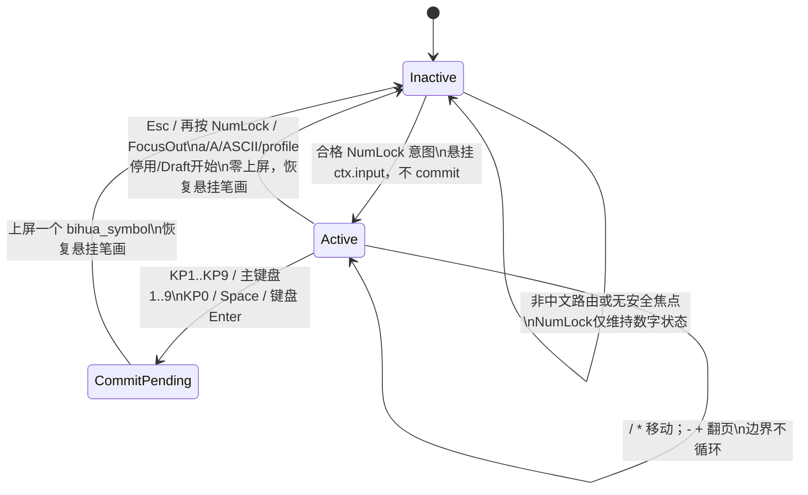
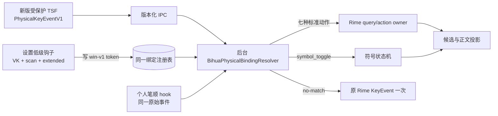
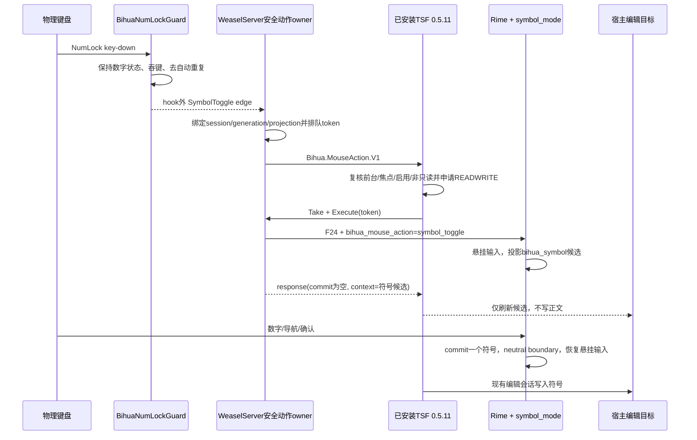

# 2026-10-20-2143-Num-Lock符号与通用按键绑定架构

**状态：ready**

**开放决策：无。** 现有证据足以选择后端复用安全动作管线、Rime 拥有符号模式，以及版本化 Windows 物理事件协议与单一 resolver。默认符号表和中风险兼容选择可按本文落地，不需要中途请求产品决策；杂牌 Fn 是否也进入真实 TSF 宿主属于设备验收边界，不是设计选项。

## 问题、范围与非目标

当前 0.6.29 把 Num Lock 锁定在数字状态，并吞掉物理 Num Lock 按键，避免小键盘数字变成方向键。用户希望把已经被吞掉的 Num Lock 键改成“常用符号”入口：按 Num Lock 打开符号候选，数字选符号，`/`、`*` 移动候选，`−`、`+` 翻页；选完回到笔画输入。Esc 或再次按 Num Lock 取消，保留尚未上屏的笔画，进入符号区不得隐式确认首字。

本设计覆盖：Num Lock 物理按下到安全 Rime 动作的路由；符号模式状态、候选投影与恢复；数字、导航、翻页、KP0/Space/Enter 的语义；中文／a／A、鼠标模式、失焦、只读目标、个人笔顺 Draft、联想反馈和字符／词组学习的边界；后端与受保护 TSF 的兼容结论；以及把现有“字母区／小键盘区白名单”改为 Windows 真实物理键事件绑定的合同。后者必须同时覆盖普通键、可被 Windows 识别的杂牌键盘 Fn、未知 VK、扫描码、extended 位、左右修饰键、内置键优先级、跨组冲突和旧配置迁移，不能用扩大几个 F 键枚举代替。

本设计不修改运行时代码，不安装或更新输入法，不操作用户键盘、剪贴板或个人资料，不改变微信基础数据、标准笔画码、个人词库、个人笔顺或联想存储格式。小键盘点作为默认分词，以及 `/`、`*` 作为左右选字，属于当前工作区中的另一实施切片，本设计只规定符号模式与其兼容合同。Fn 仍只是可选硬件入口，输入法的打字和符号能力不得依赖它；但用户已经证明该杂牌键盘的 Fn 能被设置窗口的 Windows 低级键盘钩子看到，所以通用绑定必须保存并匹配该真实事件，而不是因为它不在现有枚举内拒绝。无法由 Windows 作为键盘事件上报的固件层 Fn、Consumer HID／`WM_APPCOMMAND` 或按设备区分同一扫描码，仍不在此合同可保证的范围内。

## 现状证据与参考资料

### 已接受的项目合同

- 物理键必须先归一化为标准动作，词典编码和学习数据不随键位风格变化；原 ADR 还规定临时选字状态必须在释放和 FocusOut 后清理（`.claw/truth/adr/0003-configurable-physical-key-normalization.md:5-13`）。
- 鼠标动作已有会话、焦点代次、语义投影、候选身份、单在途、3 秒过期和至多一次合同。TSF 前端领取 token 后申请读写 edit session，再核对前台、焦点、输入法、键盘开启、只读状态和上下文；失败结束、不重放、不得用 SendInput 补写正文（`.claw/truth/adr/0004-persistent-mouse-panel-and-tsf-actions.md:21-23`）。
- 鼠标模式两种 Enter 在四个 TSF 入口直接透传宿主；键盘模式 Return/KPEnter 确认后结束本轮联想。这个差异是既有产品合同（`.claw/truth/adr/0004-persistent-mouse-panel-and-tsf-actions.md:9`、`:66-68`）。
- 显式字符选择、词组 Memory、联想反馈是三条不同的个人数据路径；只有对应候选类型和显式选择才能学习。已展示未选的联想才可能扣分，中性边界不得扣分（`.claw/truth/adr/0001-personal-learning-and-local-profile-boundaries.md:5-11`）。基础微信快照由锁文件固定，升级保留个人资料（同文档 `:15-17`）。

### 当前源码与工作区事实

- `native/BihuaNumLock.h:8-20` 的纯策略以按下／抬起 ledger 抑制自动重复；`:23-98` 的后台低级钩子只处理 Num Lock，在有效前台租约中保持数字状态、吞掉真实按键并恢复进入前的系统状态。钩子明确禁止在回调中调用 Rime、文件或 UI 锁。
- `native/BihuaMouseBackend.h:116-126` 依据活动 profile、前台 PID／输入线程、焦点 HWND 和普通完整性桌面发布 Num Lock 租约。当前保护独立于鼠标面板设置。
- `native/BihuaMouseState.h:4-43` 已拥有一个绑定会话、焦点代次、语义投影、过期时间和至多一次执行的 pending intent。`native/BihuaMouseBackend.h:155-187` 负责排队并唤醒对应 TSF 目标，`:246-276` 在执行前复核 token，然后才进入 Rime API 串行区。
- `native/BihuaMouseTSF.h:165-213` 表明前端对动作具体类型不知情：它只领取 token、申请 `TF_ES_READWRITE`、取得可写 range、请求后台执行、读取响应并写 commit。因此新增后台符号动作可复用 `Bihua.MouseAction.V1`，不需要新增 IPC 消息或前端分支。
- `rime/lua/bihua_query_keys.lua:27-85` 是物理小键盘归一化 owner；`:91-110` 已有 F24 内部语义动作入口。当前工作区还在把 KPDecimal 改为默认分词，并让未绑定的 `/`、`*` 发送 Up/Down；这些是未提交事实，不能描述为已发布行为。
- `rime/lua/bihua_character_learning.lua:22-38` 只学习 `bihua_direct`、`bihua_wildcard`、`bihua_personal_stroke` 单字；`rime/lua/bihua_phrase_runtime.lua:44-56` 只学习 `bihua_phrase`。新候选类型 `bihua_symbol` 可天然避开两条 Memory 写入。
- `rime/lua/bihua_association_runtime.lua:206-261` 对其他 commit 默认结束关联并保存状态；为了证明符号不会造成 +1／−1 或“手输字”观察，仍需加入显式的 neutral-symbol 分支，而不能只依赖候选类型偶然落入兜底。
- `native/BihuaFocusBoundary.h:3-19` 当前在 FocusOut 设置按键重置和联想中性边界，只清理预测菜单；符号模式需要在这里增加“取消并恢复悬挂笔画”的内部边界。
- `scripts/Native-Settings.py:176-223` 使用 `WH_KEYBOARD_LL`，说明设置窗口确实可以看到 `vkCode`、`scanCode`、extended 和 injected flags；但 `:197-218` 先调用 `physical_vk` 把事件压成一个 VK，再只允许字母或 KP1–9、`/`、`*`、`.`。用户所见的“识别但不允许指定”正发生在这里。
- `scripts/key_bindings.py:11-16` 只把少数非 extended 小键盘扫描码折成 `VK_NUMPAD*`；`:27-39` 再按 `letter`／`keypad` 两套正向白名单验证。当前配置值只是 Rime 键名字符串，无法表达未知 VK、同 VK 不同扫描码或左右物理键身份。
- `settings/app.js:14-16` 的 Web fallback 仍生成固定字母／小键盘 `<select>` 并直接提交旧字符串；它不能继续作为第二个较弱的写入口，否则原生设置可保存的 Fn 会被 Web 页面覆盖回白名单值。
- `native/BihuaPersonalKeys.h:9-51` 又实现了一份只读字母／小键盘白名单和 VK 比较，个人笔顺录入与设置窗口并非同一解析 owner；其 hook ledger 在 `:111-123` 已使用 `(scanCode, extended)` 配对按下／抬起，证明运行时其实拿得到更精确身份。
- `vendor/weasel/WeaselTSF/KeyEvent.cpp:4-58` 将 TSF 的 `(VK, lParam, keyboard state)` 转成 Rime `KeyEvent`；`:61-253` 显式映射 Enter／KPEnter、左右 Shift／Ctrl／Alt、Caps、Esc、小键盘、F1–F24 和 NumLock，未知 VK 只有 `ToUnicodeEx` 成功才有结果。`vendor/weasel/include/KeyEvent.h:3-25` 的输入 `KeyInfo` 有 8 位扫描码和 extended，但 IPC 中的 `KeyEvent` 只剩 16 位 keycode 与 16 位 mask。
- `vendor/weasel/WeaselIPC/WeaselClientImpl.cpp:58-64` 把这 32 位 `KeyEvent` 作为 `WEASEL_IPC_PROCESS_KEY_EVENT` 的 `wParam` 发送；`vendor/weasel/include/WeaselIPC.h:48-52` 的 `PipeMessage` 只有 command、`DWORD wParam`、`DWORD lParam`，后者已用于 session id；`vendor/weasel/WeaselIPCServer/WeaselServerImpl.cpp:248` 只从 `wParam` 重建 Rime 事件。因此后端目前不可能恢复已经丢失的原始 VK／scan／extended。

### 已安装、HEAD、未提交与公开发布的区别

2026-10-20 只读核对显示，正在运行的后台是 `%LOCALAPPDATA%/BihuaWeasel/0.6.29/WeaselServer.exe`，受保护前端目录仍有 0.5.11。安装目录中的 `bihua_query_keys.lua`、`key_bindings.py`、`Native-Settings.py` 分别与 HEAD blob `35707f4f…`、`2d6fdccc…`、`f3342647…` 完全一致；工作区对应 blob 已变为 `631576b…`、`0eb00ade…`、`b2ca2456…`，所以点分词、`/`／`*` 导航和通用按键绑定都尚未进入当前安装。HEAD `f9c88f4` 已包含空闲数字直选、Num Lock 保护和字符学习。GitHub 的 v0.6.29 仍是未发布 draft；当前可公开取得的是 [v0.6.28 测试版](https://github.com/chanyuenpang/bihua-input/releases/tag/v0.6.28)。Truth 中仍写“当前后台 0.6.28”，已被本次只读现场证据超越，后续 closeout 应更新 Truth，但本设计不改 Truth。

`claw search` 成功找到上述 Truth/ADR。GitNexus 的索引列表没有本仓库，因此调用链由 `rg`、逐文件精读、`git diff` 和安装文件 blob 对比建立；没有把其他仓库索引结果当作本项目证据。

## 领域模型、术语、不变量与唯一 owner

### 术语与 owner

| 术语 | 含义 | 唯一 owner |
|---|---|---|
| Num Lock 数字租约 | 本输入法活动且前台焦点合格时，把系统 Num Lock 保持在数字状态；离开后恢复进入前状态 | `BihuaNumLockGuard` |
| 符号切换意图 | 一次合格的物理 Num Lock 首次按下；自动重复不产生第二次意图 | `BihuaNumLockGuard` 的 ledger，后台只消费边沿 |
| 安全动作 | 与当前 Rime 会话、焦点代次和语义投影绑定、单在途、过期、至多一次的语义 mutation | 现有 `BihuaMouseState`／`RimeWithWeaselHandler`；不另建第二队列 |
| 符号模式 | `inactive`、`active`、`commit-pending` 三态，以及悬挂输入、恢复种类和当前符号候选 | 新的 `rime/lua/bihua_symbol_mode.lua`，状态仅在当前 Rime session 内 |
| 悬挂输入 | 进入符号模式前尚未上屏的原始 `ctx.input`；不是第二份可编辑笔画 | `bihua_symbol_mode` 临时快照；active 期间只读，退出后一次性归还 Rime context |
| 符号目录 | 固定顺序、固定文本的常用符号内容 | schema 的 `bihua_symbols/items`；Lua 只读投影 |
| 符号候选 | 类型为 `bihua_symbol` 的 Rime Candidate | `bihua_symbol_mode` 生成，Rime menu 为唯一候选真相 |
| 学习边界 | 符号不会写字符 Memory、词组 Memory 或联想分数；成功上屏形成中性关联边界 | 各既有学习 owner 显式识别 `bihua_symbol` |
| 物理键身份 `PhysicalKeyId` | Windows 实际上报的不可变身份；正常形态为 `(scanCode, extended)`，保存 `vkCode` 作诊断与 scan=0 回退。它不是显示名称，也不是 Rime 键名 | 新的共享 `BihuaPhysicalKey` 合同；设置、TSF 和个人笔顺录入共同实现同一测试向量 |
| 旧式语义键 `LegacyRimeKey` | 现有 custom 配置中的 `a`、`KP_1` 等 Rime 键名，表示旧行为，不伪造为未曾捕获的扫描码 | 兼容解析器，只读保留；用户重新录入该槽位时才转成 `PhysicalKeyId` |
| 绑定槽位 | `letter.*`、`keypad.*` 只是设置界面的两组替代键位；每个槽位指向同一七种标准笔画动作之一，不再代表允许键集合 | `key_bindings.py` 的版本化配置与全局验证；Rime 动作仍是业务真相 |
| 命令绑定 | 除十四个笔画槽位外，`symbol_toggle` 是同一冲突域中的可空命令；默认物理键为 Num Lock | 同一绑定注册表；设置 UI 只编辑投影，不持有第二份映射 |

默认目录按 9 项一页固定为：

1. `， 。 ？ ！ 、 ； ： “ ”`
2. `‘ ’ （ ） 【 】 《 》 …`
3. `— · ￥ + - * / = %`
4. `, . ? ! # @ & _ \`

最后一项是反斜杠。候选不显示注释，不按个人历史重排；进入总从第一页第一项开始。未来若用户明确要求自定义或按频率排序，再为符号内容／历史设计独立数据合同，本次不预建个人存储。

### 不变量

1. Num Lock 仍保持数字状态；物理按键只增加语义意图，不允许 OS 切换成方向键状态。
2. 打开符号模式不调用 `ctx:commit()`、不选择当前笔画候选、不写宿主文本、不产生任何学习。
3. active 期间原笔画只存在一份不可编辑悬挂快照；所有小键盘数字 1–9 临时表示当前符号页 1–9，不能追加笔画。
4. Esc、再次 Num Lock、FocusOut、切换 a/A、Rime ASCII、profile 停用或 Draft 开始都取消符号模式并恢复悬挂笔画；取消不改变联想分数。
5. 成功选符号只提交该符号，然后恢复悬挂笔画；符号 commit 是中性联想边界，不观察为手输字，不对已展示联想执行未选扣分。
6. 一个 Num Lock 按下周期只产生一个意图；失败和超时不重放。物理键已被保护器吞掉时，失败结果是“Num Lock 状态不变且符号模式不变”。
7. 鼠标模式 Return/KPEnter 始终透传宿主，即使符号候选可见；键盘模式 Return/KPEnter 延续既有确认并结束本轮候选的语义。
8. 符号目录、模式状态和候选投影不得写入个人 TSV、JSONL、UserDb 或微信基础表。
9. 新捕获的绑定必须保存 Windows 原始身份，不能先压成 VK 或 Rime 名；`label` 和推导出的 `rime_key` 仅用于展示／兼容，不能参与相等判断。
10. `(scanCode != 0)` 时相等性只由 `(scanCode, extended)` 决定；`scanCode == 0` 才使用 `(vkCode, extended)` 的弱身份。当前 Windows 钩子／TSF 不提供设备句柄，因此相同物理身份在两把键盘之间不能区分。
11. 所有十四个笔画槽位和 `symbol_toggle` 形成一个全局冲突域。同一 `PhysicalKeyId` 最多属于一个槽位，即使两个 UI 组指向相同动作也拒绝重复，避免个人笔顺和正常输入出现双 owner。
12. 绑定只在本输入法中文路由生效；a／A 与非本 profile 不接管。Ctrl／Alt／Win 任一侧按下时整组按键透传系统，不能被单键绑定拆解成快捷键；自动重复和 key-up 必须由同一次 key-down ledger 配对。
13. 设置窗口、普通 TSF 输入和个人笔顺 Draft 必须对同一测试事件得出同一动作；未知 VK 只要 Windows 提供稳定 scan／extended 就可绑定，Rime 是否已有名称不能成为拒绝理由。

## 技术决策及每项决策的原因

### 1. Num Lock 只产出语义边沿，不在低级钩子里调用 Rime

在 `BihuaNumLockPolicy::Key` 首次合格 key-down 时登记一个 pending edge，继续执行现有抑制与状态修复。hook 只做无锁原子登记；40 ms worker 刷新或等价的 hook 外消息处理再次检查租约后调用后台回调。这样保留自动重复、注入事件、安全桌面和原始状态恢复合同，也满足 hook 内不获取 UI/Rime 锁的现有约束。

### 2. 复用现有单在途安全动作，而不是给 Num Lock 新建直达 Rime 通道

后台为 Num Lock 增加 `SymbolToggle` 动作码和专用 queue 入口，但写入同一个 `BihuaMouseState` token。该动作没有显示候选身份，不要求 view revision；仍绑定 session、focus generation 和 Rime projection。排队后继续向已有 TSF target 发送 `Bihua.MouseAction.V1`。任何并发键盘 mutation 都会推进 projection，使陈旧 toggle 在执行时失败。

原因是既有管线已经解决只读目标、焦点跨进程变化、并发 IPC、至多一次和宿主写入失败；另建 hook→Rime 通道会绕过这些不变量并产生第二动作 owner。

### 3. Num Lock 符号模式本身不更新受保护 TSF；通用物理绑定必须更新

单独实现 Num Lock 符号模式不增加 IPC message、不要求前端识别 `SymbolToggle`、不改变键事件 sink。现有前端只看到“有 token 可领取”，照常申请读写 edit session并请求后台执行；候选打开时 commit 为空，只刷新 UI，选符号时沿用现有 response commit 写入。源码证据是 `native/BihuaMouseTSF.h:165-213`，动作分支实际位于后台 `native/BihuaMouseBackend.h:246-276`。

通用绑定是另一结论：当前 TSF 在 `ConvertKeyEvent` 后只发 32 位 Rime `KeyEvent`，原始 VK／scan／extended 已丢失；设置窗口识别到的未知 Fn 事件无法由后台复原。只在 Lua 或后端扩大 F 键／VK 白名单不能满足“任何 Windows 可识别真实事件”。因此该切片必须发布新的受保护 TSF 和配套后台 IPC，并经过 UAC 安装；不能声称保持 0.5.11 哈希不变。

最小协议改动是新增版本化 `PhysicalKeyEventV1` 请求，不破坏旧 `PROCESS_KEY_EVENT`：携带 session、现有 Rime keycode/mask、原始 `vkCode`、8 位 `scanCode`、extended、key-up 和 repeat count。因现有 `PipeMessage` 两个 DWORD 无法无损容纳这些字段，采用共享 pipe buffer 中的固定宽度结构，并由新 command 指向该 payload；旧前端继续走旧 command，新后台同时接受两版。新前端只负责无损转交，绑定解析仍在后台／Rime owner，避免受保护组件复制用户配置。协议版本或结构长度不符时显式降级到旧语义键路径并记录诊断，绝不把未知物理键误认成另一个动作。TSF `lParam` 没有低级钩子的 injected 来源，所以 v1 不伪造该标志；注入拒绝只适用于确实拥有 `LLKHF_INJECTED` 的设置、Num Lock 和 Draft hook。

可以分两次发布：先交付无需前端更新的 Num Lock 符号模式；再交付通用绑定的前端／后台成对升级。只有后者要求受保护更新。通用绑定发布前若 32／64 位真实宿主的 v1 payload 往返、旧前端兼容和回滚未通过，则该切片不得宣称完成。

### 4. Rime menu 是符号候选唯一真相

新增 `bihua_symbol_mode.lua`，由 `bihua_matcher` 初始化并以 context property 暴露 session 身份，复用预测候选的空 placeholder 技术生成 `bihua_symbol`。标准候选窗和常驻鼠标面板都读取同一 Rime context，不在 C++ 面板复制一份可编辑符号列表。segment prompt 显示“常用符号”，候选 comment 为空。

进入时保存 `ctx.input` 和“普通笔画／联想预测／空闲”恢复种类，设置 transition guard 后清当前投影并推入 symbol placeholder。提交后先进入 `commit-pending`，等 Rime 完成该 commit 的 update 再恢复悬挂输入，避免依赖 commit_notifier 的回调注册顺序。

### 5. 符号模式覆盖数字含义，导航复用当前按键层

active 时 KP1–KP9 全部按打印数字选择当前页 1–9，不再受五笔画绑定占用；主键盘 1–9 继续使用 Rime selector。`/`、`*` 复用正在实施的 previous/next 路径；鼠标面板开启且方向导航可用时由后台 `BihuaMouseView` 移动，普通候选窗由 query processor 发送 Up/Down。`−`、`+` 仍走 Page_Up/Page_Down，首页末页不循环。KPDecimal 在 active 时被消费但不追加分词，退出后恢复默认分词。

KP0 与 Space 选择高亮符号并退出。键盘模式 Return/KPEnter 同样确认高亮符号并退出；鼠标模式在 TSF 层先行透传，因此不确认、不取消、不改变符号模式。打开动作本身永远不确认第一项。

### 6. 学习使用显式 neutral-symbol 合同

`bihua_symbol` 不满足字符或词组 Memory 的候选类型白名单。联想 runtime 增加显式分支：打开只暂停现有 episode；取消恢复原 prediction/episode；成功提交符号时 abandon 当前 episode、建立 association boundary，但不调用 select、ignore 或 observe，所以没有 +1、−1 或手输窗口事件。只有边界状态本身按原 owner 的规则持久化；符号顺序永不写个人历史。

### 7. FocusOut 立即取消，不等待下一键

扩展 `BihuaNeutralFocusOut`：设置 symbol-cancel 属性并通过已有内部 F24 入口执行一次纯 Rime 恢复，然后再完成现有联想中性边界。恢复不写宿主文本，适合在 FocusOut 的后台 API 串行区完成；不能只留一个“下一键再恢复”的标志，否则符号候选可能在另一个应用重新获得焦点时短暂泄漏。

### 8. 通用绑定保存物理身份，白名单改为明确的内置优先级

新录入值使用可被 YAML、Python、C++ 和 Lua 安全传递的标量格式 `win-v1:<scan-hex2>:<extended-0|1>:<vk-hex2>`。例如扫描码 `0x2A` 的非 extended 事件保存为 `win-v1:2a:0:a0`；若硬件只给 `scan=0`，仍保存 `win-v1:00:<e>:<vk>` 并在设置页标为“弱身份”。显示名称从保存值和 `GetKeyNameText`／VK 表推导，不写回身份。新录入不再分“字母允许集”和“小键盘允许集”；两个 UI 组只表示两套可替代槽位。

验证从正向白名单改为短而稳定的内置优先级表：

1. 注入事件、非活动 profile、a／A、非前台安全焦点先按现有边界拒绝或透传。
2. 左右 Ctrl／Alt／Win 及它们参与的任何 chord 始终归宿主／系统；左右 Shift 和 Caps 始终归中文／a／A 切换；鼠标模式 Return/KPEnter 始终透传；Esc、Backspace、Tab、Space、键盘模式 Return/KPEnter 保留现有取消、编辑、翻页或确认语义。这些内置键可以被捕获并显示具体左右／物理身份，但不能保存到七种笔画槽，设置页必须给出具体占用原因。这样“任意键”指任何未被稳定产品／系统合同占用的 Windows 键盘事件，而不是新增另一张允许键枚举。
3. 其余事件一律进入通用解析，包括未知 VK、F1–F24 之外的 OEM VK、可见扫描码的 Fn 和同 VK 不同 extended；Rime 没有名字不是失败条件。
4. 若将一个已承担默认命令的普通键显式绑定到笔画槽，显式绑定优先并停用该键的默认命令。例如把 KPDivide 绑定为某笔画后，它不再左右选字。设置保存前显示受影响默认命令，但不追加确认对话。

Num Lock 是特殊例外：它继续被低级 guard 吞键和保持数字状态，但 `symbol_toggle` 只是绑定注册表中的默认命令，不是不可覆盖的硬编码。用户可在一个原子设置事务中把 `symbol_toggle` 改到其他可绑定键或设为空，再把 Num Lock 分配给笔画槽；后台 guard 随后把 Num Lock 边沿排成对应标准动作。若 Num Lock 仍属于 `symbol_toggle`，冲突保存失败并指出占用槽位。打开符号区仍不自动确认首字。

### 9. 一个全局 resolver 服务普通输入和个人笔顺 Draft

新增 C++ `BihuaPhysicalBindingResolver`，输入 `PhysicalKeyEventV1`，输出七种标准动作、`symbol_toggle` 或 no-match。普通 TSF 路径把 v1 事件送到后台 resolver：命中后用现有内部语义键／property 驱动 Rime，未命中才把同请求携带的原 Rime `KeyEvent` 处理一次。不能先处理原事件再尝试物理绑定，否则未知键或 Enter 类键可能产生双 mutation。

个人笔顺 Draft 的 `BihuaPersonalKeyMap` 改为使用相同 token grammar、相同相等规则和相同冲突结果；其低级 hook 直接构造 v1 事件。Draft 固有的 Backspace=删除、Enter=保存、Esc=取消和 Ctrl／Alt／Win=暂停仍先于 resolver，恰与上节内置优先级一致。由 Python 设置层维护跨语言金标测试向量，C++ 正常输入、C++ Draft 和 Python 验证必须逐项一致；不得继续维护三份手写白名单。

旧 custom 值不在安装时伪造扫描码。没有 `win-v1:` 前缀的 `a`、`KP_1` 等继续作为 `LegacyRimeKey`，按当前 Rime 语义精确运行；设置页可混合显示旧值和新物理值。用户重新录入某一槽时只迁移该槽，保存不得顺便重写其他槽。这样升级不会因键盘布局、Num Lock 或未连接的旧键盘改变现有输入行为。

## 协作合同：入口、状态变化、事件或投影、失败与重试语义

### 入口与成功结果

- `SymbolToggle` 只接受当前 profile 为本输入法、TSF 中文路由、普通完整性默认桌面、前台焦点租约有效且不在个人笔顺 Draft 的首次 Num Lock key-down。
- inactive 成功执行后：无 commit；symbol placeholder 成为当前唯一 menu；悬挂输入保持只读。
- active 再次成功执行后：零 commit；恢复原始输入并重新 compose；模式 inactive。
- 符号选择成功后：response 只含一个符号 commit；随后 context 显示恢复后的原笔画候选（若悬挂为空则空闲）。
- 设置录入成功后：只保存一项 `win-v1` 身份及其目标槽位；未知 VK 和无 Rime 名称不阻止保存。保存事务先检查全局冲突、内置优先级和 `symbol_toggle`，失败时配置与当前生效 resolver 都保持原值。
- 普通输入成功后：新版 TSF 发送一次 `PhysicalKeyEventV1`；resolver 命中则只执行一个标准动作，未命中则只处理一次随包的旧 Rime `KeyEvent`。旧 TSF 没有 v1 时保持旧配置行为，新物理值明确显示“需更新前端”且不得假装生效。
- 个人笔顺 Draft 成功后：同一 `win-v1` 值解析到同一标准动作；未知 Fn 可像普通键一样录入笔顺，Backspace／Enter／Esc 和系统 modifiers 仍执行 Draft 固有控制。

### 失败与重试

| 失败点 | 可见结果 | 状态不变性 | 重试语义 |
|---|---|---|---|
| hook 未安装或输入桌面／完整性不合格 | Num Lock 按现有 inactive 规则透传或保护；无符号候选 | Rime、个人数据不变 | 不自动重试 |
| key-down 后焦点租约失效 | 该键已吞，toggle 丢弃 | Num Lock 仍为数字状态；Rime 不变 | 用户在有效焦点重新按 |
| 已有安全动作在途 | 新 toggle 拒绝 | 旧动作唯一；无第二 token | 不排队、不重放 |
| TSF 无可写 context／只读／上下文已换 | finish token | Rime、宿主、学习不变 | 用户恢复可写焦点后重按 |
| Rime 打开／取消失败 | response 无成功状态，记录诊断 | 悬挂输入不得被部分清空；模式维持执行前态 | 不自动重试 |
| Rime 已提交符号但宿主 `SetText` 失败 | 结束动作、FocusOut、记录诊断 | 不重放，避免重复符号；学习仍为 neutral | 用户自行确认正文后再操作 |
| symbol 配置为空或含非法项 | schema／启动验证失败并保持 last-good profile | 不显示“成功的空符号区” | 修复配置并重新部署 |
| 捕获事件与现有槽位或 `symbol_toggle` 冲突 | 设置页指出两个槽位 | 不写 custom、不热换 resolver | 用户改其中一个槽位后再次保存 |
| 捕获的是系统／内置优先键 | 显示实际左右键和占用原因 | 不写绑定；系统、a/A、Enter/Esc 语义不变 | 改用其他键 |
| 新前端配旧后台或 payload 版本／长度不符 | 记录一次协议不匹配；仅处理随包的旧 Rime 语义 | 不猜测物理身份、不执行绑定两次 | 成对升级后重试 |
| 旧前端配新后台 | 后台继续接受旧 `PROCESS_KEY_EVENT` | 旧槽位照常；新 `win-v1` 槽位不声称可用 | 更新受保护前端后重试 |
| scan=0 弱身份在 TSF 中未复现 | 设置显示“此键当前环境不可路由” | 不回退到相似 VK、不执行其他动作 | 用同键真实宿主探针确认，或换键 |
| 按键含 Ctrl／Alt／Win chord | 完整透传宿主／系统 | resolver 和个人学习不变 | 无自动重试 |

## 备选方案、取舍与重新评估条件

1. **让 Num Lock 进入普通 TSF 键事件。** 需要改变当前低级保护器及前端键事件路径，可能让 OS 先切换 Num Lock 或在测试／正式入口重复处理。只有现有安全动作协议被真实宿主证明不能刷新符号候选时才重评。
2. **在后台 C++ 面板自己显示和提交符号。** 可避开 Rime translator，但会让鼠标面板与标准候选窗拥有两份符号状态，并需自行复制分页、数字选择和学习边界，不采用。
3. **把 Num Lock 映射成现有 punctuation key。** Rime punctuator 在已有笔画 composition 上可能先确认当前候选，无法证明“打开不确认首字”与可取消恢复，不采用。
4. **把悬挂笔画写入 context property 字符串。** property 适合跨组件信号，不应成为第二份可编辑业务状态；采用 Lua session env 保存、property 只传动作／边界。
5. **为符号建立个人频率学习。** 会新增持久化、迁移和隐私边界，而用户只要求常用符号入口；固定顺序足够。用户明确要求个性排序时再设计。
6. **只扩大 Python／Lua 的 F 键或 VK 白名单。** 实现快，但 TSF→IPC 已丢失 scan／extended，未知 VK 仍到不了后台，同一物理键在个人 Draft 中还会走另一份逻辑；不满足用户已经复现的 Fn 事件，拒绝。
7. **让低级全局 hook 接管所有自定义键，绕过 TSF。** 可避免更新受保护前端，但每个正常笔画都要异步排安全 token，会引入输入延迟、重复／keyup 配对和系统快捷键争用；hook 也不应承担 Rime mutation owner，拒绝。Num Lock 已经被 guard 吞掉，只有它继续使用这条现有特例。
8. **把旧 Rime 键名一次性迁移成扫描码。** 没有当年捕获的 scan／extended，按当前键盘布局猜测会改变旧用户行为；采用混合 schema、按槽位显式迁移。
9. **依赖 Fn 打开符号区。** 用户的当前 Fn 确实能被设置 hook 看见，因此应作为通用绑定的验证样本；但它仍不是符号模式依赖。只有同一原始事件也进入新版 TSF 路径才能承诺正常打字，设置窗口单点识别不等于所有宿主可路由。

## 实施切片、迁移或兼容边界、验证证据

### 最小实施切片

1. **纯状态与 Rime 切片**：新增 `bihua_symbol_mode.lua`、schema 固定目录、`bihua_matcher` 初始化／翻译入口；在 `bihua_query_keys` 中实现 active 模式的数字、导航、分页、确认、Esc 和内部 toggle。先用隔离用户目录证明打开零 commit、取消恢复、选择单符号。
2. **学习与生命周期切片**：为 association runtime 加 neutral-symbol 分支；扩展 FocusOut、a/A/ASCII/profile/Draft 边界；证明字符、词组、联想三类个人数据在打开／取消后逐字节不变，选择只产生中性 boundary。
3. **原生意图切片**：扩展 `BihuaNumLockGuard` 的 hook 外边沿回调和 `BihuaMouseState::SymbolToggle`，新增不依赖 view revision 的安全 queue 入口；保持单 token、projection 失效和 3 秒期限。
4. **生成源码切片**：更新 `scripts/Patch-Mouse-Input.py` 及 vendor 生成副本，保持 native header 为设计 owner；不修改 `BihuaMouseTSF.h` 的协议和受保护前端二进制。
5. **通用配置切片**：把 `key_bindings.py` 改成 `LegacyRimeKey | PhysicalKeyId` 解析、全局冲突和内置优先级 owner；原生设置捕获保存原始三元组，Web fallback 要么使用同一服务合同，要么在本版本明确只读并引导原生设置，不能继续写旧白名单配置。加入 Num Lock／`symbol_toggle` 的原子覆盖合同。
6. **resolver 与个人 Draft 切片**：实现 `BihuaPhysicalBindingResolver`、跨语言金标向量和 last-good 配置；普通后台与 `BihuaPersonalKeys` 同时接入，证明同一未知 VK／Fn 样本产生同一动作。删除两处手写允许集后才算完成，不能只加 F 键枚举。
7. **受保护协议切片**：新增 `PhysicalKeyEventV1` command、固定宽度 payload、版本／长度检查、旧 command 兼容和原事件单次 fallback；更新 32／64 位 TSF、后台、patch 生成源与安装清单。该切片需要 UAC，必须成对打包、可回滚并在真实宿主验证。
8. **发行切片**：Num Lock 符号可先作为后端／profile 包交付并保持 0.5.11 前端哈希；通用绑定随后作为前端／后台成对升级交付。两次都先核对源码与包内容，再做当前用户升级和重复安装；保存升级前后个人 TSV、JSONL、UserDb 和 custom 配置。

### 迁移与兼容边界

- 不新增个人数据 schema，不迁移、删除或重排既有数据。`bihua_symbols/items` 是产品配置；旧 custom 文件没有该键时使用包内默认。
- 当前未提交的 KPDecimal 分词和 `/`、`*` 导航必须先合并为同一工作树基线；符号模式在 active 时覆盖这些按键，inactive 时完全交还它们的新语义。
- 0.6.29 已安装文件与 HEAD 一致，但 GitHub v0.6.29 仍是 draft；实现不能把本地安装、draft 资产和公开 v0.6.28 混称同一行为。
- 只交付 Num Lock 符号切片时保持前端 0.5.11 哈希不变；通用物理绑定切片必须把旧／新前端版本、后台版本和协议能力写入 receipt，安装器不得只替换一侧。回滚到 0.5.11 后，`LegacyRimeKey` 继续可用，`win-v1` 槽位明确不可用但不得被删除或改写。
- 鼠标面板关闭：标准 TSF 候选窗展示符号。鼠标面板开启：后台面板投影同一 Rime 候选；Return/KPEnter 继续由前端透传宿主。
- 原设置 JSON/YAML 中字符串键名原样保留；新 token 与旧值允许混合。只有用户实际重新录入的槽位转为 `win-v1`。个人笔顺 TSV 与学习数据不迁移，因为它们只存标准笔画动作／笔顺，不存物理键。
- `symbol_toggle=NumLock` 是新安装和未配置用户的默认值。已有 custom 没有该项时继承默认；显式空值表示关闭，显式其他键表示移动。它与十四个槽位使用同一冲突检查，不靠加载顺序决定赢家。

### 必须形成的验证证据

| 层级 | 验证 |
|---|---|
| 纯 C++ policy | Num Lock 原始开／关进入租约后均为数字状态；首个 down 仅一个 toggle；auto-repeat 无重复；keyup 配对；失焦恢复原状态；注入事件不触发；hook 回调零 Rime／零锁调用 |
| 真实 Rime 隔离 profile | idle、普通笔画、有／无候选、联想 prediction 四种入口；打开零 commit；Esc／二次 Num／FocusOut 恢复；1–9 精确选符号；`/ *` 边界不循环；`− +` 按 9 项翻页；KP0/Space/键盘 Enter；KPDecimal active 不分词、inactive 恢复分词 |
| 学习与个人数据 | 每个打开／取消用例前后字符 UserDb、词组 UserDb、联想 JSONL 语义相同；选择符号不增加字符／词组计数、不产生 +1/−1、不进入最近手输窗口；原个人数据文件哈希或单调计数不倒退 |
| 安全动作探针 | 错误 PID、旧 generation、旧 projection、过期 token、并发 token、只读 target、焦点切换、锁屏／非默认桌面全部拒绝；失败不重放；Rime 执行后宿主写失败只记录一次 |
| 受控桌面 E2E | 现有 0.5.11 前端、32/64 位可写宿主、鼠标面板开／关；Num Lock LED／状态保持数字态；打开不确认首字；选符号后恢复笔画；鼠标模式 Enter 仍由宿主收到，键盘模式 Enter 确认符号 |
| 物理身份单元测试 | 至少覆盖左右 Shift/Ctrl/Alt、主键盘 Enter／KPEnter、NumLock on/off 的小键盘、extended 导航键、F24、OEM 键、未知 VK+非零 scan、scan=0 弱身份、auto-repeat、keyup；Python、TSF payload、后台 resolver、Draft 得到同一身份／动作；拥有低级 hook flags 的设置／Draft 另测 injected 拒绝 |
| 冲突与内置优先级 | 同物理键跨 letter/keypad、同动作重复、与 `symbol_toggle` 冲突均原子拒绝；Ctrl/Alt/Win chord、Shift/Caps、鼠标 Enter、Esc/Backspace/Tab/Space 保持既有行为；把 KPDivide 等普通默认命令显式改绑后只执行新动作一次 |
| 协议兼容矩阵 | 旧前端+旧后台、旧前端+新后台、新前端+新后台、版本错误/截断 payload、32/64 位宿主分别验证；未知事件绝不误映射，任何请求最多一次 Rime mutation；回滚后旧配置仍可输入 |
| 真实 Fn 验收 | 用用户的杂牌键盘记录设置捕获和真实宿主 TSF 的 `vk/scan/extended`，二者完全一致才判定支持；普通输入和个人 Draft 各完成六笔画、通配与分词样本。只在设置窗口可见不得标为已支持 |
| 发行／安装 | 符号-only 包中 Lua、schema、后端与源码一致且 0.5.11 前端哈希不变；通用绑定包中新版 32/64 位前端、后台、协议能力与 receipt 一致；升级、重复安装和回滚保留所有个人资料、混合 custom 设置及默认微信基础数据；公开发布前 assets 与校验齐全 |

自动探针只能证明所列状态和受控宿主，不能扩大为所有键盘固件、Fn 行为、Consumer HID、Office／浏览器兼容或长期输入手感。我们没有该杂牌键盘，无法从源码验证它在 TSF 宿主里是否仍发出与设置 hook 相同的事件；这是必须由用户设备 E2E 收口的硬件边界，不是开放产品决策。首次物理键盘验收应明确记录键盘型号、捕获的 VK/scan/extended、Num Lock 初始状态、鼠标面板开关、宿主位数和前端实际加载模块。
